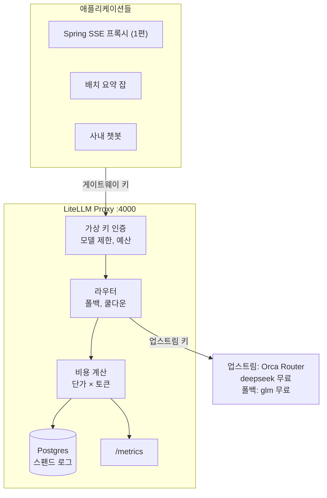
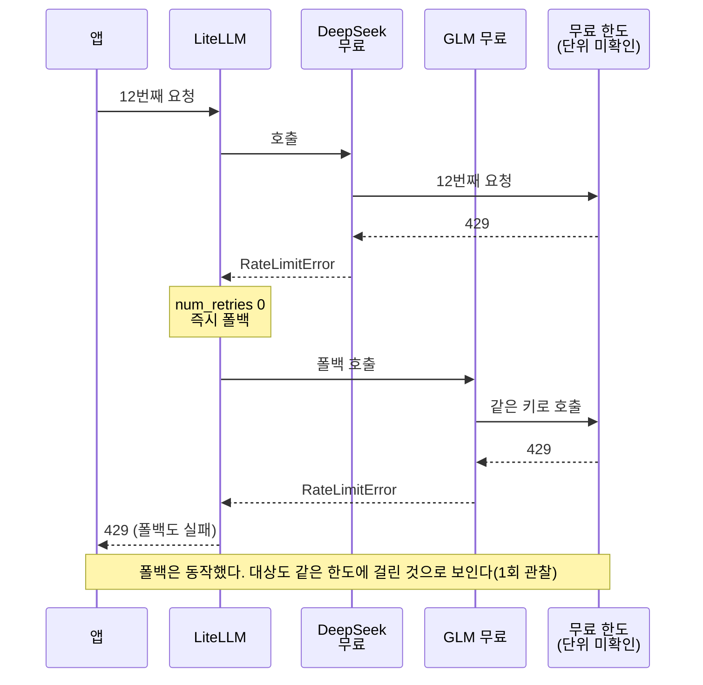

> 게이트웨이를 끼웠을 때 키·비용·429가 각각 어디로 옮겨 가는지 직접 띄워 확인했습니다. 무료 모델의 429와 예산 초과에는 일부러 부딪혀 봤습니다.
> + 샘플코드는 [litellm-gateway-sample](https://github.com/rojae/spring-sample/tree/main/litellm-gateway-sample)(게이트웨이 설정과 스크립트)과 [spring-sse-sample](https://github.com/rojae/spring-sample/tree/main/spring-sse-sample)(1편의 Spring 앱, 코드 변경 없음)에서 확인할 수 있습니다.
{: .prompt-info }
<!-- post-check: tone=polite -->

"LLM 통신 스택" 시리즈 2편입니다. 1편 [SSE, LLM 시대에 다시 보기](/posts/sse-revisited-for-llm-streaming) · 3편 [MCP란 무엇인가](/posts/mcp-jsonrpc-and-transports) · 4편 [꼬리에 꼬리를 무는 질문](/posts/llm-stack-deep-dive-qna), 다음 편은 게이트웨이 뒤의 MCP와 인증·보안을 다룰 예정입니다.

## 앱이 셋이 되면 생기는 일

1편에서 만든 Spring 프록시는 Orca Router 키를 환경변수로 직접 들고 있었습니다. 업스트림(실제 모델 제공자)을 부르는 앱이 그 하나뿐이었으니 문제가 없었습니다.

여기에 배치 요약 잡과 사내 챗봇처럼 같은 업스트림을 부르는 앱이 둘 더 붙는다고 해 보겠습니다. 1편의 방식을 그대로 복사하면 다음 네 가지가 앱 수만큼 늘어납니다.

- 업스트림 API 키가 앱마다 환경변수로 박혀 있고, 누가 어떤 키를 쓰는지 아무도 모릅니다.
- 이번 달 비용은 제공자 콘솔에 들어가야 알 수 있고, 앱별·팀별로 나눠 볼 수 없습니다.
- 업스트림이 429(요청 한도 초과)를 내면 앱마다 제각각 재시도하거나, 그냥 실패합니다.
- 모델을 바꾸려면 앱을 전부 재배포합니다.

넷 다 앱이 알 필요 없는 일입니다. 그래서 앱과 업스트림 사이에 게이트웨이를 한 겹 끼워 보기로 했습니다.

## 그때 제가 믿고 있던 것

게이트웨이를 끼우기 전에 머릿속에 있던 전제는 세 개였습니다. 실험이 끝난 뒤 다시 보니 온전히 맞은 건 하나였습니다.

| 그때의 전제 | 실험 뒤 |
|-------------|---------|
| ① 중간에 게이트웨이 하나 두면 된다. 앱은 주소만 바꾸면 된다 | 맞았습니다. 코드는 한 줄도 안 바꿨습니다 |
| ② 무료 모델을 쓰니 비용 집계는 의미가 없다. 어차피 0원이다 | 반만 맞았습니다. 그대로 두면 0원이지만, 가상 단가를 붙이면 의미 있게 만들 수 있었습니다 |
| ③ 무료 모델이 429를 내면 다른 무료 모델로 넘기면 된다 | 틀렸습니다. 실험으로 확인하기 전까지는 저도 그렇게 믿었습니다 |

①과 ②는 띄우면서 확인하고, ③은 일부러 깨뜨리면서 확인해 보겠습니다.

## 게이트웨이가 하는 일

게이트웨이를 끼우면 앱은 게이트웨이 주소와 게이트웨이가 발급한 키만 압니다. 업스트림 키, 비용 계산, 어느 모델로 보낼지(라우팅)는 게이트웨이가 가집니다.

> **쉽게 말하면** 게이트웨이는 회사의 **총무팀**입니다. 직원(앱)은 외부 업체(OpenAI, Orca Router)와 직접 계약하지 않고 총무팀에 요청서를 냅니다. 총무팀이 업체 계약(API 키)을 들고 있고, 누가 얼마나 썼는지 장부를 적고, 한 업체가 안 되면 다른 업체로 돌립니다.
{: .prompt-tip }



앱 쪽 화살표에는 게이트웨이 키만, 업스트림 쪽 화살표에는 업스트림 키만 실립니다. 앱은 업스트림 키를 모릅니다. 이 글에서는 가상 키 인증, 라우터, 비용 계산 세 상자를 하나씩 실제로 눌러 봅니다. 앱 셋 중 실제로 붙인 것은 1편의 Spring 프록시 하나이고, OpenAI·Anthropic 같은 다른 공급자는 연결하지 않았습니다.

라우터 상자의 말 두 개를 먼저 정해 둡니다. LiteLLM에서 **배포(deployment)**는 게이트웨이가 실제로 호출하는 업스트림 모델 하나, 즉 config의 `model_list` 한 항목입니다. 앱을 다시 띄우는 재배포와는 다른 말이라, 이 글에서는 LiteLLM 쪽을 "배포(deployment)"로 구분해 씁니다. **쿨다운**은 실패한 배포를 잠시 호출 대상에서 빼 두는 것이고, 뒤의 실패 1에서 직접 만납니다.

게이트웨이로는 [LiteLLM](https://docs.litellm.ai)을 골랐습니다. OpenAI 호환 API를 그대로 노출하기 때문에 1편의 Spring 앱을 코드 변경 없이 붙일 수 있고, 가상 키와 비용 집계가 오픈소스 버전에 들어 있습니다.

## 띄우기 – docker compose

이 글의 실험 환경입니다.

| 항목 | 값 |
|------|-----|
| 게이트웨이 | LiteLLM `ghcr.io/berriai/litellm:main-latest`, 포트 4000 (`LITELLM_PORT`로 변경 가능) |
| 게이트웨이 DB | Postgres 16-alpine (가상 키, 스팬드 로그) |
| 업스트림 | Orca Router 무료 모델 `deepseek/deepseek-v4-flash-free`, 폴백용 `z-ai/glm-5.3-flash-free` |
| 앱 | 1편의 spring-sse-sample (Spring Boot 3.2.2, 포트 8090), 코드 변경 없음 |
| 도구 | curl 8.7.1, docker compose |
| 샘플 코드 | [litellm-gateway-sample](https://github.com/rojae/spring-sample/tree/main/litellm-gateway-sample) (`scripts/`에 이 글의 호출 스크립트) |

LiteLLM 컨테이너와, 가상 키와 스팬드 로그(사용 기록)를 저장할 Postgres입니다. 핵심만 남겼고, 나머지 필드는 저장소 파일에 있습니다.

```yaml
services:
  litellm:
    image: ghcr.io/berriai/litellm:main-latest
    ports: ["${LITELLM_PORT:-4000}:4000"]
    environment:
      LITELLM_MASTER_KEY: ${LITELLM_MASTER_KEY:-sk-local-master-1234}
      DATABASE_URL: postgresql://llmproxy:dbpassword9090@db:5432/litellm
      ORCA_ROUTER_API_KEY: ${ORCA_ROUTER_API_KEY:?ORCA_ROUTER_API_KEY 가 필요합니다}
    volumes:
      - ./config.yaml:/app/config.yaml:ro
    command: ["--config", "/app/config.yaml", "--port", "4000"]
    depends_on:
      db:
        condition: service_healthy
  db:
    image: postgres:16-alpine
    environment:
      POSTGRES_DB: litellm
      POSTGRES_USER: llmproxy
      POSTGRES_PASSWORD: dbpassword9090
    healthcheck:
      test: ["CMD-SHELL", "pg_isready -d litellm -U llmproxy"]
      interval: 3s
```

호스트 포트는 `LITELLM_PORT`로 바꿀 수 있게 해 두었습니다. 4000은 다른 개발 도구와 자주 겹치는 포트입니다.

## 설정하기 – config.yaml의 규칙 세 가지

컨테이너가 읽는 `config.yaml`에는 앱이 부를 이름과 실제 업스트림 모델을 짝지어 둡니다. 세 번째 항목 `broken-no-v1`은 뒤의 실패 1을 재현하려고 일부러 틀리게 적은 것입니다.

```yaml
model_list:
  - model_name: deepseek-flash-free                   # 앱이 부르는 이름
    litellm_params:
      model: openai/deepseek/deepseek-v4-flash-free   # 규칙 1: OpenAI 호환이면 openai/ 프리픽스
      api_base: https://api.orcarouter.ai/v1          # 규칙 2: /v1 까지 적는다
      api_key: os.environ/ORCA_ROUTER_API_KEY         # 규칙 3: 키는 환경변수 참조
    model_info:
      input_cost_per_token: 0.00000022                # $0.22 / 1M (유료 쌍둥이 단가)
      output_cost_per_token: 0.00000066               # $0.66 / 1M

  - model_name: glm-flash-free                        # 폴백 대상 (역시 무료)
    litellm_params:
      model: openai/z-ai/glm-5.3-flash-free
      api_base: https://api.orcarouter.ai/v1
      api_key: os.environ/ORCA_ROUTER_API_KEY
    model_info:
      input_cost_per_token: 0.000000075
      output_cost_per_token: 0.00000025

  - model_name: broken-no-v1                          # 실패 재현용: /v1 빠뜨림
    litellm_params:
      model: openai/deepseek/deepseek-v4-flash-free
      api_base: https://api.orcarouter.ai
      api_key: os.environ/ORCA_ROUTER_API_KEY

litellm_settings:
  fallbacks: [{"deepseek-flash-free": ["glm-flash-free"]}]
  num_retries: 0          # 재시도 없이 바로 폴백
  allowed_fails: 1        # 실패 허용 횟수 (쿨다운 조건은 실패 1 참고)
  cooldown_time: 30
  callbacks: ["prometheus"]
  require_auth_for_metrics_endpoint: false
  # drop_params, request_timeout 과 router_settings(num_retries: 0) 는 저장소 파일 참고

general_settings:
  master_key: os.environ/LITELLM_MASTER_KEY
  database_url: os.environ/DATABASE_URL
```

| 규칙 | 이유 |
|------|------|
| `model: openai/<업스트림 모델 ID>` | LiteLLM은 프리픽스로 어떤 프로바이더 코드로 호출할지 정합니다. Orca Router는 OpenAI 호환이므로 `openai/` |
| `api_base`에 `/v1`까지 | LiteLLM은 뒤에 `/chat/completions`만 붙입니다. 빠뜨리면 404 (뒤의 실패 1) |
| `api_key: os.environ/...` | 설정 파일에 키를 적지 않고 컨테이너 환경변수에서 읽습니다 |

앱이 아는 것은 `model_name`뿐입니다. 그 이름이 실제로 어느 업체의 어떤 모델인지는 `litellm_params.model`에 있고, 이 설정은 게이트웨이만 봅니다. 도입에서 말한 네 번째 문제, 모델을 바꿀 때마다 앱을 재배포하는 일은 이 분리로 게이트웨이 설정 변경으로 바뀝니다. 이 글에서 모델을 실제로 바꿔 보지는 않았고, 설정 구조에서 나오는 판단입니다.

## 무료 모델에 왜 단가를 붙이나 – 전제 ②

Orca Router의 `deepseek/deepseek-v4-flash-free`는 요청당 $0입니다. 그대로 두면 LiteLLM은 비용을 0으로 기록하고, 스팬드 로그는 아무 의미가 없어집니다. 전제 ②가 "반만" 맞는 쪽이 여기까지입니다.

그래서 `model_info`에 **유료 쌍둥이 모델의 단가**(`deepseek/deepseek-v4-flash`, 입력 $0.22 / 출력 $0.66 per 1M)를 넣었습니다. 실제 청구는 0이지만 "유료였다면 얼마였을지"가 쌓입니다. 나중에 유료로 넘어갈 때 예산을 잡는 근거가 되고, 팀별 사용량 비교도 됩니다. 사내에서 구독제나 정액제 API를 쓸 때도 같은 방법을 씁니다.

설정을 마쳤으면 띄웁니다.

```bash
export ORCA_ROUTER_API_KEY=...
docker compose -f litellm-gateway-sample/docker-compose.yml up -d
curl http://localhost:4000/health/liveliness   # "I'm alive!"
```

가상 단가가 실제로 계산에 쓰이는지는 첫 호출의 응답 헤더로 확인할 수 있습니다.

## 첫 호출 – 응답 헤더 세 개

<figure class="post-figure">
  
  <figcaption>게이트웨이를 띄운 뒤 <code>chat.sh</code>로 "SSE가 무엇인지 한 문장으로 설명해줘."를 한 번 보낸 회차입니다. <code>/v1/models</code>에 config의 <code>model_name</code> 세 개가 보이는지, 응답 헤더의 <code>x-litellm-model-id</code>와 <code>x-litellm-response-cost</code>를 보면 됩니다.</figcaption>
</figure>

여기서 볼 것은 세 가지입니다.

- **`x-litellm-model-id`**: 실제로 어느 배포(deployment)가 처리했는지. 폴백이 일어났는지도 이 헤더로 알 수 있습니다(이 글에서는 폴백이 실패해 보지 못했습니다).
- **`x-litellm-response-cost: 6.446e-05`**: 게이트웨이가 계산한 비용입니다.
- **`model: deepseek-flash-free`**: 업스트림이 돌려준 `deepseek-v4-flash-ga-260731`이 아니라 **config의 `model_name`으로 바꿔서** 줍니다. 앱은 업스트림 모델 ID를 몰라도 됩니다.

비용이 맞는지 검산해 봤습니다.

```
prompt     98 × $0.22/1M = $0.00002156
completion 65 × $0.66/1M = $0.00004290
                    합계 = $0.00006446   ← x-litellm-response-cost 와 일치
```

`completion_tokens` 65개 안에 `reasoning_tokens` 16개가 포함되어 있습니다. 모델의 사고 과정 토큰도 출력 단가로 과금되며, 실제 DeepSeek 과금 방식도 그렇다고 알고 있습니다.

가상 단가를 붙인 무료 모델에도 토큰 단위로 맞는 금액이 찍혔습니다. 전제 ②의 나머지 반, "의미 있게 만들 수 있다"가 여기서 확인됩니다. 다음은 1편의 핵심이던 스트리밍이 이 계산을 거치면서도 그대로 흐르는지입니다.

## 스트리밍은 그대로 통과하나

1편의 핵심이 스트리밍이었으니, 게이트웨이를 거쳐도 SSE가 그대로 흘러나오는지가 중요합니다.

<figure class="post-figure">
  
  <figcaption><code>stream.sh</code>로 첫 호출과 같은 프롬프트를 스트리밍으로 보내 LiteLLM을 거쳐 받은 SSE 원문입니다. <code>reasoning_content</code> delta가 남아 있는지, <code>usage</code>가 몇 번 오는지, 마지막 청크에 <code>cost</code>가 붙었는지를 보면 됩니다.</figcaption>
</figure>

1편에서 업스트림에 직접 받은 원문과 비교하면 이렇습니다.

| 항목 | Orca Router 직접 (1편) | LiteLLM 경유 |
|------|------------------------|--------------|
| `reasoning_content` | delta에 따로 옴 | **그대로 통과** |
| `model` | `deepseek-v4-flash-ga-260731` | `deepseek-flash-free` (model_name으로 치환) |
| `usage` | **두 번** (finish 청크, 마지막 청크) | **한 번**, 마지막 청크에만 |
| `usage.cost` | 없음 | **`0.00006446` 추가** |
| `[DONE]` | 있음 | 있음 |

1편에서 "usage가 두 번 온다"고 프록시에서 막았던 문제를 여기서는 게이트웨이가 정리해 줍니다. 스트리밍 응답에도 `cost`가 붙으니 클라이언트가 요청 단위로 비용을 표시할 수 있습니다.

비용이 요청마다 계산된다면, 다음 질문은 그 비용에 한도를 걸 수 있느냐입니다.

## 가상 키에 예산 걸기

마스터 키는 관리자용입니다. 앱에는 **가상 키**를 따로 발급하고, 거기에 모델 제한과 예산을 겁니다.

```bash
curl http://localhost:4000/key/generate \
  -H "Authorization: Bearer $LITELLM_MASTER_KEY" \
  -H "Content-Type: application/json" \
  -d '{"max_budget": 0.00005, "key_alias": "budget-demo"}'
```

예산을 일부러 $0.00005로 잡았습니다. 요청 한 번(약 $0.00009)이면 넘습니다.

<figure class="post-figure">
  
  <figcaption><code>budget-demo</code> 키로 "ping"을 연달아 두 번 호출했습니다. 1회차 성공(cost 8.844e-05), 2회차 <code>Budget has been exceeded</code>. 그 직후 <code>/key/info</code>의 <code>spend</code>가 아직 0.0인 것까지 보면 됩니다.</figcaption>
</figure>

```
# 1회차 응답 헤더
x-litellm-response-cost: 8.844e-05
# 2회차 응답 본문
  "message": "Budget has been exceeded! Key=budget-demo (sk-...kT5w) Current cost: 8.843999999999969e-05, Max budget: 5e-05",
  "type": "budget_exceeded",
  "code": "422"
# 직후 /key/info
  "spend": 0.0,
```

1회차 비용도 검산이 됩니다. 프롬프트 84 토큰과 출력 106 토큰(그중 사고 과정 91)이라 `84 × $0.22/1M + 106 × $0.66/1M = $0.00008844`, 헤더의 `8.844e-05`와 같습니다. "ping" 한 마디에 사고 과정 토큰이 91개나 붙은 것도 눈여겨볼 만합니다.

여기서 세 가지를 배웠습니다.

- **예산 검사는 요청 전에 합니다.** 첫 요청은 예산 안에서 시작했으니 통과했고, 결과적으로 예산을 넘겼습니다. `max_budget`은 "이 금액에서 정확히 멈춘다"가 아니라 "넘긴 뒤의 다음 요청부터 막는다"입니다. 이 글은 순차 호출로 확인했고, 동시에 진행 중인 요청이 있으면 그 수만큼 넘길 수 있습니다. 프록시 한 대 기준이며, 여러 대에서는 spend 동기화 지연만큼 더 넘을 수 있습니다(확인하지 않음).
- **상태 코드가 422입니다.** `main-latest` 이미지는 422를 돌려줬습니다. 문서의 예시와는 다를 수 있습니다. 클라이언트에서는 `type: "budget_exceeded"`로 분기하는 편이 안전합니다.
- **`/key/info`의 `spend`는 바로 반영되지 않았습니다.** 2회차가 막힌 직후에도 `spend`는 0.0이었습니다(관찰). 예산 판정은 메모리 캐시에서 하고 DB 반영은 배치로 뒤따라온다는 것이 당시 제가 이해한 이유인데, 이 글에서 해당 문서·코드 위치를 확인해 링크하지는 않았습니다. 어느 쪽이든 대시보드가 잠깐 "예산 초과인데 사용량은 0"으로 보일 수 있습니다.

이 422는 업스트림까지 가지 않고 게이트웨이 안에서 만들어진 에러입니다. 뒤에서 만날 429 둘과 함께 다시 보겠습니다.

## 스팬드 로그 읽기

요청 한 건마다 Postgres에 한 줄이 남습니다.

<figure class="post-figure">
  
  <figcaption><code>spend.sh</code>로 실험 도중 찍은 최근 5건과, 앱 회차(<code>spring-sse-sample</code> 키)의 최신 1건입니다. 앞에서 검산한 두 금액(0.00006446, 0.00008844)과, 뒤의 실패 1에서 남은 <code>broken-no-v1</code> 줄이 0.0인 것을 보면 됩니다.</figcaption>
</figure>

| 컬럼 | 의미 |
|------|------|
| `model` | 실제 호출한 업스트림 모델 (`openai/deepseek/...`). 응답의 `model`과 달리 여기는 원본 |
| `prompt_tokens`, `completion_tokens` | 업스트림 usage 그대로 |
| `spend` | `model_info` 단가로 계산한 금액 |
| `metadata.user_api_key_alias` | 어느 가상 키가 썼는지. 팀별 집계의 기준 |

업스트림까지 간 실패 요청도 `spend: 0.0`으로 남았습니다. 뒤의 실패 1에서 `/v1` 없이 업스트림에 닿은 `broken-no-v1` 줄이 그 예입니다. 캡처의 다른 0.0 줄(`0/0`, `8/0` 토큰)은 어느 호출에서 나온 것인지 출처를 기록하지 않았습니다. 게이트웨이가 업스트림을 부르기 전에 돌려보낸 429·422가 이 로그에 남는지는 확인하지 않았습니다. 줄마다 가상 키 별칭이 붙으니, 앱마다 키를 나눠 주면 처음에 말한 "앱별·팀별로 나눠 볼 수 없다"를 이 로그로 집계할 수 있습니다.

## /metrics에는 무엇이 찍히나

`callbacks: ["prometheus"]`를 켜 두었습니다. `/metrics`는 `/metrics/`로 307 리다이렉트되니 `curl -L`이 필요합니다.

```
$ curl -sL http://localhost:4000/metrics | grep -E "^litellm_" | sed 's/{.*//' | sort | uniq -c | sort -rn
  36 litellm_request_total_latency_metric_bucket
  36 litellm_llm_api_latency_metric_bucket
  18 litellm_llm_api_time_to_first_token_metric_bucket
  15 litellm_deployment_latency_per_output_token_bucket
   3 litellm_proxy_total_requests_metric_total
   3 litellm_deployment_total_requests_total
   3 litellm_deployment_state
   ...
```

요청 수, 배포별 상태, 지연 히스토그램, 그리고 **TTFT 히스토그램**(`litellm_llm_api_time_to_first_token_metric`)이 있습니다. 이 TTFT는 게이트웨이가 업스트림에서 첫 토큰을 받기까지의 시간이며, 1편에서 파이썬 스크립트로 잰 클라이언트 측 측정과는 재는 지점이 다릅니다. Prometheus가 이 엔드포인트를 주기적으로 읽어 가면 그래프로 볼 수 있습니다.

실험 당시 제가 본 문서 일부에는 Prometheus 콜백이 엔터프라이즈 기능으로 적혀 있었습니다(문서 위치는 기록하지 않았고, 지금 문서는 바뀌었을 수 있습니다). `main-latest` 오픈소스 이미지에서는 위처럼 동작했습니다. 버전에 따라 다를 수 있으니 띄운 뒤 직접 확인하는 편이 안전합니다.

비용과 지표는 게이트웨이에 모였습니다. 남은 것은 전제 ①, 실제 앱을 주소만 바꿔서 붙일 수 있느냐입니다.

## 1편의 앱 붙이기 – 전제 ①

1편의 스트리밍 프록시를 게이트웨이 뒤로 보냅니다. 코드는 한 줄도 바꾸지 않고 환경변수만 바꿉니다.

```bash
# 앱 전용 가상 키 (모델 제한 + 예산 $0.01)
curl http://localhost:4000/key/generate \
  -H "Authorization: Bearer $LITELLM_MASTER_KEY" \
  -H "Content-Type: application/json" \
  -d '{"max_budget": 0.01, "key_alias": "spring-sse-sample", "models": ["deepseek-flash-free"]}'

ORCA_BASE_URL=http://localhost:4000/v1 \
ORCA_MODEL=deepseek-flash-free \
ORCA_ROUTER_API_KEY=sk-...(위에서 받은 가상 키) \
SERVER_PORT=8090 ./gradlew :spring-sse-sample:bootRun
```

| 환경변수 | 1편 | 2편 |
|----------|-----|-----|
| `ORCA_BASE_URL` | `https://api.orcarouter.ai/v1` | `http://localhost:4000/v1` |
| `ORCA_MODEL` | `deepseek/deepseek-v4-flash-free` | `deepseek-flash-free` (config의 model_name) |
| `ORCA_ROUTER_API_KEY` | Orca Router 키 | **LiteLLM 가상 키** |

변수 이름은 1편 그대로 `ORCA_ROUTER_API_KEY`지만, 들어 있는 값은 이제 LiteLLM 가상 키입니다. 앱은 Orca Router 키를 모릅니다. 데모 페이지에서 전송을 눌렀습니다.

<figure class="post-figure">
  
  <figcaption>위 환경변수로 띄운 1편 데모 페이지에서 "SSE가 무엇인지 세 문장으로 설명해줘."를 보낸 화면입니다. 화면은 1편과 같고, 뒤에 LiteLLM이 끼어 있다는 것을 앱도 브라우저도 모른다는 점을 보면 됩니다. 화면의 TTFT(2,687ms)는 아래 Spring 로그의 <code>ttft=1653ms</code>와 값이 다릅니다. 같은 회차를 다른 위치에서 잰 것인지 다른 회차인지는 기록으로 가리지 못했습니다.</figcaption>
</figure>

서버 로그와 게이트웨이 쪽 기록을 나란히 놓으면 이렇습니다.

```
# Spring 로그
[stream] ttft=1653ms elapsed=2847ms chunks=192 content=130 reasoning=59 error=-

# LiteLLM 스팬드 로그 (최신 1건)
model=openai/deepseek/deepseek-v4-flash-free  prompt=98  completion=199  spend=0.0001529  key_alias=spring-sse-sample

# 앱 키 누적
{"key_alias":"spring-sse-sample","spend":0.00019382,"max_budget":0.01,"models":["deepseek-flash-free"]}
```

앱은 base URL만 바꿨는데, 게이트웨이에는 "spring-sse-sample 키가 이 요청에 $0.0001529를 썼고 누적 $0.00019382"가 남았습니다. 이 키의 예산 $0.01이 다 차면 앱은 `budget_exceeded`를 받고, 1편에서 만든 `event: error` 처리가 그때 일합니다. 전제 ①은 이것으로 확인했습니다.

여기까지는 순조로웠습니다. 키와 비용은 게이트웨이로 옮겨졌습니다. 처음의 네 가지 중 남은 것은 429입니다.

## 일부러 깨뜨려 보니 – 같은 얼굴의 429 둘

다음은 망가뜨려 보는 단계입니다. 두 가지 현상이 나왔습니다.

1. `api_base`에서 `/v1`을 빼고 두 번 호출했더니, 첫 번째는 404인데 두 번째는 429가 나왔습니다. 같은 설정인데요.
2. 무료 모델이 429를 맞으면 다른 무료 모델로 폴백하도록 해 뒀는데, 폴백 대상도 429를 받았습니다.

둘 다 "429"라는 같은 얼굴을 하고 있지만 만들어진 곳이 다릅니다. 하나는 게이트웨이가 스스로 만든 것이고, 하나는 업스트림이 만든 것입니다. 앞의 422까지 합쳐, 이 글에서 만난 에러 넷을 요청 경로 위에 놓으면 다음과 같습니다.

<figure class="post-figure post-figure--diagram" id="figure-errors" aria-labelledby="errors-caption">
  <div class="figure-head"><small>01 · 에러의 출처</small>에러가 만들어진 자리 넷: 게이트웨이 둘, 업스트림 둘</div>
  <picture class="diagram-wide"></picture>
  <picture class="diagram-narrow"></picture>
  <figcaption id="errors-caption">× 자리가 에러가 만들어진 곳입니다. 게이트웨이 안의 두 에러는 업스트림을 부르기 전에 돌려보낸 것이고, 이 글은 응답 시간을 재지 않았습니다.<a class="diagram-source diagram-wide" href="/assets/img/posts/2026-09-26-litellm-gateway-in-front-of-orca-router/errors-desktop.svg" target="_blank" rel="noopener">그림 원본 보기 ↗</a><a class="diagram-source diagram-narrow" href="/assets/img/posts/2026-09-26-litellm-gateway-in-front-of-orca-router/errors-mobile.svg" target="_blank" rel="noopener">그림 원본 보기 ↗</a></figcaption>
</figure>

같은 429를 받아도, 게이트웨이에서 생긴 것이면 업스트림은 그 요청을 보지 못했고 원인은 게이트웨이의 설정이나 직전 상태에 있습니다. 업스트림에서 생긴 것이면 게이트웨이 설정을 아무리 고쳐도 한도는 그대로입니다. 두 429를 차례로 따라가 보겠습니다.

## 실패 1 – 쿨다운이 에러를 바꿔 놓는다

`broken-no-v1`은 `api_base`에서 `/v1`만 뺀 설정입니다. 일부러 두 번 연속 호출했습니다.

<figure class="post-figure">
  
  <figcaption><code>broken-no-v1</code>에 "ping"을 보내고, 첫 호출 직후 같은 호출을 바로 다시 보낸 결과입니다. 첫 호출의 <code>code: "404"</code>와 두 번째 호출의 <code>type: "all_deployments_in_cooldown"</code>, <code>code: "429"</code>, 메시지의 <code>Try again in 5 seconds</code>를 비교하면 됩니다. 캡처 안 주석(<code>allowed_fails: 1 → cooldown 30s</code>)은 실험 당시의 가정이며, 아래 본문의 판단과 다릅니다.</figcaption>
</figure>

```
# 첫 호출
  "message": "litellm.NotFoundError: NotFoundError: OpenAIException - <!doctype html>...
  "code": "404"
# 바로 다시
  "message": "No deployments available for selected model, Try again in 5 seconds. ...
  "type": "all_deployments_in_cooldown",
  "code": "429"
```

첫 번째 에러는 예상대로입니다. LiteLLM이 `https://api.orcarouter.ai/chat/completions`를 호출했고, 그 주소에는 API가 없으니 Orca Router **웹사이트의 404 HTML 페이지**가 에러 메시지에 담겨 왔습니다. `OpenAIException - <!doctype html>`로 시작하는 에러를 보면 `api_base`부터 의심하면 됩니다.

두 번째 에러가 재밌습니다. 같은 요청인데 404가 아니라 **429 `all_deployments_in_cooldown`**입니다. 한 번 실패한 배포가 쿨다운에 들어갔고, 그 모델 그룹에 다른 배포가 없으니 "쓸 수 있는 배포가 없다"가 된 것입니다. config의 `cooldown_time`은 30초이고, 응답 메시지는 5초 뒤 재시도를 안내했습니다(캡처). `allowed_fails` 값과 실제 쿨다운 조건의 관계는 이 실험으로 가르지 못했습니다.

> **쉽게 말하면** 쿨다운은 **방금 실수한 직원을 잠시 쉬게 하는 것**입니다. 업스트림이 아플 때 계속 두드리지 않으려는 보호 장치죠. 문제는 직원이 아픈 게 아니라 **주소를 잘못 적어 준 것**(설정 실수)이어도 똑같이 쉬게 한다는 점입니다.
{: .prompt-tip }

> 운영 중에 "처음엔 404였는데 지금은 429가 나요"라는 보고를 받으면, 지금 보이는 429보다 첫 에러를 먼저 찾으세요. 이 사례의 429는 게이트웨이가 쿨다운으로 만든 결과였습니다.
{: .prompt-warning }

이 429는 설정을 고치면 사라집니다. 다음 429는 설정이 맞는데도 났습니다.

## 실패 2 – 무료 → 무료 폴백도 429 – 전제 ③

무료 모델의 한도는 1편에서 확인한 대로 결제 이력이 없으면 **분당 10회**입니다. 넘기면 429가 옵니다. 그래서 전제 ③대로 config에 이렇게 적어 뒀습니다.

```yaml
fallbacks: [{"deepseek-flash-free": ["glm-flash-free"]}]
```

"DeepSeek 무료가 429면 GLM 무료로 넘기자." 그럴듯했습니다. 12번 연속으로 쏴 봤습니다.

<figure class="post-figure">
  
  <figcaption><code>burst.sh</code>로 게이트웨이를 거쳐 <code>deepseek-flash-free</code>를 12회 연속 호출했습니다. #12의 <code>HTTP 429</code>와 그 아래 LiteLLM 로그의 <code>Fallback to glm-flash-free also failed: RateLimitError</code>를 보면 됩니다.</figcaption>
</figure>

캡처에서 핵심 줄만 옮기면 이렇습니다(줄 끝은 캡처에서 잘린 그대로 `...`로 줄였고, LiteLLM 로그 한 줄은 읽기 쉽게 두 줄로 나눴습니다).

```
#11 05:42:21 HTTP 200 model-id=1d434087 model=deepseek-flash-free
#12 05:42:21 HTTP 429 model-id=N/A model=litellm.RateLimitError: RateLimitError: ...

# LiteLLM 로그
LiteLLM: model group 'deepseek-flash-free' failed with the error above.
Fallback to glm-flash-free also failed: litellm.RateLimitError: ...
```

11번째까지 성공하고 12번째에서 429가 났습니다. 같은 분 안에서 11회가 성공해 고정 10회 한도로는 설명되지 않습니다. 한도 단위는 확인하지 못했습니다. 그리고 **폴백 대상인 GLM 무료 모델도 같은 429**를 받았습니다. 업스트림 에러 메시지는 이렇습니다.

```
Free model capacity is limited right now. Retry shortly, or add credits for higher,
more stable limits: https://www.orcarouter.ai/console/billing
```

무료 티어의 분당 한도를 모델마다 따로 세는 것이 아니라 함께 세는 것 같았습니다. 추측으로 끝내기 싫어서 일일 한도가 초기화된 뒤 게이트웨이 없이 직접 확인했습니다. GLM 무료 모델만 10번 호출하고, DeepSeek 무료 모델을 처음으로 1번 호출했습니다.

<figure class="post-figure">
  
  <figcaption>일일 한도 초기화 뒤, 게이트웨이 없이 Orca Router에 직접 보낸 별도 회차입니다. GLM 무료 10회 뒤 DeepSeek 무료의 첫 호출이 429인 것을 보면 됩니다.</figcaption>
</figure>

```
GLM  #10 12:52:31 HTTP 200 model=glm-5.3-flash
DeepSeek #1 (GLM 10회 직후) 12:52:31 HTTP 429 Free model capacity is limited right now. Retry shortly, or add credit
```

DeepSeek 무료 모델은 그 분에 한 번도 부르지 않았는데 첫 호출부터 429였습니다. 같은 키로 부른 무료 모델끼리 한도를 나눠 쓴 것으로 보입니다(1회 관찰). 다만 에러 메시지가 "capacity is limited"라는 용량 부족 표현이라, 그 순간 무료 풀 전체가 혼잡했다는 식의 다른 설명도 이 한 번의 관찰로는 배제하지 못했습니다. 어느 쪽이든 이 실험에서 무료 → 무료 폴백은 효과가 없었습니다.



LiteLLM은 설정대로 움직였습니다. 폴백은 일어났고, 폴백 대상도 원본과 같은 한도에 걸린 것으로 보입니다. 문제는 제가 폴백 대상을 고른 기준이었습니다.

## 게이트웨이를 도입할 때

세 전제로 돌아가면, ①은 맞았습니다. 앱은 base URL·모델 이름·키 환경변수만 바꿨고 코드는 그대로였습니다. ②는 반만 맞았습니다. 단가를 그대로 두면 0원이지만, 가상 단가를 붙이자 토큰 수로 검산되는 비용이 쌓였습니다. ③은 틀렸습니다. 이 실험에서 무료 → 무료 폴백은 효과가 없었습니다(같은 키로 부른 무료 모델이 한도를 공유한 것으로 보임, 1회 관찰). 그리고 전제에 없던 것이 하나 있었습니다. 설정 실수로 난 404가 쿨다운을 거쳐 429로 바뀌어 보였습니다.

정리하면 키와 비용은 게이트웨이로 옮겨졌고, 429는 옮겨지지 않았습니다. 업스트림 한도는 그대로였고 게이트웨이는 자기 429를 하나 더 만들었습니다. 둘 다 게이트웨이의 버그가 아니라 설계대로 움직인 결과였습니다. 이번에 확인한 것을 구간별로 정리했습니다.

| 구간 | 확인할 것 |
|------|-----------|
| 설정 | `openai/` 프리픽스, `api_base`에 `/v1`, 키는 `os.environ/` |
| 비용 | 무료·정액 모델에도 유료 단가를 가상으로 붙여 집계. 0원 장부는 장부가 아님 |
| 예산 | 예산 검사는 요청 전이라 예산을 넘길 수 있음(순차 호출에서 첫 요청이 예산을 넘긴 것만 확인, 동시 요청은 미확인). 상태 코드보다 `type: budget_exceeded`로 분기 |
| 예산 | `/key/info`의 `spend`는 곧바로 반영되지 않았음(지연 시간은 재지 않음) |
| 쿨다운 | 설정 실수를 429로 바꿔 보여 줄 수 있음. 첫 에러를 찾을 것. `allowed_fails`·`cooldown_time`의 운영 값은 문서와 실험으로 정함 |
| 앱 | 앱은 게이트웨이 주소와 가상 키만 안다. 업스트림 키는 게이트웨이 환경변수에만 |

### 이 글에서 만난 에러

"429가 난다"는 보고를 받으면, 그 429를 누가 만들었는지부터 봐야 합니다. 위 그림의 위→아래 순서대로 옮겼습니다.

| 상태 · `type` | 누가 만들었나 | 원인 |
|---------------|---------------|------|
| 422 <code class="language-plaintext highlighter-rouge" style="overflow-wrap:normal;word-break:normal">budget_<wbr>exceeded</code> | **LiteLLM** | 가상 키의 <code class="language-plaintext highlighter-rouge" style="white-space:nowrap">max_budget</code> 초과 (<code class="language-plaintext highlighter-rouge" style="white-space:nowrap">main-latest</code> 기준) |
| 429 <code class="language-plaintext highlighter-rouge" style="overflow-wrap:normal;word-break:normal">all_<wbr>deployments_<wbr>in_<wbr>cooldown</code> | **LiteLLM** | 직전 실패로 배포가 쿨다운 중 |
| 404 <code class="language-plaintext highlighter-rouge" style="overflow-wrap:normal;word-break:normal">invalid_<wbr>request_<wbr>error</code> | 업스트림(Orca Router 웹사이트) | <code class="language-plaintext highlighter-rouge" style="white-space:nowrap">api_base</code>에 <code class="language-plaintext highlighter-rouge" style="white-space:nowrap">/v1</code> 누락 |
| 429 (예외 클래스 <code class="language-plaintext highlighter-rouge" style="overflow-wrap:normal;word-break:normal">RateLimitError</code>) | 업스트림 | 무료 한도 초과 (같은 키 공유로 보임, 1회 관찰) |

이 판단의 범위는 좁습니다. LiteLLM `main-latest` 이미지 한 대(이미지 digest는 기록하지 않았습니다)와 결제 이력이 없는 Orca Router 키 하나로, 순차 호출과 교차 모델 1회 관찰로 확인한 것입니다. 422 상태 코드와 Prometheus 콜백의 오픈소스 동작은 버전에 따라 다를 수 있습니다.

이 범위 안에서 권하는 것은 폴백 대상 고르기입니다. 폴백은 원본과 한도를 나눠 쓰지 않는 대상이어야 의미가 있으므로, `fallbacks`를 적기 전에 두 배포가 같은 한도를 쓰는지부터 확인합니다. 유료 모델이나 다른 공급자라면 의미가 있을 것입니다(이 글에서는 확인하지 않음).

## 참고

샘플 코드: [litellm-gateway-sample](https://github.com/rojae/spring-sample/tree/main/litellm-gateway-sample)에는 compose와 config.yaml, 그리고 첫 호출·스트리밍·연속 호출·예산 키·스팬드 로그·교차 모델 한도 확인 스크립트가 들어 있습니다. [spring-sse-sample](https://github.com/rojae/spring-sample/tree/main/spring-sse-sample)은 1편의 앱이며 이 글에서 변경하지 않았습니다.

<details markdown="1">
<summary>이 글에서 쓴 LiteLLM 설정 한눈에 보기</summary>

| 설정 | 위치 | 값 | 의미 |
|------|------|-----|------|
| `model: openai/<id>` | `litellm_params` | - | OpenAI 호환 업스트림을 `openai` 프로바이더 코드로 호출 |
| `api_base` | `litellm_params` | `https://api.orcarouter.ai/v1` | 뒤에 `/chat/completions`만 붙는다. `/v1` 필수 |
| `api_key` | `litellm_params` | `os.environ/...` | 컨테이너 환경변수 참조 |
| `input_cost_per_token`, `output_cost_per_token` | `model_info` | 토큰당 달러 | 무료·정액 모델의 가상 단가 |
| `fallbacks` | `litellm_settings` | `[{"A": ["B"]}]` | A 그룹 실패 시 B 그룹으로 |
| `num_retries` | `litellm_settings` / `router_settings` | `0` | 같은 모델 그룹 재시도 횟수. 0이면 바로 폴백 |
| `allowed_fails` | `litellm_settings` | `1` | 실패 허용 횟수 (쿨다운 조건은 문서 확인 필요) |
| `cooldown_time` | `litellm_settings` | `30` | 쿨다운 유지 시간(초) |
| `callbacks: ["prometheus"]` | `litellm_settings` | - | `/metrics` 노출 |
| `max_budget` | `/key/generate` | 달러 | 키별 누적 예산. 요청 전에 검사 |

</details>

### 문서 링크

LiteLLM

- [OpenAI-compatible endpoints](https://docs.litellm.ai/docs/providers/openai_compatible)
- [Custom pricing](https://docs.litellm.ai/docs/proxy/custom_pricing)
- [Proxy config: fallbacks, cooldown](https://docs.litellm.ai/docs/proxy/configs)
- [Virtual keys and budgets](https://docs.litellm.ai/docs/proxy/users)
- [Prometheus metrics](https://docs.litellm.ai/docs/proxy/prometheus)

Orca Router

- [Free models](https://docs.orcarouter.ai/routing/free-models)
- [DeepSeek V4 Flash (Free)](https://www.orcarouter.ai/models/deepseek/deepseek-v4-flash-free)
