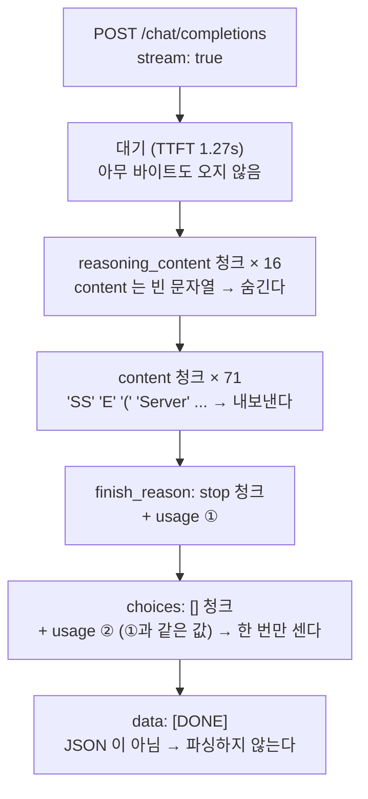

> 로컬에서는 흐르던 토큰이 nginx 뒤에서 한꺼번에 도착했습니다. 경로에 장비를 하나씩 세워 가며 재현해 보니, 토큰을 붙잡거나 깎아 낸 곳은 브라우저 파서와 nginx gzip 필터 두 곳이었습니다.
> + 샘플 코드는 [spring-sse-sample](https://github.com/rojae/spring-sample/tree/main/spring-sse-sample)에서 확인할 수 있습니다.
> + "LLM 통신 스택" 시리즈 1편입니다. 2편 [Orca Router 앞에 LiteLLM 한 겹 끼우기](/posts/litellm-gateway-in-front-of-orca-router), 3편 [MCP란 무엇인가](/posts/mcp-jsonrpc-and-transports), 4편 [꼬리에 꼬리를 무는 질문](/posts/llm-stack-deep-dive-qna)으로 이어지고, 다음 편은 게이트웨이 뒤의 MCP와 인증·보안을 다룰 예정입니다.
{: .prompt-info }
<!-- post-check: tone=polite -->

## 서버 로그는 1초인데, 화면은 3초

```
[stream] ttft=1243ms elapsed=2462ms chunks=142 content=121 reasoning=18 error=-
```

로컬에서 Spring 프록시에 직접 붙인 회차에 프록시 서버가 남긴 한 줄입니다. 업스트림 첫 청크(사고 과정)가 1.2초에 왔고, 클라이언트에 보이는 첫 글자는 1.6초(같은 회차를 잰 `stream_timing.py`의 첫 토큰 1604ms), 마지막 토큰까지 2.5초 걸렸습니다. 그런데 같은 종류의 요청을 스테이징 브라우저에서 보면 3초 가까이 빈 화면이다가 답이 통째로 뜹니다. 로컬에서는 글자가 한 자씩 잘 나오는데 말이죠.

이 차이를 놓고 팀에서 가장 먼저 나온 질문은 이것이었습니다.

> "nginx가 SSE를 버퍼링하는 거 아니에요? `proxy_buffering off` 하면 되지 않나요?"

저도 그렇게 믿고 넘겼습니다. 반은 맞고 반은 틀렸다는 건 재현해 보고서야 알았죠. 곁가지로 "WebFlux와 SSE는 뭐가 다른가", "MCP의 stdio와 SSE는 뭐가 다른가"도 나왔는데, 이 둘은 글 끝의 [보충](#보충--왜-sse와-webflux인가)에서 짧게 답합니다.

질문은 결국 **토큰이 서버에서 브라우저까지 오는 길에 무엇이 서 있는가**로 모입니다. 그래서 그 길에 장비를 하나씩 세워 가며 깨뜨려 봤고, 질문은 더 좁아졌습니다. **그 길에서 누가 토큰을 모아 두었고, 누가 무엇을 버렸나?**

## 토큰이 지나간 길과 두 실패 지점

재현 환경에서 토큰은 네 지점을 지났습니다. 업스트림 LLM에서 Spring 프록시를 거쳐, nginx를 지나 브라우저의 `EventSource`에 닿습니다. 각 지점을 어떤 도구로 쟀는지도 함께 표시했습니다.

<figure class="post-figure post-figure--diagram" id="figure-path" aria-labelledby="path-caption">
  <div class="figure-head"><small>01 · 토큰 경로</small>Spring까지는 흘렀고, 붙잡거나 깎아 낸 곳은 nginx와 브라우저였습니다</div>
  <picture class="diagram-wide"></picture>
  <picture class="diagram-narrow"></picture>
  <figcaption id="path-caption">왼쪽에서 오른쪽(모바일은 위에서 아래)이 토큰이 가는 방향입니다. 로컬 docker compose 재현 구성이며, 회색 선은 각 도구로 잰 위치, 빨간 번호는 본문의 원인 번호입니다. 수치는 경로별 단일 회차 측정값입니다.<a class="diagram-source diagram-wide" href="/assets/img/posts/2026-09-26-sse-revisited-for-llm-streaming/path-desktop.svg" target="_blank" rel="noopener">토큰 경로 그림 원본 보기 ↗</a><a class="diagram-source diagram-narrow" href="/assets/img/posts/2026-09-26-sse-revisited-for-llm-streaming/path-mobile.svg" target="_blank" rel="noopener">토큰 경로 그림 원본 보기 ↗</a></figcaption>
</figure>

원인부터 보려면 → [원인 1 · 브라우저 파서](#원인-1--data-뒤-공백-한-칸) · [원인 2 · nginx gzip 필터](#원인-2--nginx-세-가지-설정으로-비교하기)

Spring에 직접 붙으면 토큰은 여러 시점에 나뉘어 도착했습니다. 문제는 그 뒤에서 두 번 생겼습니다. 브라우저 데모 페이지를 붙이자 **띄어쓰기가 전부 사라졌고**(curl로 볼 때는 멀쩡했습니다), 앞에 nginx를 세우자 **특정 설정에서만 토큰이 응답 끝에 한꺼번에 도착**했습니다.

둘 다 "중간에서 뭔가 잘려 나간다"처럼 보이지만, 하나는 브라우저의 파서였고 하나는 nginx의 필터였습니다. 층이 다릅니다. 아래에서는 업스트림 원문과 Spring 프록시를 먼저 확인하고, 브라우저 쪽 공백 손실(원인 1)을 본 다음, nginx로 돌아와 토큰이 한꺼번에 도착한 이유(원인 2)를 봅니다.

## 실습 조건

같은 버전이면 같은 현상이 재현됩니다(수치는 회차마다 다릅니다).

| 항목 | 값 |
|------|-----|
| 프록시 서버 | Spring Boot 3.2.2, WebFlux (Reactor Netty), Java 21. 포트 8090 |
| 리버스 프록시 | nginx 1.27-alpine (docker compose). 8081 기본값, 8082 권장 설정, 8083 gzip |
| 업스트림 | Orca Router `deepseek/deepseek-v4-flash-free` (무료) |
| 측정 도구 | curl 8.7.1 (`-N`), Python 3.9 (`stream_timing.py`), Chrome |
| 샘플 코드 | [spring-sse-sample](https://github.com/rojae/spring-sample/tree/main/spring-sse-sample) |

실습에 돈이 들면 따라 하기 어려워서 [Orca Router](https://www.orcarouter.ai)의 무료 모델 `deepseek/deepseek-v4-flash-free`를 썼습니다. 요청당 $0(`pricing.request: "0.000000"`), 컨텍스트 1M·최대 출력 384K 토큰이고, Tools·JSON·Reasoning을 지원해 `reasoning_content`가 따로 옵니다. 같은 모델을 유료 ID `deepseek/deepseek-v4-flash`(입력 $0.22 / 출력 $0.66 per 1M 토큰)로도 내놓고, 무료 쪽에만 호출 제한을 거는 구조입니다. 이 글의 실험 전체(약 20회)는 무료 모델의 하루 한도 안에서 끝났습니다.

<details markdown="1">
<summary>실습 조건 보충 · 무료 티어 한도, API 키 설정, 확인 화면</summary>

무료 모델의 한도는 문서에 숫자로 박혀 있지 않고 공개 API(`/api/free-package/public`, `/v1/models`)로 내려와서 직접 확인했습니다(2026-09 기준).

| 누적 결제 | 분당 요청(RPM) | 일일 요청(RPD) |
|-----------|----------------|----------------|
| $0 (한 번도 충전 안 함) | 10 | 50 |
| $20 이상 | 20 | 800 |

무료 모델은 ID 뒤에 `-free`가 붙고, 목록은 `/v1/models`에서 확인하는 편이 안전합니다. 한도를 넘기면 `429`, 프롬프트 길이 상한을 넘기면 `400`이 오며, **무료 트래픽에는 `X-RateLimit-*` 헤더가 오지 않습니다.** 일일 카운터는 UTC 00:00(한국 오전 9시)에 초기화되고, 유료로 자동 폴백되지 않습니다.

가입 후 콘솔에서 API 키를 만들어 환경변수로 등록합니다.

```bash
# ~/.zshrc
export ORCA_ROUTER_API_KEY=sk-or-...
```

> `export` 없이 `ORCA_ROUTER_API_KEY=...`로만 적으면 셸 변수라서 Java, Python 같은 자식 프로세스에서는 보이지 않습니다.
> 저도 처음에 이걸로 10분을 날렸습니다. `curl`은 되는데 Spring이 401을 받으면 이 문제입니다.
{: .prompt-warning }

<figure class="post-figure">
  
  <figcaption>DeepSeek V4 Flash (Free) 모델 페이지. 1M 컨텍스트, 384K 최대 출력, 요청당 $0을 확인합니다.</figcaption>
</figure>

<figure class="post-figure">
  
  <figcaption><code>/api/free-package/public</code>과 <code>/v1/models</code>로 확인한 무료 티어(2026-09 기준). 위 한도 표의 출처입니다.</figcaption>
</figure>

</details>

## 업스트림 원문 – curl -N으로 받기

그림의 맨 왼쪽부터 봅니다. 설명보다 원문이 빠릅니다. `stream: true`로 업스트림을 직접 호출해 봤습니다.

```bash
curl -sN https://api.orcarouter.ai/v1/chat/completions \
  -H "Authorization: Bearer $ORCA_ROUTER_API_KEY" \
  -H "Content-Type: application/json" \
  -d '{"model":"deepseek/deepseek-v4-flash-free",
       "messages":[{"role":"user","content":"SSE가 무엇인지 한 문장으로 설명해줘."}],
       "stream":true,"stream_options":{"include_usage":true}}'
```

<figure class="post-figure">
  
  <figcaption>업스트림을 <code>curl -N</code>으로 직접 호출한 회차의 SSE 원문(아래 <code>time_total=1.84s</code>와 같은 회차). 앞부분은 <code>reasoning_content</code>, 끝에 <code>usage</code>와 <code>[DONE]</code>이 오는 것을 봅니다.</figcaption>
</figure>

여기서 볼 것은 다섯 가지입니다.

- **`curl -N`이 필수입니다.** curl도 기본적으로 출력을 버퍼링해서, `-N`이 없으면 curl 자체가 "한꺼번에 도착"을 만들어 냅니다.
- 모든 이벤트가 `data:` 한 줄과 빈 줄뿐입니다. SSE에서는 빈 줄이 이벤트 하나의 끝이고, 여기에는 `event:`도 `id:`도 없는 가장 단순한 형태가 쓰였습니다.
- 앞쪽 청크들은 `content`가 비어 있고 `reasoning_content`만 있습니다. 화면에 그대로 붙이면 "We need answer in Korean." 같은 영어 사고 과정이 노출됩니다.
- `usage`가 **두 번 옵니다.** `finish_reason: "stop"` 청크와 `choices: []`인 마지막 청크에 같은 값이 있어서, 이벤트 개수로 집계하면 비용이 두 배로 잡힙니다.
- 종료는 JSON이 아니라 문자열 `[DONE]`입니다. JSON으로 읽으려 하면 마지막에 예외가 납니다.

스트림 하나가 시작부터 끝까지 어떤 청크로 이루어지는지 시간순으로 그리면 이렇습니다. curl로 직접 호출한 회차의 청크 수라서, 첫 절 서버 로그의 142/121/18과는 다른 회차입니다.



프록시가 할 일이 노드마다 적혀 있습니다. 사고 과정 청크는 숨기고, 글자가 담긴 청크만 내보내고, `usage`는 한 번만 세고, `[DONE]`은 JSON으로 파싱하지 않습니다.

curl의 `-w` 옵션으로 찍은 시간도 의미가 있습니다.

```
[time_total=1.84s  starttransfer=1.27s]
```

`starttransfer`가 첫 바이트 도착 시각, 즉 TTFT(Time To First Token, 첫 토큰까지의 시간)입니다. 전체 1.84초 중 1.27초가 기다리는 시간이었습니다. 스트리밍이 빠르게 느껴지는 이유는 총 시간이 줄어서가 아니라 이 1.27초 뒤부터 계속 무언가가 보이기 때문입니다. 그러니 중간 장비가 이 "계속 보이는 구간"을 없애면 사용자는 총 시간만큼 기다리게 됩니다.

## Spring WebFlux 프록시 – 청크를 이벤트로 바꾸기

브라우저에 API 키를 노출할 수는 없으니 중간에 서버가 하나 필요합니다. 업스트림 SSE를 받아 브라우저에 SSE로 다시 내보내는 프록시입니다. 이 워크로드에 WebFlux를 고른 이유는 [보충](#보충--왜-sse와-webflux인가)에 적었습니다.

```gradle
dependencies {
    implementation 'org.springframework.boot:spring-boot-starter-webflux'

    compileOnly 'org.projectlombok:lombok'
    annotationProcessor 'org.projectlombok:lombok'
    annotationProcessor 'org.springframework.boot:spring-boot-configuration-processor'

    testImplementation 'org.springframework.boot:spring-boot-starter-test'
}
```

### 설정과 WebClient

```yaml
orca:
  base-url: ${ORCA_BASE_URL:https://api.orcarouter.ai/v1}
  model: ${ORCA_MODEL:deepseek/deepseek-v4-flash-free}
  api-key: ${ORCA_ROUTER_API_KEY}
  response-timeout: ${ORCA_RESPONSE_TIMEOUT:60s}
```

```java
@Bean
public WebClient orcaWebClient(WebClient.Builder builder, OrcaProperties props) {
    HttpClient httpClient = HttpClient.create()
            .compress(false)          // gzip 응답을 받지 않는다
            .responseTimeout(props.responseTimeout())
            .keepAlive(true);

    return builder
            .baseUrl(props.baseUrl())
            .clientConnector(new ReactorClientHttpConnector(httpClient))
            .defaultHeader(HttpHeaders.AUTHORIZATION, "Bearer " + props.apiKey())
            .defaultHeader(HttpHeaders.ACCEPT, MediaType.TEXT_EVENT_STREAM_VALUE)
            .defaultHeader(HttpHeaders.CONTENT_TYPE, MediaType.APPLICATION_JSON_VALUE)
            .build();
}
```

`compress(false)`는 Reactor Netty의 기본값이지만, 업스트림에 gzip을 요청하지 않도록 명시해 두었습니다. 압축을 요청하면 업스트림 쪽 압축기가 청크를 모아 둘 수 있기 때문입니다. 압축기가 어떻게 토큰을 붙잡는지는 원인 2에서 nginx로 재현합니다.

### 핵심 코드

```java
public Flux<ServerSentEvent<String>> stream(String prompt) {
    Stats stats = new Stats();

    return upstreamPayloads(prompt)
            .doOnNext(payload -> stats.markChunk())
            .filter(payload -> !ChunkParser.isDone(payload))      // "[DONE]" 은 JSON 이 아니다
            .concatMap(payload -> Flux.fromIterable(toEvents(payload, stats)))
            .concatWith(Flux.defer(() -> Flux.just(
                    ServerSentEvent.<String>builder().event("done").data("[DONE]").build())))
            .onErrorResume(error -> {
                // 스트림 도중 500 을 던질 수 없다. 이미 200 헤더가 나갔다.
                return Flux.just(ServerSentEvent.<String>builder()
                        .event("error").data(String.valueOf(error.getMessage())).build());
            })
            .doFinally(signal -> stats.log("stream", prompt));
}

private Flux<String> upstreamPayloads(String prompt) {
    return orcaWebClient.post()
            .uri("/chat/completions")
            .accept(MediaType.TEXT_EVENT_STREAM)
            .body(BodyInserters.fromValue(requestBody(prompt)))
            .retrieve()
            // text/event-stream 이면 WebClient 가 "data:" 접두어를 떼고 payload 만 준다.
            .bodyToFlux(String.class);
}
```

```java
private List<ServerSentEvent<String>> toEvents(String payload, Stats stats) {
    List<ServerSentEvent<String>> events = new ArrayList<>(2);

    ChunkParser.extractContent(payload).ifPresent(content ->
        events.add(ServerSentEvent.<String>builder()
                .id(String.valueOf(stats.seq.incrementAndGet()))
                .event("token")
                .data(SseEvents.encodeToken(content))   // 원인 1에서 설명
                .build()));

    ChunkParser.extractUsage(payload).ifPresent(usage -> {
        // 업스트림은 usage 를 두 번 보낸다. 한 번만 내보낸다.
        if (stats.usageSent.compareAndSet(false, true)) {
            events.add(ServerSentEvent.<String>builder().event("usage").data(usage).build());
        }
    });
    return events;
}
```

해부도의 처리와 에러 이벤트 처리가 코드의 결정으로 들어갔습니다.

| 결정 | 이유 |
|------|------|
| `reasoning_content`는 내보내지 않고 개수만 센다 | 사고 과정이 사용자에게 노출되면 안 됨 |
| `usage`는 스트림당 한 번만 | 업스트림이 두 번 보내므로 |
| 에러는 `event: error`로 보내고 정상 종료 | 이미 200 OK 헤더와 본문 일부가 나간 뒤라 상태 코드를 바꿀 수 없음 |

> 스트리밍 응답에서는 "헤더가 나간 뒤의 실패"를 반드시 본문 안에서 표현해야 합니다.
> 클라이언트가 `[DONE]` 없이 연결이 끊긴 것과 서버가 명시적으로 실패를 알린 것을 구분할 수 있어야 재시도 정책을 세울 수 있습니다.
{: .prompt-warning }

### 컨트롤러와 실행

```java
@GetMapping(value = "/stream", produces = MediaType.TEXT_EVENT_STREAM_VALUE)
public Flux<ServerSentEvent<String>> stream(
        @RequestParam("q") String q,
        @RequestParam(value = "accel", defaultValue = "false") boolean accel,
        ServerHttpResponse response) {

    response.getHeaders().setCacheControl("no-cache");
    if (accel) {
        response.getHeaders().add("X-Accel-Buffering", "no");   // 원인 2에서 설명
    }
    return chatStreamService.stream(q);
}
```

`GET`에 쿼리 파라미터를 쓴 이유는 브라우저의 `EventSource`가 GET만 지원하기 때문입니다. `POST`로 SSE를 받으려면 `fetch` + `ReadableStream`으로 직접 파싱해야 합니다.

```bash
export ORCA_ROUTER_API_KEY=...
SERVER_PORT=8090 ./gradlew :spring-sse-sample:bootRun

curl -N -G --data-urlencode "q=SSE가 무엇인지 한 문장으로 설명해줘." \
  http://localhost:8090/api/chat/stream
```

> 제 로컬은 8080에 다른 서비스가 떠 있어서 8090으로 띄웠습니다. 이 글의 캡처에 8090이 보이는 이유입니다.
{: .prompt-info }

<figure class="post-figure">
  
  <figcaption>Spring 프록시(8090)의 출력을 <code>curl -N</code>으로 본 화면. <code>id</code>/<code>event</code>/<code>data</code> 세 필드로 정리되고, <code>usage</code>는 한 번, 마지막은 <code>event:done</code>인지 봅니다.</figcaption>
</figure>

서버 로그에는 요청 한 건당 한 줄이 남습니다. 첫 절에서 본 `[stream] ttft=1243ms ...`가 그것입니다. 업스트림 청크 142개 중 실제 글자가 담긴 건 121개, 18개는 사고 과정이었습니다. 이 로그가 "서버는 빠른데 브라우저가 느리다"를 증명하는 근거가 됩니다. 여기까지가 그림의 "흐름" 구간입니다. 실패 지점은 브라우저 쪽 공백 손실(원인 1)부터 보고, 그다음 nginx(원인 2)로 돌아옵니다.

## 원인 1 – data: 뒤 공백 한 칸

`EventSource`로 연결하고 `token` 이벤트를 화면에 이어 붙이는 단순한 페이지였습니다. 그런데 결과가 이랬습니다.

<figure class="post-figure">
  
  <figcaption>토큰을 JSON으로 감싸기 전, 데모 페이지를 브라우저에서 실행한 회차. 응답 영역에서 "SSE(Server-SentEvents)는서버가클라이언트에게..."처럼 단어가 공백 없이 붙은 것을 봅니다.</figcaption>
</figure>

같은 토큰 `" 서버가"`(앞에 공백 한 칸)를 두 방식으로 실어 보면 어디서 공백이 사라지는지 보입니다.

<div class="post-compare" markdown="1">
<div markdown="1">
**수정 전 · 토큰을 그대로 싣기**

입력 토큰: `" 서버가"` (앞 공백 1칸)

```
data: 서버가
```

`data:` 바로 뒤가 공백이라 파서가 그 한 칸을 구분자로 보고 버립니다. 브라우저가 꺼낸 값은 `서버가`, 앞 공백이 사라졌습니다.
</div>
<div markdown="1">
**수정 후 · JSON으로 감싸기**

입력 토큰: `" 서버가"` (앞 공백 1칸)

```
data:{"t":" 서버가"}
```

`data:` 바로 뒤가 `{`라 아무것도 잘리지 않습니다. `JSON.parse(e.data).t`로 꺼낸 값은 `" 서버가"` 그대로입니다.
</div>
</div>

SSE 명세는 `data:` 뒤의 공백 한 칸을 구분자로 보고 버립니다. `data: hello`와 `data:hello`가 같은 값이 되도록 만든 규칙인데, LLM 토큰은 대부분 **앞에 공백이 붙은 채로** 옵니다(`" 서버가"`, `" Events"`). 토크나이저가 단어 앞 공백을 토큰에 포함시키기 때문입니다. Spring의 `ServerSentEvent`는 `data:` 뒤에 값을 바로 붙이니, `" 서버가"`는 `data: 서버가`가 되어 정확히 규칙에 걸립니다.

브라우저 파서는 줄 하나를 이런 순서로 처리합니다([WHATWG SSE 명세](https://html.spec.whatwg.org/multipage/server-sent-events.html)).

1. 빈 줄이면 쌓아 둔 `data`를 `\n`으로 이어 붙여 이벤트 하나로 내보냅니다(dispatch).
2. 첫 번째 `:`까지를 필드명, 그 뒤를 값으로 나눕니다.
3. **값이 공백 한 칸으로 시작하면 그 한 칸을 제거합니다.** 값의 일부로 보지 않습니다.
4. 필드명이 `data`면 값을 data 버퍼에 추가하고, `event`·`id`·`retry`면 메타 정보를 갱신하며, 그 외는 무시합니다.

공백은 3단계에서 사라집니다. `data:` 바로 뒤 글자 하나가 공백이냐 아니냐로 결과가 갈리니, 토큰을 날것으로 넣으면 왼쪽, JSON으로 감싸면 오른쪽이 됩니다.

### 해결 – 토큰을 JSON으로 감싸기

```java
public final class SseEvents {
    private static final ObjectMapper MAPPER = new ObjectMapper();

    /** 토큰 이벤트의 data 를 {"t":"<content>"} 로 인코딩한다. */
    public static String encodeToken(String content) {
        return MAPPER.writeValueAsString(Map.of("t", content));
    }
}
```

클라이언트는 `JSON.parse(e.data).t`로 원래 문자열을 그대로 꺼냅니다.

```javascript
es.addEventListener('token', function (e) {
  const text = JSON.parse(e.data).t;   // 앞 공백 보존
  appendToken(text);
  logLine(elapsed(), e.lastEventId, JSON.stringify(text));  // 타임라인엔 " 서버가" 로 표시
});
```

<figure class="post-figure">
  
  <figcaption>수정 후, Spring 직접 연결. 오른쪽 타임라인에서 " 재", " 연결"처럼 토큰 앞 공백이 보이는지 확인합니다.</figcaption>
</figure>

> 토큰을 날것 문자열로 SSE에 싣지 마세요. JSON으로 한 번 감싸는 것이 가장 싸고 확실합니다.
> OpenAI 호환 API도 토큰을 JSON 안에 담아 보냅니다(마지막 `[DONE]`만 예외).
{: .prompt-tip }

## 도착 시각 재기 – stream_timing.py

띄어쓰기는 고쳤지만, nginx 뒤의 "한꺼번에 도착한다"는 아직 눈대중입니다. 두 번째 현상으로 넘어가기 전에 이것을 숫자로 보고 싶었습니다. 요청 시작부터 각 이벤트가 도착한 시각을 ms 단위로 찍는 작은 파이썬 스크립트를 만들었습니다. (예제 저장소에 `stream_timing.py`로 포함)

<figure class="post-figure">
  
  <figcaption><code>stream_timing.py</code>로 잰 Spring 직접(8090) 회차. 첫 토큰 1604ms, 마지막 2462ms, 121개 토큰이 20개 시점에 나눠 도착했습니다.</figcaption>
</figure>

여기서 하나 배웠습니다. 토큰은 하나씩 따로 오지 않습니다. 1667ms에 3개, 1735ms에 4개처럼 **Spring 직접 연결에서도 몇 개씩 묶여 도착했습니다.** 121개가 20번에 나눠 왔습니다. 업스트림을 직접 잰 값은 아니지만, nginx가 없는 경로에서도 묶였으니 프록시 앞단(모델 서빙 쪽)의 배치로 보입니다. 그러니 "뭉쳐서 온다"는 토큰 수가 아니라 **"몇 번에 나눠 왔는가"**, 즉 도착 시점 수로 판단해야 합니다. 아래 실측에서 Spring 직접 연결은 20번, 중간 장비가 끝까지 붙잡은 경우는 1번이었습니다.

## 원인 2 – nginx 세 가지 설정으로 비교하기

실제 배포에서는 Spring 앞에 nginx나 로드밸런서가 있습니다. 팀의 첫 질문("`proxy_buffering off` 하면 되지 않나요?")을 확인하려고 docker compose로 nginx를 세 가지 설정으로 띄워 비교했습니다. (핵심만 남긴 것이고, 전체 파일은 예제 저장소의 `docker/` 폴더에 있습니다.)

```yaml
services:
  nginx:
    image: nginx:1.27-alpine
    ports: ["8081:8081", "8082:8082", "8083:8083"]
    environment:
      UPSTREAM_PORT: ${UPSTREAM_PORT:-8080}
    volumes:
      - ./templates:/etc/nginx/templates:ro
    extra_hosts:
      - "host.docker.internal:host-gateway"
```

```nginx
# 8081 : nginx 기본값. 버퍼링 관련 지시어를 하나도 주지 않는다.
server {
    listen 8081;
    location / {
        proxy_pass http://host.docker.internal:${UPSTREAM_PORT};
        proxy_http_version 1.1;
        # proxy_buffering on (기본값), proxy_read_timeout 60s (기본값)
    }
}

# 8082 : SSE 권장 설정
server {
    listen 8082;
    location / {
        proxy_pass http://host.docker.internal:${UPSTREAM_PORT};
        proxy_http_version 1.1;
        proxy_buffering off;
        proxy_cache off;
        proxy_read_timeout 300s;
        proxy_set_header Connection '';
    }
}

# 8083 : gzip 만 켠다. 버퍼링은 기본값 그대로.
server {
    listen 8083;
    gzip on;
    gzip_types text/event-stream
               application/json text/plain;
    gzip_min_length 0;
    # 앞단 프록시가 있는 환경을 흉내 낸 설정.
    # Via 헤더가 없는 이번 직접 요청에는 영향 없음.
    gzip_proxied any;
    location / {
        proxy_pass http://host.docker.internal:${UPSTREAM_PORT};
        proxy_http_version 1.1;
    }
}
```

```bash
UPSTREAM_PORT=8090 docker compose -f spring-sse-sample/docker/docker-compose.yml up -d
```

### 실측 결과

같은 프롬프트로 각 경로를 측정 스크립트로 한 번씩 돌렸습니다. 프롬프트는 "SSE가 무엇인지 세 문장으로 설명해줘."입니다(앞 절의 curl 예시는 "한 문장으로"라서 응답 길이와 시점 수가 다를 수 있습니다). TTFT는 업스트림 편차가 커서(모델 페이지 기준 p50 2.85초) 경로 간 비교 의미가 없고, **"도착 시점 수"** 열이 핵심입니다. 스크립트는 도착 시각을 5ms 단위로 반올림해 같은 칸에 든 토큰을 한 시점으로 셉니다(출력의 `distinct arrival instants (5ms buckets)`). 8083 측정은 `stream_timing.py … gzip`처럼 `gzip` 인자를 줘서 `Accept-Encoding: gzip`을 보낸 회차입니다. 스크립트는 이 인자가 있을 때만 그 헤더를 붙이고(`if use_gzip:` 분기), nginx는 클라이언트가 이 헤더를 보낼 때만 압축합니다. 아래 브라우저 캡처는 스크립트와 별개로 실행한 회차라 숫자가 표와 다릅니다.

| 경로 | 도착 시점 수 | 첫→마지막 토큰 | 토큰 수 |
|------|------------:|--------------|-------:|
| Spring 직접 (8090) | 20 | 1604→2462ms | 121 |
| nginx 기본 설정 (8081) | 28 | 2056→2601ms | 125 |
| nginx 버퍼링 off (8082) | 29 | 1651→2214ms | 125 |
| **nginx gzip on (8083)** | **1** | **2434→2434ms** | 144 |
| nginx gzip on + X-Accel 헤더 (8083) | 22 | 1611→2328ms | 122 |

버퍼링 기본값인 8081은 직접 연결과 비슷하게 나뉘어 왔고, gzip을 켠 8083만 144개 토큰이 **한 시점에** 도착했습니다. 같은 8083에 헤더 하나를 붙이자 다시 22개 시점으로 풀렸습니다. 이 차이가 nginx 안의 어디서 갈리는지 그리면 이렇습니다.

### nginx 내부 경로 – 갈림길 두 번

청크 하나가 nginx 안에서 지나는 판단은 두 번입니다. 버퍼링이 꺼져 flush 표시가 붙는가, 그리고 gzip 필터가 그 표시를 보고 내보내는가입니다.

<figure class="post-figure post-figure--diagram" id="figure-nginx-branch" aria-labelledby="nginx-branch-caption">
  <div class="figure-head"><small>02 · nginx 내부</small>flush 표시가 없으면 gzip 필터가 청크를 모아 둡니다</div>
  <picture class="diagram-wide"></picture>
  <picture class="diagram-narrow"></picture>
  <figcaption id="nginx-branch-caption">위에서 아래로 청크 하나가 nginx 안에서 지나는 두 판단입니다. 결과 상자의 도착 시점 수는 위 실측 표의 값이고, 압축 출력 버퍼의 크기 같은 세부 동작은 생략했습니다.<a class="diagram-source diagram-wide" href="/assets/img/posts/2026-09-26-sse-revisited-for-llm-streaming/nginx-branch-desktop.svg" target="_blank" rel="noopener">nginx 갈림길 그림 원본 보기 ↗</a><a class="diagram-source diagram-narrow" href="/assets/img/posts/2026-09-26-sse-revisited-for-llm-streaming/nginx-branch-mobile.svg" target="_blank" rel="noopener">nginx 갈림길 그림 원본 보기 ↗</a></figcaption>
</figure>

- 8081은 버퍼링 on 갈래를 지나지만 gzip이 꺼져 있어 두 번째 갈림길을 거치지 않습니다. 클라이언트가 빠르면 소켓에 쓸 수 있을 때 바로 나가므로, 로컬에서는 뭉치지 않았습니다.
- 8083은 버퍼링 on 갈래에서 flush 표시 없이 gzip 필터에 들어가 deflate 버퍼에 쌓입니다. 출력 버퍼가 찰 때까지 보류되는데, 이번 응답은 작아서 `[DONE]`이 온 뒤 한꺼번에 풀렸습니다.
- `X-Accel-Buffering: no`는 첫 갈림길에서 버퍼링 off 갈래로 보냅니다. 그래서 8083이어도 gzip 필터가 청크마다 내보냅니다.

#### 예상과 달랐던 것 – proxy_buffering on만으로는 재현이 안 됐다

솔직히 8081에서 뭉칠 줄 알았습니다. "nginx가 SSE를 버퍼링한다"는 말을 워낙 많이 들었기 때문입니다. 그런데 로컬의 빠른 클라이언트에서는 차이가 없었습니다.

`proxy_buffering on`은 "다 모았다가 보낸다"가 아니라 "받은 만큼 버퍼에 넣고, 클라이언트 소켓이 쓸 수 있으면 바로 보낸다"입니다. 클라이언트가 느릴 때 그 차이를 버퍼로 흡수하는 게 목적이라, 클라이언트가 빠르면 즉시 흘러갑니다. 그래서 로컬에서는 재현이 안 됐고, 느린 클라이언트에서는 나타날 수 있습니다(이번 측정에는 그 조건이 없습니다).

> **쉽게 말하면** 버퍼는 **택배 집하장**입니다. 집하장이 있다고 택배가 무조건 늦는 게 아닙니다. 배송 트럭이 비어 있으면 들어온 물건을 바로 실어 보냅니다. 트럭이 꽉 찼을 때(클라이언트가 느릴 때)만 집하장에 물건이 쌓입니다.
{: .prompt-tip }

#### gzip을 켠 8083만 한 시점에 몰렸다

왜 gzip이 문제일까요. nginx의 gzip 필터는 압축 결과를 자체 버퍼에 모았다가 **flush 표시가 있거나 압축 출력 버퍼가 찰 때만** 내보냅니다. `proxy_buffering on`으로 들어온 데이터에는 그 표시가 없고, 이번 응답은 작아서 버퍼도 차지 않았습니다. 그래서 스트림이 끝날 때까지 아무것도 나가지 않았습니다. 버퍼링은 클라이언트 속도에 따라 달라질 수 있지만(이번 측정에는 느린 클라이언트 조건이 없음), gzip 필터의 보류는 빠른 로컬 클라이언트에서도 재현됐습니다.

<figure class="post-figure">
  
  <figcaption>8083(gzip on)을 브라우저에서 따로 실행한 회차(표와 다른 회차). 첫 토큰 2070ms, 마지막 토큰 2094ms로 103개가 24ms 안에 다 왔습니다. 사실상 한꺼번에 도착한 것입니다.</figcaption>
</figure>

<figure class="post-figure">
  
  <figcaption><code>stream_timing.py … gzip</code>으로 잰 실측 표와 같은 회차(8083 두 행과 수치 일치). 위는 gzip on, 도착 시점 1개. 아래는 같은 8083에 <code>X-Accel-Buffering: no</code>를 붙인 경우(<code>gzip accel</code>)로 22개 시점으로 나뉘어 도착했습니다.</figcaption>
</figure>

정리하면 **"proxy_buffering on + gzip on"** 조합이 SSE를 죽입니다. `gzip on`을 켠 템플릿이 많은데, 위험한 쪽은 `gzip on` 자체가 아니라 `gzip_types`에 `text/event-stream`이 들어간 경우입니다. `gzip_types`에 `application/json`만 있어도 같은 일이 벌어질 수 있습니다(응답 Content-Type이 `application/json`인 스트리밍이라면). 팀의 첫 질문에 대한 답도 여기서 나옵니다. `proxy_buffering off`는 답이 맞지만, 로컬에서 뭉침을 만든 것은 버퍼링 단독이 아니라 gzip 필터와의 조합이었습니다.

### 해결 방법 세 가지

조합의 어느 한쪽만 끊으면 됩니다.

| 방법 | 어디를 고치나 · 비고 |
|------|----------------------|
| `proxy_buffering off` | nginx. 가장 확실(8082 설정). X-Accel 행과 같은 메커니즘에서 추론한 것으로, gzip on + buffering off 조합은 측정하지 않음 |
| `gzip_types`에서 `text/event-stream` 제외 | nginx. SSE는 어차피 작은 텍스트라 압축 이득이 없음 |
| 응답 헤더 `X-Accel-Buffering: no` | **애플리케이션**. nginx 설정을 못 건드릴 때 |

세 번째가 재밌습니다. nginx는 업스트림 응답에 `X-Accel-Buffering: no` 헤더가 있으면 **그 응답에 한해** 버퍼링을 끕니다. 그러면 청크마다 flush 표시가 붙고 gzip 필터도 청크마다 내보냅니다. 8083에 `accel=true`를 주자 22개 시점으로 풀린 이유입니다. nginx의 전체 규칙을 바꾸는 게 아니라 응답 하나에 붙는 표시라서, 인프라 담당이 아니어도 애플리케이션에서 붙일 수 있습니다.

<figure class="post-figure">
  
  <figcaption>같은 8083을 브라우저에서 헤더를 붙여 실행한 회차(표와 다른 회차). 첫 토큰 1992ms, 마지막 2195ms로 토큰이 다시 나뉘어 흘러나옵니다.</figcaption>
</figure>

```java
response.getHeaders().add("X-Accel-Buffering", "no");
```

> 이 헤더는 nginx가 소비하고 클라이언트에는 전달하지 않습니다. 측정 스크립트에서 `x-accel-buffering=None`으로 찍힌 이유입니다.
> "헤더를 붙였는데 브라우저 개발자 도구에 안 보인다"고 당황하지 않아도 됩니다.
{: .prompt-info }

인프라를 직접 만지지 못하는 팀이라면 이 헤더가 가장 현실적인 답입니다. 스트리밍 엔드포인트에는 그냥 항상 붙이는 것을 권합니다. 다만 이 헤더는 nginx 계열에서만 듣고, nginx 쪽에서 `proxy_ignore_headers`로 무시하도록 설정돼 있으면 효과가 없습니다.

#### 하나 더 – proxy_read_timeout 60초

8081 설정에는 함정이 하나 더 있습니다. `proxy_read_timeout` 기본값 60초는 전체 시간이 아니라 **연속된 두 읽기 사이의 간격**입니다. 이번 실험에서 재현하지 않은 설명이지만, 끊기는 시점에 따라 결과가 갈립니다.

- **스트림 도중의 침묵:** 응답이 이미 흐르던 중에 모델이 60초 동안 토큰을 하나도 내지 않으면(긴 사고 과정) nginx가 연결을 끊고, `EventSource`가 자동 재연결하면서 같은 프롬프트가 다시 날아갑니다. 사용자는 답이 처음부터 다시 시작되는 걸 보게 되죠.
- **첫 바이트 전의 침묵:** 응답이 시작되기 전에 60초가 지나면(큐 대기 등) nginx는 `504`로 실패를 돌려주고, `EventSource`는 재연결하지 않고 연결을 끝냅니다.

어느 쪽이든 LLM 엔드포인트에는 넉넉히 늘려 두어야 합니다.

> **쉽게 말하면** `proxy_read_timeout`은 **통화 중 침묵이 60초 이어지면 전화를 끊는 교환원**입니다. 통화가 길어서 끊는 게 아니라 **말이 없어서** 끊습니다. 모델이 오래 생각하는 동안이 바로 그 침묵입니다.
{: .prompt-tip }

## 스트리밍을 배포할 때

스트리밍을 배포할 때는 코드보다 앱 앞뒤에 무엇이 서 있는지부터 확인합니다.

| 구간 | 확인할 것 |
|------|-----------|
| 클라이언트 | "한꺼번에 도착한다"는 보고를 받으면 `curl -N`으로 원문부터 본다. 판단은 토큰 수가 아니라 도착 시점 수로 |
| 클라이언트 | gzip을 의심하면 `curl -N --compressed` 또는 브라우저로 확인. `Accept-Encoding: gzip`을 보내야 nginx가 압축한다 |
| 클라이언트 | 브라우저 `EventSource`는 GET만 지원 |
| 애플리케이션 | 토큰은 JSON으로 감싸기 (`data:` 뒤 공백 규칙) |
| 애플리케이션 | `X-Accel-Buffering: no`, `Cache-Control: no-cache` 헤더 |
| 애플리케이션 | 에러는 `event: error`로. `[DONE]`은 JSON이 아님. `usage`는 두 번 옴 |
| 애플리케이션 | 업스트림 WebClient에 압축을 요청하지 않기 (`compress(false)`, 기본값이지만 명시) |
| nginx | `proxy_buffering off` 또는 `gzip_types`에서 `text/event-stream` 제외 |
| nginx | `proxy_read_timeout`은 토큰 간 간격 기준. LLM은 길게 |
| 업스트림 | `reasoning_content`는 사용자에게 숨기기. 무료 모델은 RPM/RPD 한도 확인 |

이 판단이 성립하는 범위도 적어 둡니다. 실측은 로컬 docker compose의 nginx 1.27과 빠른 로컬 클라이언트에서 경로마다 한 번씩 돌린 결과입니다. 그래서 `gzip on`과 기본 버퍼링이 겹치고 클라이언트가 `Accept-Encoding: gzip`을 보내면 빠른 클라이언트에서도 토큰이 한 시점에 몰린다는 것은 이 환경에서 확인한 사실이지만, `proxy_buffering on` 단독에 대해서는 "로컬에서는 재현되지 않았다"까지만 말할 수 있습니다. 이 글의 측정에는 느린 클라이언트 조건이 없으므로, 모바일 회선 같은 환경에서는 버퍼링 단독도 의심 대상에 남겨 둬야 합니다. nginx 앞에 로드밸런서 같은 장비가 더 있다면, 그 장비마다 같은 질문(이 장비는 무엇을 모아 두는가)을 던지고 도착 시점 수를 다시 세면 됩니다.

첫 절의 스테이징 nginx 설정까지 대조한 기록은 없어서, 서버의 1.2초와 화면의 3초 사이를 단정하지는 않겠습니다. 로컬 재현이 가리킨 것은 gzip 필터 하나였습니다.

실험에 쓴 Spring WebFlux 프록시, 데모 페이지, nginx 세 가지 설정, 도착 시각 측정 스크립트는 [spring-sse-sample](https://github.com/rojae/spring-sample/tree/main/spring-sse-sample)에 있습니다. 테스트 편의를 위해 작성한 샘플입니다.

## 보충 – 왜 SSE와 WebFlux인가

팀의 두 번째·세 번째 질문에 대한 답입니다. 결론부터 적으면, LLM 응답은 질문 한 번에 답이 길게 흐르는 단방향이라 HTTP 그대로인 SSE가 맞습니다. WebFlux는 SSE와 비교할 대상이 아니라 SSE를 만들어 내는 서버 쪽 프로그래밍 모델이고, 그 선택에서 중요한 것은 프레임워크가 아니라 **업스트림 읽기가 블로킹인지 아닌지**였습니다.

<details markdown="1">
<summary>SSE와 WebSocket, 그리고 SSE의 줄 단위 형식</summary>

SSE(Server-Sent Events)는 서버가 클라이언트에게 데이터를 계속 밀어 주는 HTTP 응답 형식입니다. 자주 비교되는 WebSocket과 나란히 놓으면 이렇습니다.

| 항목 | SSE | WebSocket |
|------|-----|-----------|
| 방향 | 서버 → 클라이언트 단방향 | 양방향 |
| 프로토콜 | 그냥 HTTP (Content-Type만 다름) | HTTP에서 업그레이드한 별도 프로토콜 |
| 프록시, 로드밸런서 | 일반 HTTP 응답으로 통과 | 업그레이드 지원 필요 |
| 재연결 | 브라우저가 자동으로 재접속, `Last-Event-ID` 전달 | 직접 구현 |
| 브라우저 API | `EventSource` 한 줄 | `WebSocket` + 프로토콜 설계 |

LLM 응답은 "질문 한 번, 답은 길게"인 단방향 흐름입니다. 양방향 채널이 필요 없으니 WebSocket은 과하고, HTTP 그대로인 SSE가 딱 맞습니다. OpenAI 호환 API의 `stream: true` 응답도 `text/event-stream`이라 사실상 업계 표준입니다.

SSE는 텍스트 프로토콜입니다. 줄 단위로 필드가 오고, 빈 줄이 이벤트 하나의 끝입니다.

```
id: 1
event: token
data: {"t":"SSE"}

id: 2
event: token
data: {"t":"는"}

```

| 필드 | 의미 |
|------|------|
| `data:` | 페이로드. 여러 줄이면 `\n`으로 이어 붙임. 바로 뒤 공백 한 칸은 구분자로 버려짐(원인 1) |
| `event:` | 이벤트 이름. 없으면 `message` |
| `id:` | 마지막으로 받은 id. 재연결 시 `Last-Event-ID` 헤더로 서버에 전달 |
| `retry:` | 재연결 대기 시간(ms) |
| 빈 줄 | 이벤트 하나 끝 (dispatch) |

</details>

<details markdown="1">
<summary>Spring MVC SseEmitter와 WebFlux Flux&lt;ServerSentEvent&gt;</summary>

**SSE는 와이어 포맷**이고, **WebFlux는 그 포맷을 만들어 내는 서버 쪽 프로그래밍 모델**입니다. 층이 다르니 "WebFlux vs SSE"는 성립하지 않습니다. 성립하는 비교는 전송 층의 "SSE vs WebSocket"(위)과 서버 모델 층의 "Spring MVC `SseEmitter` vs WebFlux `Flux<ServerSentEvent>`"입니다. 두 번째가 이 글의 선택이고, 브라우저가 받는 바이트는 둘 다 똑같습니다.

| 항목 | Spring MVC (`SseEmitter`) | Spring WebFlux (`Flux`) |
|------|---------------------------|------------------------------------------|
| 클라이언트 쪽 연결 | 비동기 서블릿으로 유지. 스레드는 반납됨 | Netty 이벤트 루프가 유지 |
| **업스트림(LLM API) 읽기** | `RestTemplate`, `RestClient`는 블로킹. 스트림 하나당 스레드 하나가 읽는 동안 점유 | `WebClient`가 논블로킹. 스레드 점유 없음 |
| 토큰을 기다리는 동안 | 스레드가 `read()`에 묶여 대기. 스트림 수만큼 늘어남 | 이벤트 루프 스레드는 청크가 도착할 때만 깨어남 |
| 동시 스트림 1,000개 | 읽기 스레드 1,000개 (Java 21 가상 스레드로 완화 가능) | 이벤트 루프 스레드 몇 개 (CPU 코어 수만큼, 스트림 수와 무관) |
| 코드 모양 | 별도 스레드에서 `emitter.send()` 반복 호출 | 업스트림 `Flux`를 `map`해서 반환 |
| 백프레셔 | 없음. 클라이언트가 느리면 서버 버퍼가 쌓임 | Reactor가 처리 |
| 학습 비용 | 낮음 | 높음. 디버깅이 어려움 |

LLM 프록시는 요청 하나가 몇 초 동안 열려 있고 그동안 업스트림을 계속 읽는 워크로드라서 WebFlux를 골랐습니다. 이미 MVC 기반이라면 `SseEmitter` + 가상 스레드도 현실적인 답입니다.

</details>

세 번째 질문의 stdio는 메시지 형식이 정말로 같고, 다른 것은 **그 줄이 어디를 타고 가느냐**입니다. stdio는 부모 프로세스가 띄운 자식 프로세스와 stdin/stdout 파이프로 바로 이어져 중간 장비가 없으니 이 글의 버퍼링 문제도 없습니다. 대신 stdout이 곧 프로토콜이라 `System.out.println` 한 줄이 통신을 깨뜨리고, 로그는 stderr로만 남겨야 합니다. SSE는 인증과 재접속을 HTTP에서 얻는 대신 nginx 같은 중간 장비가 응답을 붙잡을 수 있고, 이 글의 원인 2가 그 이야기였습니다. stdio 쪽은 👉 [3편](/posts/mcp-jsonrpc-and-transports)에서 파이프에 직접 JSON을 넣어 가며 다룹니다.

## 참고한 내용들

### nginx 지시어와 기본값

| 지시어 (기본값) | 이 글에서의 의미 |
|------------------|------------------|
| `proxy_buffering` (기본 `on`) | 단독으로는 로컬에서 뭉침을 만들지 않았다 |
| `proxy_buffer_size` (기본 `4k` 또는 `8k`, 플랫폼 페이지 크기) | 응답 헤더와 첫 부분을 담는 버퍼 |
| `proxy_buffers` (기본 `8 4k` 또는 `8 8k`) | 본문을 담는 버퍼 개수와 크기 |
| `proxy_read_timeout` (기본 `60s`) | 연속된 두 읽기 사이의 최대 간격 |
| `gzip` (기본 `off`) | 켜면 gzip 필터가 flush 표시 없는 데이터를 계속 모은다 |
| `gzip_types` (기본 `text/html`) | `text/event-stream`을 넣고, 버퍼링이 켜져 있고, 클라이언트가 gzip을 받으면 SSE가 뭉친다 |
| `gzip_proxied` (기본 `off`) | `Via` 헤더가 있는 요청(앞단 프록시·CDN을 거친 요청)의 응답을 압축할지 정한다. 앞에 CDN/LB가 있으면 `any`일 때 압축된다 |
| `X-Accel-Buffering` (응답 헤더) | 업스트림이 `no`를 보내면 그 응답에 한해 버퍼링 off. nginx가 소비한다 |

### Reference Links

#### 명세와 공식 문서

- [Server-Sent Events (WHATWG HTML Living Standard)](https://html.spec.whatwg.org/multipage/server-sent-events.html)
- [nginx ngx_http_proxy_module - proxy_buffering, X-Accel-Buffering](https://nginx.org/en/docs/http/ngx_http_proxy_module.html#proxy_buffering)
- [nginx ngx_http_gzip_module](https://nginx.org/en/docs/http/ngx_http_gzip_module.html)
- [Spring WebFlux - Server-Sent Events](https://docs.spring.io/spring-framework/reference/web/webflux/reactive-spring.html#webflux-codecs-streaming)

#### Orca Router

- [Orca Router Free Models](https://docs.orcarouter.ai/routing/free-models)
- [DeepSeek V4 Flash (Free) on Orca Router](https://www.orcarouter.ai/models/deepseek/deepseek-v4-flash-free)
