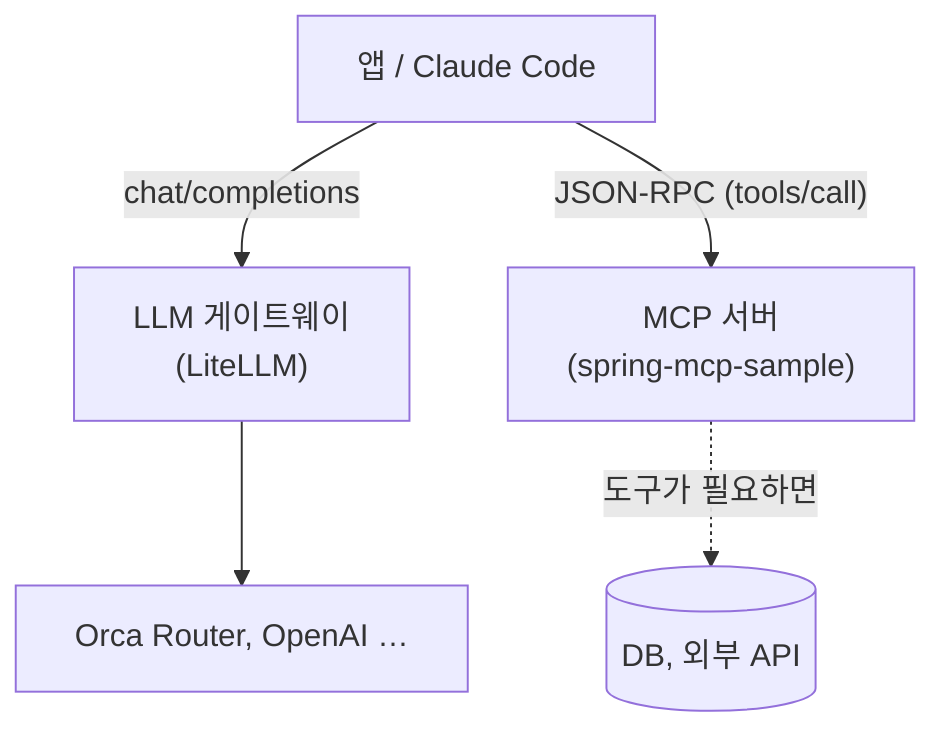
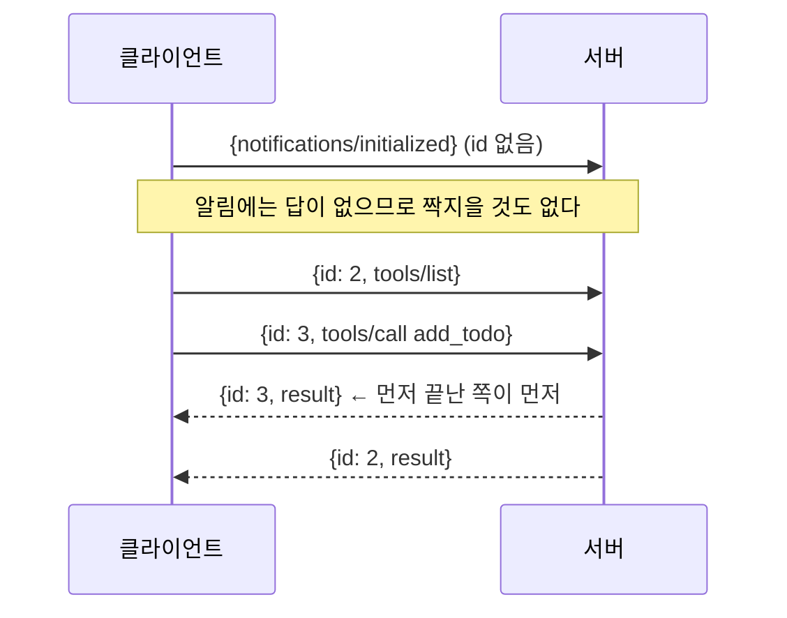

> 새로 주장하는 네 가지(stdio flush, 게이트웨이 키별 분당 한도, 동시 요청의 `id`, 세션 없는 MCP)는 직접 돌려서 캡처했습니다. 나머지 답은 1~3편의 관찰에서 이어 낸 것이고, 확인하지 않은 것은 결말에 모았습니다.
> + "LLM 통신 스택" 시리즈 4편입니다. [1편 SSE, LLM 시대에 다시 보기](/posts/sse-revisited-for-llm-streaming) · [2편 Orca Router 앞에 LiteLLM 한 겹 끼우기](/posts/litellm-gateway-in-front-of-orca-router) · [3편 MCP란 무엇인가](/posts/mcp-jsonrpc-and-transports) · 다음 편은 게이트웨이 뒤의 MCP와 인증·보안을 다룰 예정입니다.
{: .prompt-info }
<!-- post-check: tone=polite -->

## 이 글을 읽는 법

세 편을 쓰는 동안 이런 순간이 여러 번 있었습니다. 답을 적고 나면 그 답 때문에 새 질문이 생기는데, 그 글의 주제가 아니라서 접어 두는 것입니다.

> "gzip이 SSE를 뭉치게 한다고요? 그럼 MCP 응답도 SSE니까 똑같이 뭉치는 거 아니에요?"

이 글은 그렇게 접어 둔 질문들을 꺼내 순서대로 답합니다. 규칙은 하나입니다. **질문 하나에 답 하나, 그 답에서 다음 질문.** 사슬은 셋이고, 각 사슬은 앞 편에서 본 장면 하나에서 출발합니다.

| 사슬 | 출발 (앞 편에서 본 것) | 도착 |
|------|------------------------|------|
| A. 스트림 | 1편: nginx gzip이 SSE를 끝에 모았다 | 3편의 Streamable HTTP, 그리고 stdio |
| B. 게이트웨이 | 2편: 게이트웨이와 업스트림이 각각 429를 냈다 | 다음 편의 "게이트웨이 뒤의 MCP" |
| C. 메시지와 세션 | 3편: stdout에 로그가 섞여도 Connected였다 | 1편의 "길에 무엇이 서 있는가" |

사슬 안에서는 앞 답이 다음 질문을 부르고, 사슬 사이(A4 → B1, B4 → C1)에서는 소재를 옮깁니다. 세 사슬이 끝나는 C5에서 확인할 질문은 하나입니다. **"메시지는 얇고, 통로와 중간 장비가 두껍다"는 한 문장으로 세 편의 증상이 설명되는가.**

근거는 앞 편의 캡처를 그대로 가리키고(👉), 이번에 새로 확인한 네 가지는 이 글에 캡처를 실었습니다. 환경은 앞 편들과 같습니다.

| 항목 | 값 |
|------|-----|
| MCP 서버 | spring-mcp-sample, Spring Boot 3.2.2, Spring AI 1.1.8 (MCP Java SDK 0.18.3) |
| 게이트웨이 | LiteLLM `main-latest` 이미지, 포트 4400, 모델 `deepseek-flash-free` (Orca Router 무료) |
| 손 도구 | Python 3.9, curl 8.7.1. 작은 서버·클라이언트는 각 샘플의 `scripts/` 폴더 |
| 리버스 프록시 | nginx 1.27 (1편의 docker 설정) |

## A1. gzip 필터는 왜 이벤트 경계를 모르나요

1편에서 SSE 이벤트의 경계는 **빈 줄**이라고 했습니다. 그런데 nginx의 gzip 필터는 빈 줄이 와도 내보내지 않고 스트림 끝까지 모았습니다. 왜일까요.

필터가 보는 것이 **이벤트가 아니라 바이트**이기 때문입니다. nginx 안에서 응답은 버퍼 체인으로 흐르고, 각 버퍼에는 "여기까지 내보내라"는 flush 표시가 있거나 없습니다. gzip 필터는 **flush 표시가 오거나 압축 출력 버퍼가 찰 때만** 압축 결과를 내보냅니다. 1편의 응답은 작아서 버퍼도 차지 않았습니다. `data:`가 뭔지, 빈 줄이 뭔지는 모릅니다.

| 층 | 누가 아나 | 무엇을 기준으로 자르나 |
|----|-----------|------------------------|
| 애플리케이션 (SSE) | 브라우저 `EventSource`, Spring | 빈 줄 = 이벤트 하나 |
| 전송 (HTTP 본문) | nginx, 로드밸런서 | 버퍼와 flush 표시 |
| 압축 (gzip) | nginx 필터 | flush 표시가 오거나 출력 버퍼가 찰 때 |

그래서 1편의 해결책은 **flush 표시를 붙이거나, 그 응답을 gzip 필터에서 빼는 것**이었습니다. `proxy_buffering off`는 모든 버퍼에 표시를 붙이고, `X-Accel-Buffering: no`는 그 응답 하나에만 붙입니다. `gzip_types`에서 `text/event-stream`을 빼면 필터를 아예 지나지 않습니다. 뭉침을 푼 방법 가운데 이벤트 형식을 바꾸는 것은 없었습니다.

👉 1편 [원인 2 – nginx 세 가지 설정으로 비교하기](/posts/sse-revisited-for-llm-streaming/#원인-2--nginx-세-가지-설정으로-비교하기) 안의 [nginx 내부 경로 – 갈림길 두 번](/posts/sse-revisited-for-llm-streaming/#nginx-내부-경로--갈림길-두-번) 그림이 이 두 갈림길입니다.

뭉침이 이벤트 층이 아니라 버퍼 층에서 생긴다면, 버퍼는 nginx 말고도 여럿 있습니다. 다음 질문은 그중 어디였는지 가려내는 방법입니다.

## A2. 그럼 뭉침이 어디서 생겼는지는 어떻게 가려내나요

버퍼는 curl에도, nginx에도, 브라우저에도 있습니다. 어디서 뭉쳤는지 어떻게 알 수 있을까요.

**지점을 하나씩 늘려 가며 "도착 시점 수"를 셉니다.** 1편의 측정 스크립트가 한 일이 정확히 이것입니다. 토큰 수가 아니라 토큰이 몇 번에 나눠 도착했는지를 세면, 업스트림의 배치와 중간 장비의 버퍼링이 구분됩니다.

| 경로 | 도착 시점 수 | 해석 |
|------|-------------:|------|
| Spring 직접 (8090) | 20 | 121개 토큰이 20번에 나눠 옴. 업스트림 배치 |
| nginx 기본 (8081) | 28 | 직접과 비슷. 버퍼링은 있지만 흘러감 |
| nginx gzip on (8083) | **1** | 응답 끝에 한꺼번에. 여기가 범인 |
| gzip on + `X-Accel-Buffering: no` | 22 | 복구 |

순서가 중요합니다. `curl -N`으로 업스트림을 직접 받아 기준을 만들고, 그다음 앱, 그다음 nginx를 끼웁니다. 기준 없이 브라우저만 보면 "원래 그런지" "뭉친 건지" 알 수 없습니다.

👉 1편 [도착 시각 재기 – stream_timing.py](/posts/sse-revisited-for-llm-streaming/#도착-시각-재기--stream_timingpy)와 원인 2 안의 [실측 결과](/posts/sse-revisited-for-llm-streaming/#실측-결과) 표.

이 방법은 LLM 스트리밍만이 아니라 MCP 응답, 로그 스트리밍, 어떤 chunked 응답에도 그대로 씁니다. 세는 것은 언제나 "몇 번에 나눠 왔는가"입니다. 그러면 MCP 응답도 같은 필터를 탈까요.

## A3. Streamable HTTP 응답도 SSE인데, MCP 서버도 nginx 뒤에서 뭉치나요

3편에서 Streamable HTTP의 `tools/list` 응답이 `text/event-stream`으로 오는 걸 봤습니다. 같은 형식이면 같은 필터를 타지 않을까요.

**1편의 규칙대로라면 탑니다.** MCP 서버를 nginx 뒤에 두고 재 보지는 않았습니다. 다만 nginx는 그 응답이 LLM 토큰인지 MCP 메시지인지 모릅니다. `Content-Type: text/event-stream`이고 `gzip_types`에 걸리면 A1과 똑같이 flush 표시나 버퍼가 찰 때를 기다립니다.

티가 나는 조건은 다를 것입니다. 이벤트가 하나뿐인 응답은 뭉쳐도 어차피 한 덩어리라 차이가 없고, 이벤트가 여러 개일 때 드러납니다.

| MCP 응답 | 이벤트 수 | 예상되는 증상 (1편 결과에서 이어 냄) |
|----------|----------:|--------------------------------------|
| `tools/list`, 짧은 `tools/call` | 1 | 티가 안 남 |
| 긴 도구 실행 + 진행 알림(`notifications/progress`) | 여러 개 | 진행 알림이 끝에 한꺼번에 옴 |
| `GET /mcp`로 열어 둔 서버→클라이언트 스트림 | 계속 | 늦게, 몇 개씩 묶여 도착 |

1편의 다른 함정 하나는 MCP에서 더 자주 걸릴 수 있습니다. `proxy_read_timeout` 60초입니다. 이것은 1편에서도 재현하지 않은 설명입니다. LLM은 토큰이 계속 오지만, MCP 도구는 DB 조회나 외부 API 호출 동안 **아무것도 보내지 않을 수** 있습니다. 응답이 이미 흐르던 중에 60초 넘게 조용하면 nginx가 연결을 끊고, 응답이 시작되기 전에 60초가 지나면 `504`가 돌아옵니다. 어느 쪽이든 클라이언트는 도구가 실패한 줄 압니다.

그래서 MCP 서버를 nginx 뒤에 둔다면 1편의 SSE 설정을 그대로 옮기는 것이 출발점입니다. 아래 설정도 이 글에서 재 본 것이 아니라 1편 설정을 옮긴 것입니다.

```nginx
location /mcp {
    proxy_pass http://mcp-server:8091;
    proxy_http_version 1.1;
    proxy_buffering off;          # 또는 앱에서 X-Accel-Buffering: no
    proxy_read_timeout 300s;      # 도구 실행 시간에 맞게
    proxy_set_header Connection '';
}
```

👉 3편 [손으로 보내 보기](/posts/mcp-jsonrpc-and-transports/#손으로-보내-보기)의 [실험 2 – Streamable HTTP를 curl로: 세션 헤더 하나](/posts/mcp-jsonrpc-and-transports/#실험-2--streamable-http를-curl로-세션-헤더-하나) 캡처에서 `tools/list` 응답의 `Content-Type: text/event-stream`을 다시 보면 됩니다.

> Streamable HTTP를 "그냥 HTTP니까 로드밸런서 뒤에 두기 쉽다"고 소개하는 글이 많습니다. 반은 맞습니다. 레거시 SSE 전송처럼 연결 두 개를 같은 서버로 묶을 필요는 없어졌습니다. 하지만 응답 하나하나는 여전히 스트림이라 1편의 버퍼링·타임아웃 규칙이 그대로 적용됩니다.
{: .prompt-warning }

HTTP 통로에서는 밖에 서 있는 장비를 신경 써야 한다는 답이 나왔습니다. 그렇다면 장비가 없는 통로는 어떨까요.

## A4. stdio는 중간 장비가 없으니 이런 걱정이 없나요

stdio는 파이프 하나뿐이니 버퍼 걱정에서 자유로울까요.

nginx는 없습니다. 대신 **프로세스 자기 자신의 stdout 버퍼**가 있습니다. 파이프에 물린 stdout은 많은 언어 런타임에서 줄 단위가 아니라 **블록 단위**로 버퍼링합니다. 터미널에 찍을 때는 줄마다 나가던 출력이, 파이프로 연결되면 4KB나 8KB가 찰 때까지 안 나갑니다.

| 상황 | stdout 버퍼링 | 결과 |
|------|---------------|------|
| 터미널에서 직접 실행 | 줄 단위 | 한 줄 쓰면 바로 보임 |
| 클라이언트가 파이프로 띄움 (MCP stdio) | 블록 단위 (C, Python 기본값) | 핸드셰이크가 멈춘 것처럼 보임 |
| 매 메시지 뒤 `flush()` | - | 정상 |

파이프로 띄웠을 때는 JSON 한 줄을 써도 클라이언트에 가지 않습니다. 말로만 하면 믿기 어려우니 25줄짜리 파이썬 JSON-RPC 서버(`tiny_stdio_server.py`)를 만들어 `flush()` 한 줄만 빼고 돌려 봤습니다.

```bash
cd spring-mcp-sample/scripts
python3 noflush_probe.py --no-flush   # 서버가 응답을 쓰고 flush 하지 않음
python3 noflush_probe.py              # 서버가 응답마다 flush
```

<figure class="post-figure">
  
  <figcaption>같은 서버를 flush 한 줄만 바꿔 두 번 돌린 회차입니다. 위(<code>--no-flush</code>)는 5초 timeout 동안 서버가 살아 있고(<code>exit=None</code>) stdin을 닫자 5006ms에 답이 도착합니다. 아래는 22ms에 답합니다.</figcaption>
</figure>

서버는 답을 **썼습니다.** 다만 프로세스 안의 stdout 버퍼에 머물러 있었고, 프로세스가 끝나면서 버퍼가 비워지는 순간에야 클라이언트에 도착했습니다. 확인한 범위에서는 Spring AI의 stdio 서버에 이 문제가 없었습니다. 3편 [실험 1](/posts/mcp-jsonrpc-and-transports/#실험-1--stdio를-손으로-파이프에-json-한-줄씩)에서 프로세스가 살아 있는 동안 응답이 바로 왔습니다. 직접 만든 서버에서 "initialize를 보냈는데 답이 안 온다"면 로그 오염(3편 [원인 1](/posts/mcp-jsonrpc-and-transports/#원인-1--stdout은-통로입니다-로그-통로가-아닙니다))보다 먼저 이걸 의심해야 합니다.

그러니 stdio에도 버퍼 문제는 있습니다. 위치가 다를 뿐입니다. HTTP는 **밖의** 버퍼(nginx)를, stdio는 **안의** 버퍼(런타임)를 봐야 합니다.

👉 3편 [실험 1 – stdio를 손으로: 파이프에 JSON 한 줄씩](/posts/mcp-jsonrpc-and-transports/#실험-1--stdio를-손으로-파이프에-json-한-줄씩)의 파이썬 클라이언트는 stdin을 `bufsize=1`(텍스트 모드 줄 버퍼)로 열어 개행마다 자동으로 flush되고, 그래도 `proc.stdin.write(...)` 뒤에 `flush()`를 명시적으로 부릅니다. 바이너리 모드나 기본 버퍼로 열었다면 그 한 줄이 없을 때 서버가 요청을 못 받습니다.

## B1. 2편의 429는 결국 몇 종류였나요

사슬을 바꿉니다. 2편에서는 `/v1`이 빠진 주소로 부른 직후 쿨다운 429를, 무료 모델을 12번 연속 호출해 업스트림 429를 봤습니다. 같은 429였지만 만든 곳이 달랐고, 이번에 하나를 더 확인해서 세 종류가 됐습니다.

| 누가 만드나 (언제) | 구분법 (`error.type`·메시지) · 응답 시간 |
|--------------------|------------------------------------------|
| 업스트림 Orca Router (무료 한도 초과, 안내상 분당 10회·단위 미확인) | "Free model capacity…" 메시지<br>업스트림 왕복만큼 (추정, 재지 않음) |
| 게이트웨이 쿨다운 (직전 실패로 배포가 쉬는 중) | `all_deployments_in_cooldown`<br>몇 ms (추정, 재지 않음) |
| 게이트웨이 키 한도 (가상 키의 `rpm_limit` 초과) | `throttling_error`, "Limit type: requests"<br>**7ms (측정)** |

업스트림의 무료 한도는 2편에서 같은 키로 부른 무료 모델끼리 나눠 쓰는 것을 한 번 관찰했습니다. 세 번째 줄은 이번에 실제로 걸어 봤습니다. `rpm_limit: 2`인 가상 키로 세 번 연속 호출했습니다.

```bash
LITELLM_PORT=4400 docker compose -f litellm-gateway-sample/docker-compose.yml up -d
bash litellm-gateway-sample/scripts/rpm_limit.sh     # 키 발급 + 3회 호출
```

<figure class="post-figure">
  
  <figcaption>LiteLLM 가상 키 <code>rpm_limit=2</code>로 세 번 연속 호출한 회차입니다. #1·#2의 <code>HTTP 200</code>(2.2s, 2.0s)과 #3의 <code>HTTP 429</code> <code>throttling_error</code>(0.007s)를 비교하면 됩니다. #3은 업스트림에 나가지 않은 것으로 보입니다(7ms 기준, 업스트림 로그는 보지 않음).</figcaption>
</figure>

7ms는 업스트림 왕복보다 짧습니다. 게이트웨이가 만든 429는 업스트림에 나가기 전에 막으니 빠르고, 업스트림이 만든 429는 업스트림까지 갔다 와야 합니다. 다만 이 글에서 잰 429는 이 한 번뿐이라, 응답 시간은 판정이 아니라 보조 단서로 씁니다. 2편 [실패 1 – 쿨다운이 에러를 바꿔 놓는다](/posts/litellm-gateway-in-front-of-orca-router/#실패-1--쿨다운이-에러를-바꿔-놓는다)의 쿨다운 429도 업스트림을 부르기 전에 게이트웨이가 돌려보낸 경우입니다.

👉 2편 [게이트웨이를 도입할 때](/posts/litellm-gateway-in-front-of-orca-router/#게이트웨이를-도입할-때)의 [이 글에서 만난 에러](/posts/litellm-gateway-in-front-of-orca-router/#이-글에서-만난-에러) 표에 이 줄을 하나 더 얹으면 됩니다.

> 429를 받으면 상태 코드보다 **`error.type`과 메시지**를 먼저 보세요. `throttling_error`나 `all_deployments_in_cooldown`이면 게이트웨이, "Free model capacity…"면 업스트림입니다. 응답 시간은 그다음에 보는 단서입니다.
{: .prompt-tip }

게이트웨이가 키별로 429를 만들 수 있다면, 2편에서 막막했던 문제에도 손을 쓸 여지가 생깁니다.

## B2. 앱들이 무료 한도 하나를 나눠 쓴다면, 게이트웨이가 할 수 있는 건 뭔가요

2편에서는 같은 키로 부른 무료 모델끼리 무료 한도(안내상 분당 10회)를 나눠 쓰는 것을 한 번 관찰했습니다. 다만 같은 분 안에서 11회가 성공해, 한도를 세는 단위는 확인하지 못했습니다. 게이트웨이 뒤의 앱들이 모두 같은 업스트림 키로 나간다면, 앱 하나가 한도를 다 써 버리는 순간 나머지가 굶습니다.

게이트웨이가 할 수 있는 일은 **그 한도를 가상 키별로 쪼개 주는 것**입니다. 예를 들어 앱 셋이 같은 업스트림 키로 나간다고 가정하면 이렇게 나눌 수 있습니다.

| 앱 (가상 키, 가정 예시) | `rpm_limit` |
|-------------------------|------------:|
| Spring SSE 프록시 | 4 |
| 배치 요약 잡 | 3 |
| 사내 챗봇 | 3 |

안내된 한도 10을 기준으로 나눈 예입니다. 이렇게 하면 어느 앱이 폭주해도 업스트림 429는 나지 않을 것입니다(이 배분으로 확인하지는 않았습니다). 대신 그 앱만 게이트웨이 429를 받습니다. 업스트림 429는 같은 한도를 쓰는 앱 전부를 멈추지만, 게이트웨이 429는 그 키 하나만 멈춥니다. 2편에서 관찰한 대로 같은 한도를 나눠 쓴다면, 게이트웨이는 **한도를 미리 나눠 주는 것**으로 2편의 무료 → 무료 폴백이 풀지 못한 문제를 우회하는 셈입니다.

```bash
curl http://localhost:4400/key/generate \
  -H "Authorization: Bearer $LITELLM_MASTER_KEY" -H "Content-Type: application/json" \
  -d '{"key_alias": "spring-sse-sample", "models": ["deepseek-flash-free"], "rpm_limit": 4}'
```

> **쉽게 말하면** 집 전체의 수도 계량기(업스트림 한도)는 하나지만, 방마다 밸브(키 한도)를 달아 두면 한 방이 물을 다 써서 다른 방이 마르는 일은 없습니다. 밸브가 잠긴 방만 "물 안 나옴"(게이트웨이 429)을 겪습니다.
{: .prompt-tip }

`tpm_limit`(분당 토큰)과 `max_budget`(누적 달러)도 같은 키 설정에 겁니다. `rpm_limit`은 위 캡처처럼 세 번째 호출에서 바로 걸렸고, `tpm_limit`이 같은 식으로 바로 걸리는지는 확인하지 않았습니다(추정). 2편에서 본 것처럼 `/key/info`의 `spend` 반영은 늦었습니다(원인은 확인하지 않음). 그런데 요청 수는 들어오는 순간 셀 수 있지만, 달러는 토큰 수를 알아야 나옵니다.

## B3. 스트리밍이면 비용은 언제 확정되나요

2편의 예산(`max_budget`)은 달러입니다. 스트리밍 응답에서 토큰 수는 언제 알 수 있을까요.

**마지막 청크입니다.** 1편에서 본 것처럼 `usage`는 스트림 끝에 옵니다. 게이트웨이도 그걸 받아야 비용을 계산합니다. 2편 [스트리밍은 그대로 통과하나](/posts/litellm-gateway-in-front-of-orca-router/#스트리밍은-그대로-통과하나) 캡처에서 `usage.cost`가 마지막 청크에만 붙어 있던 이유입니다.

여기서 따져 볼 것이 둘 있습니다.

- **예산 검사는 요청 전, 비용 확정은 응답 후.** 2편의 예산 키도 첫 요청이 통과한 뒤 예산을 넘겼고, 2편의 표현대로 `max_budget`은 "넘긴 뒤의 다음 요청부터 막는다"였습니다. 스트리밍이면 그 한 번이 몇 초 동안 열려 있는 요청입니다.
- **스트림이 중간에 끊기면** `usage` 청크가 오지 않습니다. 클라이언트가 브라우저 탭을 닫거나 nginx가 타임아웃으로 끊으면(A3), 게이트웨이가 무엇을 기록하는지는 확인하지 않았습니다. 스팬드 로그에 0으로 남거나, 추정값이 남거나, 빠질 수 있습니다.

두 번째는 운영에 넣기 전에 일부러 끊어 보고 `/spend/logs`를 확인해 볼 항목으로 남깁니다.

👉 2편 [가상 키에 예산 걸기](/posts/litellm-gateway-in-front-of-orca-router/#가상-키에-예산-걸기) 캡처의 "`spend`가 아직 0.0"은 원인이 다릅니다(DB 반영 지연). 기록이 늦거나 빠질 수 있다는 점만 비슷합니다.

키·한도·비용은 모두 LLM 요청 이야기였습니다. 3편의 MCP 도구 호출도 이 게이트웨이를 지나게 할 수 있을까요.

## B4. 게이트웨이 뒤에 MCP 서버를 두면요

B 사슬의 끝입니다. 2편의 게이트웨이는 `chat/completions`를 받는 **LLM API 게이트웨이**였습니다. 3편의 MCP는 **도구 프로토콜**입니다. 둘은 층이 다릅니다.



앱에서 나가는 선이 둘입니다. 그래서 "게이트웨이 뒤에 MCP"는 두 가지 뜻이 될 수 있습니다.

| 뜻 | 게이트웨이가 하는 일 | 클라이언트 → 게이트웨이 구간의 통로 |
|----|----------------------|-------------------------------------|
| MCP 서버를 게이트웨이가 대신 노출 | 인증(가상 키), 서버 목록, 감사 로그를 한 곳에 | Streamable HTTP (stdio는 불가) |
| MCP 서버가 LLM을 부를 때 게이트웨이 경유 | 도구 안에서 쓰는 LLM 호출의 키·비용 | 통로와 무관 |

첫 번째가 다음 편의 주제입니다. LiteLLM 문서에는 MCP 서버를 등록해서 가상 키로 노출하는 기능이 있다고 적혀 있고, 그렇다면 B1·B2의 키 한도가 도구 호출에도 걸릴 것입니다. 이 글에서는 확인하지 않았습니다. 그때 3편의 세션(`Mcp-Session-Id`)이 게이트웨이를 지나며 어떻게 되는지까지가 다음 편에서 직접 돌려 볼 것들입니다.

## C1. JSON-RPC의 id는 왜 필요한가요

사슬을 바꿉니다. B4에서 남긴 세션 문제로 가기 전에, 메시지 자체부터 봅니다. 3편에서 요청에는 `id`가 있고 답에 같은 `id`가 온다고 했습니다. 하나 보내고 하나 받으면 될 텐데, 왜 굳이 번호가 필요할까요.

**요청을 동시에 여러 개 보내도 되고**, 답이 **보낸 순서대로 오지 않아도 되기 때문**입니다. 클라이언트가 `tools/list`(id 2)와 `tools/call`(id 3)을 연달아 보내면, 서버는 빠른 쪽을 먼저 답할 수 있습니다. 번호가 없으면 어느 답이 어느 요청 것인지 모릅니다.



실제로 그렇게 되는지 A4의 작은 서버로 확인했습니다. 요청마다 스레드를 띄우는 서버에 800ms 걸리는 요청(id 2)을 먼저, 100ms 걸리는 요청(id 3)을 나중에 보냈습니다.

```bash
cd spring-mcp-sample/scripts
python3 concurrent_client.py python3 tiny_stdio_server.py
```

<figure class="post-figure">
  
  <figcaption><code>tiny_stdio_server.py</code>에 31ms 시점에 id 2(800ms), id 3(100ms)을 연달아 보낸 회차입니다. 답이 id 3은 135ms, id 2는 838ms에 온 것, 즉 보낸 순서와 온 순서가 뒤바뀐 것을 보면 됩니다.</figcaption>
</figure>

순서가 바뀌어도 클라이언트는 `id`로 짝을 찾았습니다. 이 규칙은 통로와 무관합니다. stdio의 파이프 하나에서도, Streamable HTTP의 POST 여러 개에서도 같습니다. 다만 Streamable HTTP는 요청마다 독립된 HTTP 요청이라 답이 그 요청의 응답으로 돌아오니 헷갈릴 일이 적고, stdio는 stdout 한 줄기로 모든 답이 섞여 오니 `id`가 전부입니다.

👉 3편 [실험 1 – stdio를 손으로: 파이프에 JSON 한 줄씩](/posts/mcp-jsonrpc-and-transports/#실험-1--stdio를-손으로-파이프에-json-한-줄씩) 캡처에서 `id: 1, 2, 3`이 각각 짝지어 돌아오는 것을 볼 수 있습니다.

`id`는 요청 하나와 답 하나를 묶습니다. 요청 여러 개를 하나로 묶는 것은 세션이고, 세션은 서버 메모리에 삽니다.

## C2. 세션이 서버 메모리에 있으면, 인스턴스를 둘로 늘리면 404가 나겠네요

Streamable HTTP는 요청마다 독립된 HTTP 요청이고, 3편에서는 그 요청들을 `Mcp-Session-Id`로 묶었습니다. 그러면 서버를 두 대로 늘리고 로드밸런서를 앞에 두면, `initialize`는 A에서 하고 `tools/call`은 B로 가서 404 `Session not found`가 나지 않을까요.

**3편의 404 규칙대로라면 납니다.** 3편에서 서버가 모르는 세션 ID를 받으면 404였기 때문입니다. 두 대로 재 보지는 않았습니다. 해결은 둘입니다.

| 방법 | 어떻게 | 대가 |
|------|--------|------|
| 세션 고정 (sticky) | 로드밸런서가 응답의 `Mcp-Session-Id`를 학습해 이후 요청을 발급한 인스턴스로 보냄 | 인스턴스가 죽으면 그 세션 전부 404. 재시작 시 `initialize`부터 |
| 세션 없음 (stateless) | 서버가 세션 ID를 아예 발급하지 않음 | Spring AI 1.1.8의 STATELESS 전송에서는 서버→클라이언트 알림, 진행 상황 스트림, 재개(resume)를 쓰지 않음 |

두 번째를 실제로 돌려 봤습니다. Spring AI 1.1의 `protocol: STATELESS`입니다.

```bash
java -jar build/libs/spring-mcp-sample-0.0.1-SNAPSHOT.jar \
  --spring.profiles.active=streamable --spring.ai.mcp.server.protocol=STATELESS --server.port=8095
bash scripts/stateless_curl.sh
```

<figure class="post-figure">
  
  <figcaption><code>protocol=STATELESS</code>, 포트 8095의 서버 한 대에 보낸 회차입니다. 1)의 initialize 응답 헤더에 <code>Mcp-Session-Id</code>가 없는 것과, initialize도 하지 않은 새 연결에서 세션 헤더 없이 보낸 2)·3)이 <code>HTTP 200</code>인 것을 보면 됩니다. 4)는 같은 요청을 다시 보낸 것으로, 실제 두 번째 인스턴스를 띄우지는 않았습니다.</figcaption>
</figure>

3편에서 세션 헤더 없이 보내면 400 `Session ID missing`이 났던 서버가, 모드 하나 바꾸니 헤더 없이도 도구를 실행합니다. 요청마다 완결이고 이 샘플의 할 일은 서버 메모리가 아니라 PostgreSQL에 저장되니 어느 인스턴스로 가도 같을 것이고, 로드밸런서에 세션 고정 설정이 필요 없습니다.

그러면 언제 stateless를 고를까요. **도구가 서버 메모리에 상태를 두지 않을 때**입니다(이 샘플은 할 일을 PostgreSQL에 저장합니다). "할 일 추가"처럼 상태를 바꾸는 도구라도 상태가 공유 저장소에 있고 요청 하나에 결과 하나면 세션이 필요 없습니다. 반대로 이 글에서 쓴 STATELESS 전송으로는 긴 작업의 진행률을 보내거나 서버가 먼저 클라이언트에 알림을 보낼 수 없으니, 그런 도구라면 세션 모드를 씁니다.

스펙도 세션 ID 발급을 서버의 선택(MAY)으로 둡니다. 3편 [원인 2 – 세션은 헤더 하나로 이어집니다](/posts/mcp-jsonrpc-and-transports/#원인-2--세션은-헤더-하나로-이어집니다)의 400·404는 "세션을 쓰기로 한 서버"의 규칙이지 MCP 전체의 규칙이 아닙니다.

## C3. stdio 서버가 stderr로 보낸 로그는 어디로 가나요

C2는 HTTP 쪽 세션 이야기였습니다. stdio로 돌아오면, 3편에서는 로그를 stdout이 아니라 stderr나 파일로 보내라고 했습니다. 그런데 자식 프로세스의 stderr는 누가 받을까요. 아무도 안 보면 사라지는 것 아닌가요.

**호스트(클라이언트)가 받을 수 있습니다.** 자식 프로세스를 띄운 쪽이 stderr 파이프도 쥐고 있습니다. 3편의 파이썬 클라이언트도 `stderr=PIPE`로 띄웠습니다. 다만 스펙은 클라이언트가 stderr를 받아 두거나, 넘기거나, 무시해도 된다(MAY)고만 정합니다. 받아서 버리는 호스트도 있을 수 있다는 뜻입니다.

| 출력 | stdio에서의 역할 | 누가 읽나 |
|------|------------------|-----------|
| stdout | **통로.** JSON-RPC만 | 호스트의 메시지 파서 |
| stderr | 로그 | 호스트가 받기로 했다면 그 로그 수집기 |
| 파일 (`logging.file.name`) | 로그 | 사람 |

그래서 3편 원인 1의 해결이 "로그를 끈다"가 아니라 "stdout에서 치운다"였습니다. stderr나 파일로 보내면 로그는 살아 있고 통로만 깨끗합니다. 운영에서는 파일 쪽이 낫습니다. 호스트가 stderr를 어디에 모으는지, 모으기는 하는지는 호스트마다 다르지만, 파일은 내가 정한 자리에 있습니다.

👉 3편 [일부러 깨뜨려 보기 – 깨지는 자리 네 곳](/posts/mcp-jsonrpc-and-transports/#일부러-깨뜨려-보기--깨지는-자리-네-곳) 안의 [원인 1 – stdout은 통로입니다, 로그 통로가 아닙니다](/posts/mcp-jsonrpc-and-transports/#원인-1--stdout은-통로입니다-로그-통로가-아닙니다)에 있는 Claude Code 디버그 로그 캡처(`--debug-file`로 기록)는 stderr가 아니라, stdout에 섞인 JSON 아닌 줄을 Claude Code가 어떻게 기록했는지 보여 줍니다.

그 캡처에서 Claude Code는 JSON이 아닌 stdout 줄을 에러로 기록하고 넘어갔습니다. 3편의 파이썬 손 클라이언트도 그 줄을 `[NOT JSON]`으로 표시하고 넘어갔습니다. 두 클라이언트 모두 관대했습니다.

## C4. 스펙은 엄격한데 클라이언트는 왜 관대한가요

스펙은 "stdout에 MCP 메시지 아닌 것을 쓰면 안 된다"인데, 왜 클라이언트는 그걸 봐줄까요.

오래된 설계 원칙 하나가 있습니다. **보낼 때는 엄격하게, 받을 때는 관대하게.** 네트워크 프로토콜 구현에서 흔히 따르는 규칙이고, 덕분에 배너 한 줄 때문에 모든 서버가 안 붙는 사태는 피합니다.

대신 대가가 있습니다.

| 관대함의 결과 | 무엇이 문제인가 |
|---------------|-----------------|
| 문제가 숨는다 | 개발자가 고칠 이유를 못 느낌 |
| 클라이언트마다 다를 수 있다 | 스펙대로 거부하는 클라이언트라면 깨질 것 |
| 우연히 파싱된다 | 조용히 틀린 동작을 함 |

3편의 "Connected인데 에러 네 번"이 첫 줄의 예입니다. 둘째 줄은 관찰이 아니라 스펙에서 이어 낸 예상입니다. 이 시리즈의 두 클라이언트(Claude Code, 파이썬 손 클라이언트)는 모두 넘어갔고, 깨지는 클라이언트는 보지 못했습니다. 셋째 줄은 로그 한 줄이 `{`로 시작할 때입니다. 그 줄은 버려지지 않고 메시지로 읽힙니다.

그러니 "우리 클라이언트에서는 되는데요"는 근거가 못 됩니다. 스펙대로 stdout을 비우는 것이 맞고, 관대함은 남의 서버를 붙일 때 고마워할 일이지 내 서버를 만들 때 기댈 일이 아닙니다.

👉 3편 [원인 1 – stdout은 통로입니다, 로그 통로가 아닙니다](/posts/mcp-jsonrpc-and-transports/#원인-1--stdout은-통로입니다-로그-통로가-아닙니다)의 세 캡처(SQL 누출, 배너 누출, Claude Code 디버그 로그).

C 사슬은 메시지의 `id`에서 출발해 클라이언트의 파서까지 왔습니다. 1편이 물었던 "길에 무엇이 서 있는가"로 돌아온 셈입니다.

## C5. 결국 세 편을 한 문장으로 잇는다면

세 편이 공통으로 말한 것을 한 문장으로 줄이면 이렇습니다.

**메시지는 얇고, 통로와 중간 장비가 두껍습니다.**

이 문장이 얼마나 맞는지 세 편의 원인을 놓고 따져 봅니다. 1편의 원인은 둘이었습니다. nginx gzip 필터의 보류(원인 2)는 장비의 문제였습니다. 브라우저 파서가 `data:` 뒤 공백 한 칸을 버린 것(원인 1)은 파서의 규칙이었지만, 해결은 토큰을 JSON으로 감싸 메시지를 싣는 방식을 바꾸는 것이었습니다. 2편의 요청은 `chat/completions` 하나였고, 문제는 게이트웨이의 쿨다운과 업스트림의 한도에 있었습니다. 3편의 메시지는 JSON-RPC 한 줄이었고, 원인 넷은 stdout 오염, 세션 헤더, 프로세스 수명, 전송 설정이었습니다.

<figure class="post-figure post-figure--diagram" id="figure-stack" aria-labelledby="stack-caption">
  <div class="figure-head"><small>01 · 응답이 지나는 자리</small>메시지 내용은 문제가 없었고, 문제는 메시지를 싣는 방식과 앞뒤 장비에서 났습니다</div>
  <picture class="diagram-wide"></picture>
  <picture class="diagram-narrow"></picture>
  <figcaption id="stack-caption">위에서 아래로 응답이 지나는 순서입니다. 오른쪽(모바일에서는 상자 아래)이 그 자리에서 난 문제이고, 끝의 번호가 그 자리를 다룬 질문입니다. LLM 요청 경로와 MCP 경로를 한 줄에 겹친 설명용 그림이며, 게이트웨이 뒤의 MCP(B4)는 확인하지 않았습니다. <a class="diagram-source diagram-wide" href="/assets/img/posts/2026-09-27-llm-stack-deep-dive-qna/stack-desktop.svg" target="_blank" rel="noopener">그림 원본 보기 ↗</a><a class="diagram-source diagram-narrow" href="/assets/img/posts/2026-09-27-llm-stack-deep-dive-qna/stack-mobile.svg" target="_blank" rel="noopener">그림 원본 보기 ↗</a></figcaption>
</figure>

그러니 답은 "대부분 그렇다"입니다. 메시지 내용, 즉 SSE 이벤트의 필드나 JSON-RPC 메시지의 형식 때문에 생긴 증상은 세 편 어디에도 없었습니다. C1의 `id`도 증상이 아니라 짝짓기 규칙이었습니다. 예외는 앱 칸에서 생긴 셋, 1편 원인 1, 3편 원인 1(서버가 stdout에 로그를 실음), A4(런타임 stdout 버퍼)입니다. 셋 다 메시지 내용이 아니라 **메시지를 싣는 방식**(공백 처리, stdout에 무엇을 싣는가, flush)의 문제였습니다. 3편 원인 4(스타터 충돌로 통로가 안 열림)는 메시지를 싣는 방식이 아니라 프레임워크 설정 문제라, 그림에서 앱 칸 안에 "프레임워크 설정"으로 따로 표시했습니다. 3편 원인 2(세션 헤더)와 원인 3(프로세스가 죽으면 파이프도 죽음)은 이 글에서 각각 C2와 A4의 출발점으로만 쓰고 그림에서 뺐습니다. 둘 다 통로의 규칙과 수명 문제라 메시지 칸의 반례는 아닙니다. 이 판단에도 범위가 있습니다. 3편은 처음부터 통로를 깨뜨리도록 실험을 설계했고 메시지를 일부러 틀리게 보내지는 않았으니, "메시지에서 난 증상이 없었다"는 그 범위 안의 이야기입니다.

## 증상을 받으면 먼저 가를 것

세 편에서 쓴 디버깅 순서는 같았습니다.

1. **메시지 원문을 먼저 봅니다.** `curl -N`으로 받거나 파이프에 직접 써서, 앱이 무엇을 주고받는지 장비 없이 확인합니다.
2. **앱 앞뒤에 무엇이 서 있는지 그립니다.** 1편의 질문("길에 무엇이 서 있나")과 3편의 질문("메시지 층인가 통로 층인가")으로 자리를 잡습니다.
3. **증상을 누가 만들었는지 가릅니다.** 이 글에서 쓴 도구는 지점별 도착 시점 수, `error.type`과 응답 시간, 클라이언트의 로그였습니다.

| 증상 | 먼저 볼 자리 (이 글) | 가르는 방법 |
|------|----------------------|-------------|
| 스트림이 끝에 한꺼번에 옴 | nginx의 gzip·버퍼 (A1–A3) | 지점별 도착 시점 수 |
| stdio 서버가 답을 안 함 | 서버 런타임의 stdout 버퍼 (A4) | 메시지마다 flush 하는 서버와 비교 |
| 429 | 게이트웨이 또는 업스트림 (B1) | `error.type`과 메시지, 응답 시간은 보조 |
| 인스턴스를 늘리자 404 | 로드밸런서와 세션 (C2) | 응답의 세션 헤더 유무 |
| Connected인데 에러 로그 | stdout 오염 (C3·C4) | Claude Code 디버그 로그(`--debug-file`), 손 클라이언트의 `[NOT JSON]` 표시 |

이 판단이 성립하는 범위는 이렇습니다.

- 캡처 네 장은 모두 로컬에서 한 번씩 돌린 회차이고, 버전은 위 환경 표(LiteLLM `main-latest`, Spring AI 1.1.8, nginx 1.27)에 묶여 있습니다.
- 429의 응답 시간은 게이트웨이 키 한도의 7ms 한 번만 쟀습니다. 업스트림·쿨다운 429의 시간은 재지 않았습니다.
- 키별 `rpm_limit` 배분은 2편에서 같은 키의 무료 모델끼리 한도를 나눠 쓴 것을 한 번 본 데 기댑니다. 2편은 무료 풀 전체가 혼잡했다는 다른 설명과, 한도를 세는 창의 경계를 가르지 못했습니다. 그 경우라면 합 10으로 나눠도 업스트림 429가 날 수 있습니다.
- 폴백·재시도가 켜져 있으면 게이트웨이 요청 1건이 업스트림 호출 여러 건이 될 수 있으므로(2편 설정에는 `fallbacks`가 있음), 키 한도의 합이 업스트림 호출 수의 상한이 되지 않습니다.
- LiteLLM 인스턴스가 여럿일 때 키 한도 카운터가 인스턴스 사이에서 공유되는지는 확인하지 않았습니다.
- Spring AI 1.1.8의 STATELESS 전송에서 진행 알림이나 서버가 먼저 보내는 메시지가 필요하면 세션을 써야 하고, 인스턴스가 여럿이면 세션 고정이 필요합니다(이 글에서 확인한 범위).
- "메시지 내용에서 난 증상은 없었다"는 메시지를 일부러 틀리게 보내지 않은 실험 범위 안의 판단입니다.

### 확인하지 않은 것

- **A3 nginx 뒤의 MCP 서버.** MCP Streamable HTTP 응답이 nginx gzip 뒤에서 실제로 뭉치는지, `proxy_read_timeout`에 걸리는지는 1편 결과에서 이어 낸 예상입니다.
- **C2 인스턴스 두 대.** 세션 모드 서버 두 대를 로드밸런서 뒤에 두고 404가 나는지는 재 보지 않았습니다.
- **B3 끊긴 스트림의 비용.** 스트림이 중간에 끊겨 `usage` 청크가 오지 않을 때 LiteLLM이 `/spend/logs`에 무엇을 남기는지.
- **B4 LiteLLM의 MCP 게이트웨이.** 가상 키 한도가 도구 호출에도 걸리는지, `Mcp-Session-Id`가 게이트웨이를 지나며 어떻게 되는지. 다음 편에서 직접 돌려 볼 항목입니다.

### 재현

캡처 네 장은 아래 샘플의 `scripts/` 폴더로 재현할 수 있습니다. `tiny_stdio_server.py`(25줄 JSON-RPC 서버), `noflush_probe.py`(A4), `concurrent_client.py`(C1), `stateless_curl.sh`(C2), `rpm_limit.sh`(B1)입니다.

- [spring-sse-sample](https://github.com/rojae/spring-sample/tree/main/spring-sse-sample) (1편)
- [litellm-gateway-sample](https://github.com/rojae/spring-sample/tree/main/litellm-gateway-sample) (2편, B1·B2)
- [spring-mcp-sample](https://github.com/rojae/spring-sample/tree/main/spring-mcp-sample) (3편, A4·C1·C2)

## 참고한 내용들

<details markdown="1">
<summary>이 글에서 새로 쓴 설정</summary>

- **`spring.ai.mcp.server.protocol`** (yml, 기본값 `SSE`): `STATELESS`면 세션 ID를 발급하지 않고 요청마다 완결합니다(Spring AI 1.1.x).
- **`rpm_limit`, `tpm_limit`** (LiteLLM `/key/generate`, 기본값 없음): 가상 키별 분당 요청·토큰 한도. 초과하면 게이트웨이가 429 `throttling_error`를 돌려줍니다.
- **`proxy_read_timeout`** (nginx, 기본값 `60s`): 연속된 두 읽기 사이 간격. 조용한 MCP 도구 실행에서 끊길 수 있습니다(1편·이 글 모두 재현하지 않음).
- **`X-Accel-Buffering: no`** (응답 헤더): 그 응답만 버퍼링을 해제합니다. MCP Streamable HTTP 응답에도 같은 nginx 규칙이 적용될 것입니다(재 보지 않음).

</details>

- [MCP Specification 2025-03-26 · Transports](https://modelcontextprotocol.io/specification/2025-03-26/basic/transports) - 세션 ID 발급은 서버의 선택(MAY), stdout 규칙, stderr 처리는 클라이언트의 선택(MAY)
- [JSON-RPC 2.0 Specification · Batch, id](https://www.jsonrpc.org/specification)
- [nginx ngx_http_gzip_module](https://nginx.org/en/docs/http/ngx_http_gzip_module.html), [ngx_http_proxy_module](https://nginx.org/en/docs/http/ngx_http_proxy_module.html)
- [LiteLLM · Virtual keys, rate limits](https://docs.litellm.ai/docs/proxy/users)
- [Spring AI · MCP Server Boot Starter](https://docs.spring.io/spring-ai/reference/api/mcp/mcp-server-boot-starter-docs.html) - `protocol` 값
- [RFC 1122 §1.2.2 Robustness Principle](https://www.rfc-editor.org/rfc/rfc1122#section-1.2.2) - "보낼 때는 엄격하게, 받을 때는 관대하게"
- 👉 [1편](/posts/sse-revisited-for-llm-streaming) · [2편](/posts/litellm-gateway-in-front-of-orca-router) · [3편](/posts/mcp-jsonrpc-and-transports)
