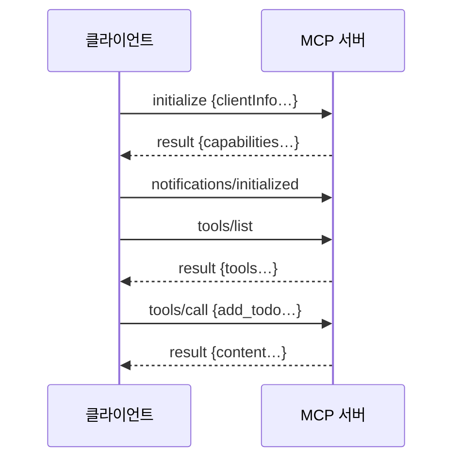

> Spring으로 만든 MCP 서버를 stdio·Streamable HTTP·레거시 SSE 세 통로로 직접 붙이고 일부러 깨뜨려 봤습니다. 메시지는 어느 통로로 보내도 같고, 깨지는 자리는 통로마다 다르다는 것을 확인한 기록입니다.
{: .prompt-info }
<!-- post-check: tone=polite -->

"LLM 통신 스택" 시리즈 3편입니다. 1편 [SSE, LLM 시대에 다시 보기](/posts/sse-revisited-for-llm-streaming) · 2편 [Orca Router 앞에 LiteLLM 한 겹 끼우기](/posts/litellm-gateway-in-front-of-orca-router) · 4편 [꼬리에 꼬리를 무는 질문](/posts/llm-stack-deep-dive-qna) · 다음 편은 게이트웨이 뒤의 MCP와 인증·보안을 다룰 예정입니다.

## Connected인데, 로그에는 에러가 네 번

사내 할 일 서비스의 백엔드를 맡은 제게 어느 날 이런 요청이 왔다고 해 보겠습니다.

> "로재님! Claude에서 우리 할 일 목록을 바로 읽고 추가하게 하고 싶어요. MCP 서버 하나 만들어 주세요."

Spring AI 스타터를 넣고 `@Tool` 메서드 네 개를 붙이니 30분 만에 됐습니다. Claude Code에 등록하고 `claude mcp list`를 치니 이렇게 나옵니다.

```
todo-stdio-broken: java -jar spring-mcp-sample.jar ... - ✔ Connected
```

서버 이름의 `broken`이 말해 주듯, 이 서버는 아래 실험 4에서 이 증상을 재현하려고 일부러 stdout에 배너와 로그를 흘리게 등록한 것입니다. 그런데 같은 서버의 디버그 로그에는 이런 줄이 네 번 찍혀 있습니다.

```
[ERROR] MCP server "todo-stdio-broken" Ignoring non-JSON line on stdout: JSON Parse error
```

연결은 됐다는데 파싱 에러가 납니다. 그리고 곧이어 두 번째 질문이 옵니다.

> "근데 MCP가 정확히 뭐예요? REST API랑 뭐가 달라요? 결국 JSON 주고받는 거잖아요."

저는 "LLM용 플러그인 규격"이라고 답했고, 그 답이 마음에 안 들었습니다. 그 말로는 stdio가 뭔지, 회사에서 붙였다는 SSE와 Streamable HTTP가 왜 따로 있는지, 위의 로그가 왜 에러이면서 동시에 Connected인지 설명이 안 됩니다.

그래서 프레임워크가 감춰 주는 부분을 걷어 내고 직접 해 봤습니다. 파이프에 JSON을 한 줄씩 밀어 넣고, curl로 세션 헤더를 빼먹어 보고, 서버 프로세스를 죽여 봤습니다. 결론은 한 줄입니다.

**메시지는 JSON-RPC 하나고, 다른 건 통로뿐입니다.**

## MCP는 두 층입니다 – 메시지와 통로

MCP(Model Context Protocol)는 LLM 애플리케이션(Claude Code 같은 호스트)이 바깥의 도구와 데이터에 접근하는 **약속**입니다. 이 약속은 두 층으로 나뉩니다. 위의 **메시지 층**은 봉투 모양과 메서드 이름을 정하고, 바꿀 수 없습니다. 이것이 MCP입니다. 아래의 **통로 층**은 그 봉투를 어디로 나를지 정하고, 상황에 맞게 고릅니다.

처음 보는 용어가 섞여 있지만, 통로 층 절까지 읽은 뒤 다시 보면 모든 칸이 읽힙니다. 아래 그림은 같은 `tools/list` 한 줄이 세 통로로 내려갈 때 무엇이 같고 무엇이 달라지는지를 한 장에 놓은 것입니다. 위 칸은 어느 통로에서도 그대로이고, 아래 세 칸에서 요청을 넣는 자리·응답이 오는 자리·세션을 구분하는 방법·서버가 죽었을 때 보이는 신호만 다릅니다.

<figure class="post-figure post-figure--diagram" id="figure-layers" aria-labelledby="layers-caption">
  <div class="figure-head"><small>01 · 두 층</small>같은 JSON 한 줄이 세 통로로 내려가고, 통로마다 다른 것은 자리와 신호뿐입니다</div>
  <picture class="diagram-wide"></picture>
  <picture class="diagram-narrow"></picture>
  <figcaption id="layers-caption">위에서 아래로 읽습니다. 실선은 지금 쓰는 통로, 점선은 2025-03-26 스펙에서 Streamable HTTP로 대체된 레거시 SSE 전송입니다(이 글의 실험 3에서 실제로 열어 봤습니다). 레거시 SSE의 경로는 실험 3에서 본 것이며 경로는 구현마다 다릅니다. "죽으면" 행 중 stdio만 이 글의 관찰값(원인 3)이고, 나머지는 스펙과 구조에서 추론한 것입니다.<a class="diagram-source diagram-wide" href="/assets/img/posts/2026-09-27-mcp-jsonrpc-and-transports/layers-desktop.svg" target="_blank" rel="noopener">두 층 그림 원본 보기 ↗</a><a class="diagram-source diagram-narrow" href="/assets/img/posts/2026-09-27-mcp-jsonrpc-and-transports/layers-mobile.svg" target="_blank" rel="noopener">두 층 그림 원본 보기 ↗</a></figcaption>
</figure>

REST API와의 차이가 여기서 나옵니다. REST는 자원마다 URL이 다르고 동사는 HTTP 메서드입니다. MCP는 **주소가 하나**고, 무엇을 할지는 JSON 안의 `method` 필드가 정합니다. 그래서 통로가 HTTP가 아니어도 됩니다.

> **쉽게 말하면** MCP는 **택배 규격**입니다. 송장(JSON-RPC 봉투)에 무엇을 적을지는 정해져 있고, 그 상자를 오토바이(stdio)로 보내든 트럭(HTTP)으로 보내든 받는 쪽은 송장만 봅니다.
{: .prompt-tip }

위 칸부터 보겠습니다. 송장에는 정확히 무엇이 적혀 있을까요.

## 메시지 층 – JSON-RPC 2.0 한 장

"결국 JSON이잖아요"는 맞습니다. 다만 아무 JSON이 아니라 **JSON-RPC 2.0**이라는 오래된 규격입니다. 봉투는 세 종류뿐입니다.

| 종류 | 필수 필드 | 답이 오나 |
|------|-----------|-----------|
| 요청 (request) | `jsonrpc`, `id`, `method` (+ 선택 `params`) | 옵니다. 같은 `id`로 |
| 응답 (response) | `jsonrpc`, `id`, `result` 또는 `error` | - |
| 알림 (notification) | `jsonrpc`, `method` (+ 선택 `params`, `id` 없음) | 안 옵니다 |

```json
{"jsonrpc":"2.0","id":2,"method":"tools/list"}
{"jsonrpc":"2.0","id":2,"result":{"tools":[…]}}
{"jsonrpc":"2.0","method":"notifications/initialized"}
```

위에서부터 요청, 그 요청의 응답, 알림의 예입니다.

`id`가 있으면 답을 기다리는 요청이고, 없으면 "알려만 주는" 알림입니다. 같은 번호가 적힌 답장이 돌아오고, 번호 없는 안내문에는 답장이 없습니다. 이 규칙은 통로와 무관합니다. 뒤의 실험에서 stdio로 보낸 `tools/list`와 curl로 보낸 `tools/list`는 **같은 JSON입니다**(공백 차이뿐).

MCP가 여기에 얹는 것은 메서드 이름뿐입니다. 이 글에서 쓰는 것은 네 개입니다.

| 메서드 | 누가 보내나 | 뜻 |
|--------|-------------|-----|
| `initialize` | 클라이언트 → 서버 | 프로토콜 버전과 서로의 기능(capabilities)을 교환합니다 |
| `notifications/initialized` | 클라이언트 → 서버 | "준비 끝" 알림. 답이 없습니다 |
| `tools/list` | 클라이언트 → 서버 | 서버가 가진 도구 목록과 입력 스키마를 받습니다 |
| `tools/call` | 클라이언트 → 서버 | 도구 하나를 인자와 함께 실행합니다 |

순서도 정해져 있습니다. `initialize`로 서로 할 줄 아는 것을 밝히고, 답이 없는 `initialized` 알림으로 시작을 알린 뒤에야 본론(`tools/list`, `tools/call`)이 시작됩니다.



실선은 요청과 알림, 점선은 응답입니다. `notifications/initialized` 알림에는 답이 없습니다. 클라이언트는 이 글에서 Claude Code, curl, 파이썬이고 서버는 Spring입니다.

메시지 층에서 배울 것은 이 정도입니다. 이 봉투가 실제로 어디로 오가는지가 아래 칸, 통로 층입니다.

## 통로 층 – stdio, Streamable HTTP, 레거시 SSE

회사에서 "stdio로 붙였다"는 말과 "SSE로 붙였다"는 말은 **같은 서버를 다른 통로로 열었다**는 뜻입니다. 그림의 아래 세 칸을 하나씩 풀면 이렇습니다.

**stdio**는 처음부터 있던 통로입니다. 같은 컴퓨터에서 클라이언트가 서버를 **자식 프로세스**로 띄우고, 서버의 stdin에 요청을 한 줄 쓰고 stdout에서 응답을 한 줄 읽습니다. 프로세스 자체가 세션이고, 서버가 죽으면 파이프가 끊깁니다(EOF). stdout이 통로이므로 로그는 stdout이 아닌 곳(stderr·파일)에 써야 합니다.

**Streamable HTTP**(2025-03-26 스펙)는 네트워크 너머에서 서버가 HTTP 포트를 열고 엔드포인트 하나(흔한 기본 경로는 `POST /mcp`)로 모든 요청을 받습니다. 응답은 그 POST의 응답으로 오는데, 형식은 `application/json`일 수도 있고 `text/event-stream`(SSE 형식)일 수도 있습니다. 세션을 쓰는 서버라면(세션 ID 발급은 서버의 선택입니다) `Mcp-Session-Id` 헤더로 구분하고 `DELETE`로 끝냅니다. 서버가 죽으면 연결이 거부되고 세션이 사라집니다.

**SSE 전송**(2024-11-05 스펙)은 지금은 대체된 레거시입니다. `GET` 스트림(흔한 기본 경로는 `/sse`)을 항상 열어 두면 첫 `endpoint` 이벤트가 POST할 주소를 알려 줍니다. 실험 3에서는 `/mcp/message?sessionId=…`였습니다. 요청은 그 주소로 따로 보내고, 답은 열어 둔 스트림으로 옵니다. 세션은 그 URL의 `sessionId`로 구분하는데 이것도 SDK·프레임워크의 관례이고, 서버가 죽으면 스트림이 끊깁니다. 옛 클라이언트 호환을 위해 남아 있습니다.

이름이 헷갈리는 이유는 **SSE라는 단어가 두 층에 걸쳐 있기 때문**입니다. 1편에서 본 SSE(Server-Sent Events)는 HTTP 응답의 한 형식입니다. Streamable HTTP는 이 형식을 응답 **안에 품고** 씁니다. 반면 "SSE 전송"은 통로 이름이고, `GET /sse`를 항상 열어 두는 옛 방식입니다. POST 하나로 합친 것이 Streamable HTTP이고, 요청과 응답이 두 연결로 나뉘던 번거로움이 그 한 가지 이유입니다.

## 그래서 어느 통로를 쓰나요

셋을 다 외울 필요는 없습니다. 먼저 묻는 것은 **서버가 어디서 도나**이고, 다른 곳이라면 새로 만드는지 이미 있는 서버에 붙는지를 봅니다.

| 조건 | 통로 | 왜 |
|---|---|---|
| 서버가 내 컴퓨터에서 돈다 | stdio | 포트·인증 없음 |
| 다른 곳에서 돌고 새로 만든다 | Streamable HTTP | 여러 사용자·로그인 |
| 이미 SSE 전송으로 서 있는 서버에 붙는다 | 레거시 SSE 병행 | 새로 만들지 않음 |

stdio는 설정이 명령어 한 줄입니다. 포트·인증·네트워크가 없고, 호스트가 서버를 띄우고 죽여 줍니다. **개수로도 stdio가 압도적입니다.** 로컬 파일, 로컬 DB, CLI 도구를 LLM에 붙이는 공식 filesystem·git 서버와, `npx`·`uvx` 한 줄로 까는 대부분의 커뮤니티 서버가 여기에 속합니다. 스펙도 "클라이언트는 가능하면 stdio를 지원해야 한다"고 적습니다.

그런데 이 글의 출발이었던 "우리 **서비스**도 붙여 주세요"는 Streamable HTTP 쪽입니다. 여러 사람이 같은 서버를 쓰고, 누가 호출했는지 알아야 하고(로그인, OAuth), 로드밸런서 뒤에서 늘려야 하며, 서버 배포가 앱과 분리됩니다. GitHub, Sentry, Atlassian 같은 원격 MCP와 사내 공용 도구 서버가 이쪽입니다. 회사에서 stdio로 시작했다가 HTTP로 옮기는 흐름이 흔한 이유입니다.

"대부분의 서비스는 SSE 아니에요?"는 반만 맞습니다. 2025년 3월 전까지 원격 MCP의 통로가 HTTP+SSE뿐이어서, 그때의 원격 서버·튜토리얼·프레임워크 기본값(Spring AI 1.0.x)은 SSE 전송이고 **기존 원격 서버에는 아직 많습니다.** 클라이언트도 받아 줍니다(`claude mcp add --transport sse`). 스펙의 호환 절차는 같은 서버 URL로 `POST` initialize를 먼저 보내고, 4xx(405·404 등)가 오면 같은 URL로 `GET`을 열어 `endpoint` 이벤트를 기다리는 것입니다. 새로 만드는 서버와 그 뒤 나온 SDK는 Streamable HTTP입니다.

📌 "SSE 쓴다"는 말을 들으면 엔드포인트를 보세요. `GET /sse` 스트림과 `POST /mcp/message?sessionId=`(실험 3의 경로)처럼 둘로 나뉘어 있으면 레거시 전송, `POST /mcp` 하나에 `Mcp-Session-Id`면 Streamable HTTP입니다. `/mcp`·`/sse`·`/message`는 스펙이 정한 경로가 아니라 SDK·프레임워크가 흔히 쓰는 기본 경로이므로 이름보다 이 모양을 보세요. Streamable HTTP도 응답은 SSE 형식으로 주기 때문에 이름만으로는 구분이 안 됩니다.

여기까지는 스펙과 그림으로 정리한 것입니다. 정말 메시지가 같은지, 통로마다 무엇이 다르게 보이는지는 직접 보내 봐야 압니다.

## 실습 준비

| 항목 | 값 |
|------|-----|
| Spring Boot | 3.2.2 (Java 21.0.10) |
| Spring AI | 1.1.8 (`spring-ai-bom`, 원래 1.0.3이었는데 올렸습니다. 이유는 원인 4에서) |
| MCP Java SDK | 0.18.3 (Spring AI 1.1.8이 끌어옵니다) |
| 서버 프로필 | `stdio`, `streamable`(Tomcat, 8091), `sse`(Netty, 8092) |
| 레거시 SSE 관측(실험 3) | `spring-ai-bom` 1.0.3으로 빌드한 회차. 1.1.8의 `sse` 프로필은 이 글에서 확인하지 않았습니다 |
| DB | PostgreSQL 15 (docker, 5434) |
| 손 클라이언트 | Python 3.9 파이프 클라이언트 60줄, curl 8.7.1 |
| 진짜 클라이언트 | Claude Code 2.1.267 (`claude mcp add`) |

서버는 [spring-mcp-sample](https://github.com/rojae/spring-sample/tree/main/spring-mcp-sample)입니다. 도구는 넷입니다: `add_todo`, `list_todos`, `complete_todo`, `delete_todo`. 프레임워크가 하는 일은 `@Tool` 메서드를 `tools/list`에 싣고, `tools/call`이 오면 호출해 주는 것뿐입니다.

```java
@Service
public class TodoService {
    @Tool(name = "add_todo", description = "Add a new todo item with the given title")
    public String addTodo(@ToolParam(description = "The title of the todo") String title) { … }
}
```

```bash
cd spring-mcp-sample
docker compose up -d                 # postgres:15 (5434)
./gradlew bootJar
JAR=build/libs/spring-mcp-sample-0.0.1-SNAPSHOT.jar

java -jar $JAR --spring.profiles.active=streamable --server.port=8091   # 통로 2
# 통로 3. 실험 3은 spring-ai-bom 1.0.3으로 다시 빌드한 jar
java -jar $JAR --spring.profiles.active=sse        --server.port=8092
# 통로 1 (stdio) 은 클라이언트가 직접 띄웁니다. 아래 참고.
```

## 손으로 보내 보기

같은 메시지를 세 통로로 손으로 보내 보고, 마지막에 진짜 클라이언트에 붙입니다.

### 실험 1 – stdio를 손으로: 파이프에 JSON 한 줄씩

프레임워크 없이 통로의 맨살을 보려고, 서버를 자식 프로세스로 띄워서 stdin에 JSON을 쓰고 stdout을 읽는 파이썬 60줄을 짰습니다. 핵심은 이게 전부입니다.

```python
proc = subprocess.Popen(cmd, stdin=PIPE, stdout=PIPE, stderr=PIPE, text=True)

def send(obj):                                  # 한 줄 = 메시지 하나
    proc.stdin.write(json.dumps(obj) + "\n"); proc.stdin.flush()

send({"jsonrpc": "2.0", "id": 1, "method": "initialize",
      "params": {"protocolVersion": "2024-11-05", "capabilities": {},
                 "clientInfo": {"name": "tiny-client", "version": "0.1"}}})
send({"jsonrpc": "2.0", "method": "notifications/initialized"})
send({"jsonrpc": "2.0", "id": 2, "method": "tools/list"})
send({"jsonrpc": "2.0", "id": 3, "method": "tools/call",
      "params": {"name": "add_todo", "arguments": {"title": "MCP 3편 쓰기"}}})
# stdout 에서 한 줄씩 읽어 json.loads. 실패하면 [NOT JSON] 으로 표시합니다.
```

<figure class="post-figure">
  
  <figcaption>stdout 설정을 정리한 서버(설정은 원인 1)로 돌린 정상 왕복 한 회차. 각 응답까지 걸린 시간과, stdout에 JSON이 아닌 줄이 없는 것을 보면 됩니다.</figcaption>
</figure>

관측한 것은 셋입니다. stdout에는 JSON 응답 세 줄(id 1·2·3)만 있었고 알림에는 응답이 없었습니다. 응답마다 보낸 요청과 같은 `id`가 붙어 왔습니다. `tools/call`의 결과는 `content` 배열이었습니다. 시간은 `initialize` 응답까지 1871ms, `tools/list` 8ms, `tools/call` 64ms였습니다(이 회차 한 번의 값).

이것을 이렇게 읽습니다.

- 통로가 정말 **"한 줄 = 메시지 하나"**입니다. 줄바꿈이 봉투의 경계입니다.
- `content` 배열의 각 항목 `text`가 그대로 LLM에게 갑니다.
- 첫 응답까지 1.8초는 MCP가 느린 게 아니라 Spring Boot 기동입니다. stdio에서는 이 기동 시간이 곧 **연결 시간**입니다.

### 실험 2 – Streamable HTTP를 curl로: 세션 헤더 하나

같은 JSON을 이번엔 HTTP로 보냅니다. 다른 건 딱 둘입니다. `Accept` 헤더에 `application/json, text/event-stream`을 둘 다 적어야 하고, `initialize` 응답 헤더로 받은 `Mcp-Session-Id`를 그 뒤 모든 요청에 붙여야 합니다.

```bash
# bash에서 실행합니다. $H는 따옴표 없이 펼쳐 헤더 두 개가 됩니다
B=http://localhost:8091/mcp
H='-H Content-Type:application/json -H Accept:application/json,text/event-stream'

curl -s -D /tmp/h1 $H -X POST $B -d '{"jsonrpc":"2.0","id":1,"method":"initialize",
  "params":{"protocolVersion":"2025-03-26","capabilities":{},"clientInfo":{"name":"curl","version":"0"}}}'
SID=$(grep -i '^mcp-session-id' /tmp/h1 | awk '{print $2}' | tr -d '\r')

curl -s $H -H "Mcp-Session-Id: $SID" -X POST $B -d '{"jsonrpc":"2.0","method":"notifications/initialized"}'
curl -s $H -H "Mcp-Session-Id: $SID" -X POST $B -d '{"jsonrpc":"2.0","id":2,"method":"tools/list"}'
# 세션 없이
curl -s $H -X POST $B -d '{"jsonrpc":"2.0","id":2,"method":"tools/list"}'
# 세션 종료
curl -s -H "Mcp-Session-Id: $SID" -X DELETE $B
```

<figure class="post-figure">
  
  <figcaption>Streamable HTTP 한 세션의 8단계. initialize 200(+Mcp-Session-Id) → initialized 202 → tools/list 200(text/event-stream) → 세션 없이 400 → 엉터리 세션 404 → tools/call 200 → DELETE 200 → 종료된 세션으로 404. 단계별 상태 코드와 Content-Type을 보면 됩니다.</figcaption>
</figure>

관측한 것은 셋입니다.

- `initialize` 응답은 `application/json`인데, `tools/list` 응답은 **`text/event-stream`**으로 왔습니다. 같은 POST인데 서버가 응답 형식을 고릅니다. 이름에 "Streamable"이 붙은 이유입니다.
- 세션 헤더를 빼면 **400 `Session ID missing`**, 엉터리를 넣으면 **404 `Session not found`**입니다. JSON-RPC 오류가 아니라 HTTP 상태 코드로 옵니다. 왜 그런지는 원인 2에서 다룹니다.
- `DELETE`로 세션을 닫으면 같은 ID는 그 즉시 404가 됩니다.

### 실험 3 – 레거시 SSE 전송: 통로가 두 개

이 실험만 Spring AI 1.0.3으로 별도 실행한 회차입니다. 1편의 SSE가 여기서 어떻게 쓰였는지 보려고 `sse` 프로필을 열어 봤습니다. 이쪽은 응답이 **요청을 보낸 연결로 오지 않습니다.**

```bash
# 실험 3은 spring-ai-bom 1.0.3으로 다시 빌드한 jar
java -jar $JAR --spring.profiles.active=sse --server.port=8092
bash scripts/sse_curl.sh      # GET /sse 를 열어 둔 채 POST 두 번, 스트림에 쌓인 것을 출력
```

<figure class="post-figure">
  
  <figcaption>레거시 SSE 전송. Spring AI 1.0.3으로 별도 실행한 회차입니다. GET /sse 스트림의 첫 이벤트, POST 두 번의 응답 본문 크기, 스트림에 쌓인 event: message 두 개를 보면 됩니다.</figcaption>
</figure>

- `GET /sse`를 열면 첫 이벤트(`event: endpoint`)로 **어디에 POST 하라는 주소**(`/mcp/message?sessionId=…`)가 옵니다.
- 그 주소로 `initialize`를 POST 하면 HTTP 응답은 200인데 **본문이 비어 있습니다(0 bytes).** 진짜 답은 스트림 쪽에 `event: message`로 옵니다.
- 요청과 응답이 다른 연결로 오가니, 로드밸런서 뒤에서는 두 연결이 같은 서버로 가야 합니다. Streamable HTTP가 이걸 하나로 합친 한 가지 이유입니다.

### 실험 4 – Claude Code에 붙이기

손으로 다 해 봤으니 이제 진짜 클라이언트에 등록합니다. 정상 stdio, 일부러 stdout에 배너와 INFO 로그를 흘리는 stdio, 그리고 Streamable HTTP 세 가지입니다.

```bash
claude mcp add -s local todo-stdio -- java -jar $JAR --spring.profiles.active=stdio
claude mcp add -s local todo-stdio-broken -- java -jar $JAR --spring.profiles.active=stdio \
      --spring.main.banner-mode=console --logging.level.root=INFO
claude mcp add -s local --transport http todo-http http://localhost:8091/mcp
claude mcp list
```

<figure class="post-figure">
  
  <figcaption>claude mcp add 세 번 뒤의 claude mcp list. 정상 stdio, 로그를 흘리는 stdio, Streamable HTTP 각각의 상태 표시를 보면 됩니다.</figcaption>
</figure>

셋 다 "✔ Connected"였습니다. 일부러 stdout에 로그를 흘린 `todo-stdio-broken`까지 통과했다는 것이 첫 번째 의문입니다.

## 일부러 깨뜨려 보기 – 깨지는 자리 네 곳

여기까지는 다 됐습니다. 일부러 망가뜨리기 시작하자 네 가지에서 갸웃했습니다.

1. stdio 서버의 첫 인사는 멀쩡한데, 첫 `tools/call`에서 손 클라이언트에 JSON이 아닌 줄이 16줄 섞였습니다. 그런데 같은 종류로 망가뜨린 서버를 Claude Code는 "Connected"라고 했습니다.
2. Streamable HTTP에서 세션 헤더를 빼먹으면 JSON-RPC `error`가 아니라 HTTP 400이 왔습니다. 엉터리 ID는 404였습니다.
3. stdio 서버 프로세스를 죽였더니 클라이언트가 본 것은 에러 메시지가 아니라 `BrokenPipeError`와 EOF였습니다.
4. README에는 Streamable HTTP라고 써 있는데 `/mcp`가 404였습니다. 심지어 `/sse`도 404였습니다.

넷 다 "MCP가 안 돼요" 한 문장으로 보고될 일입니다. 그런데 자리가 전부 다릅니다. 하나는 통로가 오염된 것, 하나는 통로 층의 세션 규칙, 하나는 통로의 수명, 하나는 통로가 아예 안 열린 것입니다. 메시지 층(JSON-RPC)의 문제는 하나도 없었습니다. 다만 이번 실험은 처음부터 통로를 깨뜨리도록 설계했고, 메시지를 일부러 틀리게 보내는 실험은 하지 않았습니다. 그 범위 안에서 하나씩 원인을 따라가 봅니다.

### 원인 1 – stdout은 통로입니다, 로그 통로가 아닙니다

수정 전 서버로 실험 1을 처음 돌렸을 때의 원문입니다. `initialize`와 `tools/list`까지는 깨끗했습니다. DB를 건드리지 않으니까요. 첫 `tools/call`에서 INSERT가 나가는 순간, stdout에 SQL이 쏟아졌습니다.

<figure class="post-figure">
  
  <figcaption>수정 전 서버, 실험 1과 같은 손 클라이언트. tools/call 한 번에 stdout으로 나온 JSON이 아닌 줄 16줄([NOT JSON])을 보면 됩니다. 포맷된 insert 문과 Hibernate DEBUG 로그입니다. 줄 끝의 '깨진다' 표시는 엄격한 파서였다면 실패했을 자리를 손 클라이언트가 표시한 것이고, 이 클라이언트는 다음 줄로 넘어갔습니다.</figcaption>
</figure>

stdio 통로에서 **stdout은 곧 메시지 채널**입니다. 한 줄이 곧 봉투입니다. 그런데 Spring의 `spring.jpa.show-sql: true`는 로거가 아니라 `System.out`으로 SQL을 찍습니다. 배너도 마찬가지입니다. 로그 레벨을 아무리 낮춰도 이 둘은 stdout으로 갑니다. 여기에 Spring Boot의 기본 콘솔 로거도 stdout으로 씁니다. 첫 인사에서는 안 보이니 "붙었다"고 착각하기 딱 좋습니다. 손 클라이언트는 이 줄들을 `[NOT JSON]`으로 표시하고 넘어가 뒤의 응답을 정상으로 받았습니다. 그 자리는 줄 단위로 엄격하게 파싱하는 클라이언트라면 깨지는 곳입니다.

일부러 더 세게 망가뜨려 봤습니다. 배너를 켜고 root 로그를 INFO로 stdout에 흘리면 `initialize` 응답이 오기도 전에 JSON이 아닌 줄이 쏟아집니다. 손 클라이언트는 이번에도 이 줄을 `[NOT JSON]`으로 표시하고 넘어갔고, 엄격한 클라이언트라면 첫 줄에서 깨지는 자리입니다.

<figure class="post-figure">
  
  <figcaption>배너 + INFO 로그를 stdout으로 보낸 회차. 397ms부터 나온 JSON이 아닌 줄 29줄과, 그 뒤에야 도착한 첫 JSON 응답을 보면 됩니다. 줄 끝의 '깨진다' 표시는 엄격한 파서였다면 실패했을 자리를 손 클라이언트가 표시한 것이고, 이 클라이언트는 다음 줄로 넘어갔습니다.</figcaption>
</figure>

그런데 같은 망가진 서버를 Claude Code는 "Connected"라고 했습니다. 실제로 도구를 호출해 보고 디버그 로그를 열어 봤습니다.

<figure class="post-figure">
  
  <figcaption>claude -p --debug-file로 망가진 stdio 서버(todo-stdio-broken)의 list_todos를 호출한 회차. 정상 결과(12개)와, 디버그 로그에 4번 찍힌 "Ignoring non-JSON line on stdout: JSON Parse error"를 함께 보면 됩니다.</figcaption>
</figure>

결과는 정상(12개)인데 로그에는 에러가 4번 있습니다. 이 4번은 `list_todos`를 호출한 이 회차에서 stdout으로 나온 줄에서 찍힌 것입니다. 버틴 것이지 괜찮은 게 아닙니다. 디버그 로그로 보면 Claude Code는 JSON으로 안 읽히는 줄을 **에러로 기록하고 넘어갔습니다**(같은 종류로 망가뜨린 손 클라이언트 회차에서는 29줄이었는데 4건만 기록된 이유는 확인하지 않았습니다). 그래서 겉으로는 됩니다. 하지만 스펙은 stdio 서버가 stdout에 MCP 메시지 아닌 것을 쓰면 안 된다고 못 박습니다. 엄격한 클라이언트는 깨지고, 로그 한 줄이 `{`로 시작하는 순간에는 관대한 클라이언트도 엉뚱한 메시지를 파싱하게 됩니다.

> **쉽게 말하면** stdio 서버에게 stdout은 **전화선**입니다. 통화 중에 옆에서 라디오(로그)를 틀면, 상대가 눈치껏 걸러 듣거나(이 글의 두 클라이언트) 못 알아듣고 끊습니다(엄격한 클라이언트). 라디오는 다른 방(stderr, 파일)에서 틀어야 합니다.
{: .prompt-tip }

해결은 stdio 프로필에서 stdout으로 가는 것을 전부 끄는 것입니다. 로그는 stderr로 보내거나 파일로 보냅니다.

```yaml
# application-stdio.yml
spring:
  main:
    banner-mode: off          # 배너는 System.out 으로 갑니다
    web-application-type: none
  ai:
    mcp:
      server:
        stdio: true
  jpa:
    show-sql: false           # 이것도 System.out 입니다. 로거가 아닙니다
logging:
  level:
    root: OFF                 # 필요하면 logging.file.name 으로 파일에
    org.hibernate.SQL: OFF
    org.hibernate.orm.jdbc.bind: OFF
```

이렇게 고친 뒤의 결과가 실험 1의 캡처입니다. JSON이 아닌 줄이 0이 됩니다.

> Spring Boot에서 stdout으로 가는 것은 로거만이 아닙니다. `banner-mode`, `spring.jpa.show-sql`, `System.out.println`, 그리고 Hibernate의 `hibernate.show_sql`이 다 해당합니다. stdio 프로필을 만들면 `java -jar … | head`로 첫 줄이 `{`인지 눈으로 확인하세요.
{: .prompt-warning }

### 원인 2 – 세션은 헤더 하나로 이어집니다

stdio는 프로세스가 곧 세션이라 이런 문제가 없습니다. Streamable HTTP는 다릅니다. 요청마다 독립된 HTTP 요청이라, 서버는 "이 요청이 아까 `initialize`한 그 클라이언트인가"를 알 방법이 헤더뿐입니다. 그래서 세션을 쓰는 서버라면(세션 ID 발급은 서버의 선택입니다) `initialize` 응답에 `Mcp-Session-Id`를 실어 주고, 그 뒤 모든 요청에 되돌려 받기를 요구합니다.

실험 2의 4·5·8번이 이 규칙의 세 얼굴입니다.

| 상황 | 어느 층의 오류 | 응답 | 뜻 |
|------|----------------|------|-----|
| 헤더 자체가 없다 | 통로 (HTTP) | `400` | `Session ID missing`. 봉투를 열기 전에 반려 |
| 헤더는 있는데 모르는 값 | 통로 (HTTP) | `404` | `Session not found`. 그 세션이 없다. 만료·재시작·DELETE 뒤 |
| 세션은 맞는데 없는 도구 이름 | 메시지 (JSON-RPC) | `200 + error` | JSON-RPC `error`(-32602). 봉투는 열렸고, 요청이 틀렸다 |
| 도구 실행이 실패 | 메시지 (도구 결과) | `200 + isError` | `result.isError: true`. 봉투는 열렸고, 도구가 실패했다 |

앞의 두 줄은 실험 2에서 관찰한 응답이고, 뒤의 두 줄은 스펙 기준 서술이며 이 글에서 캡처하지 않았습니다.

위아래 두 줄씩의 차이가 핵심입니다. **통로 층의 오류는 HTTP 상태 코드로, 메시지 층의 오류는 JSON-RPC `error`로 옵니다.** 클라이언트를 만든다면 상태 코드로 먼저 분기합니다. 404면 세션 없이 `initialize`부터 다시 하고, 400이면 헤더를 빠뜨린 것이니 헤더 누락을 고칩니다. 서버가 재시작되면 메모리의 세션은 사라지니, 멀쩡히 붙어 있던 클라이언트가 어느 날 갑자기 404를 받는 것도 이 경우입니다.

> **쉽게 말하면** `Mcp-Session-Id`는 **놀이공원 손목 밴드**입니다. 입장(`initialize`)할 때 받고, 놀이기구(`POST /mcp`)마다 보여 줘야 합니다. 밴드 없이 가면 "입장부터 하세요"(400), 어제 밴드를 차고 가면 "오늘 것이 아닙니다"(404)입니다. 밴드가 맞아야 비로소 용건(JSON-RPC)을 들어 줍니다.
{: .prompt-tip }

stdio에는 이 규칙이 없습니다. 프로세스 하나가 곧 세션 하나라서 세션 ID를 잃어버릴 방법이 없습니다. 대신 프로세스가 죽으면 세션도 같이 죽습니다. 그게 세 번째입니다.

### 원인 3 – 프로세스가 죽으면 파이프도 죽습니다

`tools/list`까지 마친 뒤 서버에 `SIGKILL`을 보내고, 그다음 `tools/call`을 써 봤습니다.

<figure class="post-figure">
  
  <figcaption>tools/list 뒤 1654ms에 SIGKILL을 보낸 회차. 2159ms의 tools/call이 stdin 쓰기에서 받은 BrokenPipeError, stdout의 EOF, 서버 exit code -9를 보면 됩니다.</figcaption>
</figure>

캡처 어디에도 "에러"라는 JSON은 없습니다. 메시지 층에서는 아무 일도 일어나지 않습니다. `{"error": …}` 같은 응답이 올 리가 없습니다. 답을 써 줄 프로세스가 없으니까요. 클라이언트가 보는 것은 운영체제 수준의 신호뿐입니다. 읽던 stdout이 EOF가 되고, 쓰던 stdin이 `BrokenPipe`가 됩니다. 그래서 **EOF를 "세션 종료"로 해석하고 프로세스를 다시 띄우는** 것은 클라이언트의 책임입니다(스펙과 구조상). 이 글에서 Claude Code의 재연결 동작은 따로 확인하지 않았습니다.

| 서버가 죽었을 때 | stdio (원인 3에서 관찰) | Streamable HTTP (스펙·구조상 추론, 미관찰) |
|------------------|-------|-----------------|
| 클라이언트가 보는 것 | stdout EOF, stdin `BrokenPipe` | `connection refused`, 살아난 뒤엔 404 `Session not found` |
| 누가 다시 띄우나 | **클라이언트** (자식 프로세스니까) | 서버 운영자 (systemd, k8s …) |
| 다시 붙는 법 | 프로세스 재실행 → `initialize`부터 | 연결 재시도 → `initialize`부터 |
| 죽기 전 상태 | 프로세스와 함께 사라집니다 | 서버 메모리의 세션이 사라집니다 |

세 원인은 모두 통로가 열린 뒤의 일이었습니다. 마지막은 통로가 아예 열리지 않은 경우입니다.

### 원인 4 – 스타터 세 개를 다 넣으면 통로가 안 열립니다

이건 MCP의 문제가 아니라 제 샘플의 문제였는데, 통로가 "안 열리는" 모양을 잘 보여 줘서 남깁니다. 샘플은 처음에 Spring AI 1.0.3이었고, `streamable` 프로필에 `protocol: STREAMABLE`이라고 적어 뒀습니다. 그런데 curl은 404였습니다.

<figure class="post-figure">
  
  <figcaption>404의 정체를 세 단계로 따라간 기록(Spring AI 1.0.3 → 1.1.8). ① SDK 0.10.0 jar의 전송 클래스 목록 ② --debug 조건 평가 보고서에서 건너뛰어진 WebMvc 자동설정 ③ 1.1.8에서의 빈 2개 충돌 메시지를 차례로 보면 됩니다.</figcaption>
</figure>

세 겹이었습니다.

1. **Spring AI 1.0.3에는 Streamable HTTP가 없습니다.** 1.0.x가 쓰는 MCP Java SDK 0.10.0에는 `Stdio…`와 `…Sse…` 전송 클래스뿐입니다. `protocol: STREAMABLE`은 아무도 읽지 않는 설정이라 **경고 한 줄 없이 무시**됐습니다. Streamable HTTP는 Spring AI 1.1부터입니다.
2. **스타터 세 개(`mcp-server`, `-webflux`, `-webmvc`)가 다 있으면** servlet(Tomcat) 앱인데도 WebFlux 전송 빈이 먼저 만들어지고, WebMvc 자동설정은 건너뛰어집니다. 그래서 `/sse`마저 404였습니다. `--debug`로 켜는 조건 평가 보고서가 이걸 그대로 말해 줍니다.
3. **1.1.8로 올리니** 이번엔 WebFlux와 WebMvc 양쪽 전송 빈이 **둘 다** 만들어져서 `required a single bean, but 2 were found`로 기동이 실패했습니다.

해결은 프로필마다 쓰지 않는 쪽 자동설정을 `spring.autoconfigure.exclude`로 빼는 것입니다. 정확한 설정은 샘플 저장소의 `application-streamable.yml`에 있습니다.

📌 깔끔한 답은 프로젝트 하나에 스타터 하나만 두는 것입니다. 이 샘플은 세 통로를 한 jar로 보여 주려고 셋을 다 넣은 것뿐입니다.

> "설정은 있는데 아무 일도 안 일어난다"면 그 설정을 읽는 코드가 이 버전에 있는지부터 확인하세요. `unzip -l`로 jar 안의 클래스 이름을 훑는 게 문서보다 빠를 때가 있습니다.
{: .prompt-warning }

## Connected는 첫 인사일 뿐, 깨지는 자리는 통로에 있습니다

처음의 두 줄로 돌아가면 이제는 설명이 됩니다. Connected는 첫 인사가 JSON-RPC로 통과했다는 뜻이고(debug.log의 'Successfully connected' 기준), 에러 네 번은 그 통로에 JSON이 아닌 것이 섞였다는 뜻입니다. 둘은 다른 층의 이야기라 동시에 참일 수 있습니다. 실험에서 만난 네 증상을 층과 자리로 다시 놓으면 이렇습니다.

| 증상 | 층 · 통로 | 자리 |
|---|---|---|
| Connected+파싱 에러 | 통로 층 · stdio | stdout 오염 (원인 1) |
| HTTP 400, 404 | 통로 층 · HTTP | 세션 헤더 (원인 2) |
| `BrokenPipe`, EOF | 통로 층 · stdio | 프로세스 수명 (원인 3) |
| `/mcp`, `/sse` 404 | 통로가 열리기 전 · 프레임워크 설정 | 전송 설정 (원인 4) |

네 줄 모두 봉투 바깥입니다. 이번에 고친 것도 stdio 프로필의 yml 다섯 줄(배너, `show-sql`, 로그 레벨 셋)과 프로필별 `autoconfigure.exclude`, 헤더 하나, 버전 하나였고, 메시지 형식은 한 글자도 고치지 않았습니다. 그래서 MCP 서버를 붙일 때 확인할 것도 통로별로 나뉩니다.

| 구간 | 확인할 것 |
|------|-----------|
| 메시지 | 어느 통로든 JSON-RPC 2.0 한 줄. `initialize` → `initialized` → `tools/list` 순서를 건너뛰지 말 것 |
| stdio | stdout에 JSON 외엔 아무것도 쓰지 말 것. 배너·`show-sql`·콘솔 로거·`System.out` 전부. 로그는 stderr나 파일 |
| stdio | EOF·BrokenPipe = 세션 종료. 클라이언트가 재실행하고 `initialize`부터 |
| Streamable HTTP | `Accept`에 `application/json, text/event-stream` 둘 다. 세션을 받았다면 `Mcp-Session-Id`를 모든 요청에 (2025-03-26 기준. 이후 개정판(2025-06-18)에서는 `MCP-Protocol-Version` 헤더가 모든 요청에 추가됨) |
| Streamable HTTP | 상태 코드로 먼저 분기. 400이면 헤더 누락 수정, 404면 `initialize`부터. 메시지 오류는 JSON-RPC `error` |
| Spring AI | Streamable HTTP는 1.1부터. 스타터는 통로당 하나만. 안 열리면 `--debug` 조건 평가 보고서 |

이 구분이 바로 쓰이는 조건도 분명히 해 둡니다. 증상이 HTTP 상태 코드, EOF·BrokenPipe, 파싱 에러처럼 봉투 바깥에서 보이면 통로를 먼저 봅니다. 200 응답 안에 JSON-RPC `error`나 `isError: true`가 왔다면 통로는 정상이고 메시지 내용(도구 이름, 인자)이나 도구 실행을 봅니다. 그리고 오염된 stdout은 이 글의 두 클라이언트(Claude Code, 파이썬 손 클라이언트)가 모두 버리고 넘어갔지만, 스펙은 이것을 위반으로 정합니다. 관대한 클라이언트에서 통과했다는 사실을 서버가 규칙을 지켰다는 근거로 쓰지 않습니다.

여기서 관찰한 동작은 Spring AI 1.1.8(MCP Java SDK 0.18.3)과 Claude Code 2.1.267 조합에서 본 것이고, 실험 3과 원인 4의 ①②는 Spring AI 1.0.3(MCP Java SDK 0.10.0)에서 본 것입니다. 시간 값은 각각 한 회차의 관찰입니다.

처음 MCP 서버를 만든다면 프레임워크 클라이언트에 붙이기 전에 한 번은 손으로 첫 인사를 해 보길 권합니다. 60줄이면 되고, stdio 프로필이라면 기동 직후 stdout이 비어 있는지와 첫 DB 호출 뒤에도 그런지를 함께 볼 수 있습니다. 손 클라이언트(파이썬 파이프 클라이언트, curl 스크립트)와 `@Tool` 네 개짜리 할 일 서버, stdio·streamable·sse 프로필은 [spring-mcp-sample](https://github.com/rojae/spring-sample/tree/main/spring-mcp-sample)에 있습니다.

## 참고한 내용들

### 이 글에서 쓴 Spring 설정

`spring.ai.mcp.server.stdio`
: 기본값 `false`. `true`면 stdin/stdout 전송. 웹 서버는 `web-application-type: none`

`spring.ai.mcp.server.protocol`
: 기본값 `SSE`. 1.1.x부터. `STREAMABLE`이면 `POST /mcp`, 1.0.x는 무시

`spring.autoconfigure.exclude`
: 기본값 없음. 프로필마다 안 쓰는 전송(WebFlux/WebMvc) 자동설정 제거

`spring.main.banner-mode`, `spring.jpa.show-sql`
: 기본값 `console`, `false`. 둘 다 stdout으로 갑니다. stdio에서는 `off`, `false`

`logging.level.root`
: 기본값 `INFO`. stdio에서는 `OFF` 또는 `logging.file.name`으로 파일

### Reference Links

- [MCP Specification 2025-03-26 · Transports](https://modelcontextprotocol.io/specification/2025-03-26/basic/transports) - stdio, Streamable HTTP, 세션 헤더, stdout 규칙
- [MCP Specification 2025-06-18 · Transports](https://modelcontextprotocol.io/specification/2025-06-18/basic/transports) - 이후 개정판. `MCP-Protocol-Version` 헤더
- [MCP Specification 2024-11-05 · Transports](https://modelcontextprotocol.io/specification/2024-11-05/basic/transports) - 레거시 HTTP+SSE 전송
- [JSON-RPC 2.0 Specification](https://www.jsonrpc.org/specification)
- [Spring AI · MCP Server Boot Starter](https://docs.spring.io/spring-ai/reference/api/mcp/mcp-server-boot-starter-docs.html) - `protocol`, 스타터 종류, 자동설정
- [MCP Java SDK](https://github.com/modelcontextprotocol/java-sdk) - 전송 구현 클래스 이름들
- [Claude Code · MCP 서버 연결하기](https://docs.anthropic.com/en/docs/claude-code/mcp) - `claude mcp add`, `--transport http`, `--mcp-config`
- 👉 [SSE, LLM 시대에 다시 보기](/posts/sse-revisited-for-llm-streaming) - 1편. SSE 응답 형식 자체
- 👉 [spring-mcp-sample](https://github.com/rojae/spring-sample/tree/main/spring-mcp-sample) - 이 글의 샘플 서버와 손 클라이언트
