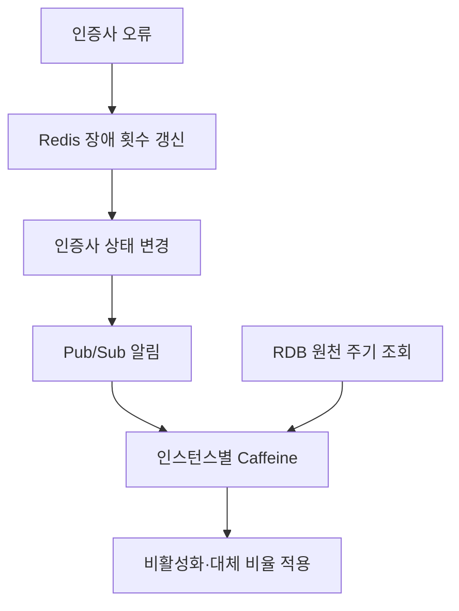
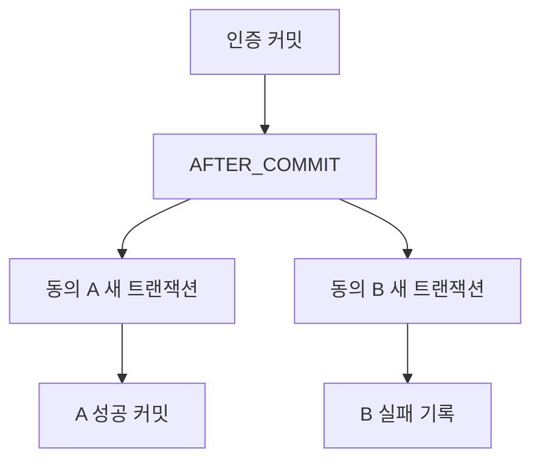

> 인증·제휴·전자문서 프로젝트에서 실패를 나눈 기준을 돌아봤다. 구현한 동작, 실제 운영한 대응, 검토만 한 복구를 구분해서 남겼다.
{: .prompt-info }

인증은 성공했는데 동의 항목 하나가 실패하면 어떻게 해야 할까. 이때 인증까지 되돌리는 것이 맞을까. 한 번에 성공시키면 상태는 단순해 보이지만, 외부 연동이 포함된 업무에서는 이미 끝난 일을 되돌릴 수 없는 경우가 생긴다.

내가 맡았던 설계를 돌아보면 이런 경계를 정하는 일이 많았다. 장애 횟수와 인증사 상태는 어디서 공유할지, 외부 실패는 무엇을 남길지, DB를 묶은 뒤에도 무엇은 따로 둘지 정해야 했다. 사용한 기술보다 그 판단을 중심으로 기록해 두려 한다. 그림에서는 업무별 책임 경계만 남겼다.

## **"장애 횟수와 장애 상태의 전달은 다른 일이었다"**

2024년 통합인증에서는 세 사이트의 다섯 인증 유형을 다뤘다. 나는 기술 설계를 주도하고 전체 인증 구현을 맡았다. 인증사 오류가 누적되면 해당 인증사를 자동 비활성화하고, 휴대폰 본인확인은 대체 인증사로 요청 비율을 조정했다.

여러 인스턴스에서 동시에 오류가 발생하므로 누적 횟수를 각 서버 메모리에만 둘 수 없었다. Redis에서 장애 횟수를 갱신하는 로직을 Lua로 묶고, 스크립트를 SHA로 캐시해 `EVALSHA`로 호출했다. 실행마다 바뀌는 값은 인자로 전달했다. 목적은 반복·동시 갱신을 하나의 실행 범위로 처리하는 것이었다.

단일 `INCR`도 원자적이다. 따라서 “Redis는 원자적이지 않아 Lua를 썼다”는 표현은 맞지 않는다. 또 SHA로 호출해도 요청은 매번 Redis에 도달하고 스크립트는 실행된다. 줄인 것은 스크립트 본문의 반복 전송이다. 여기서 Lua로 묶은 대상으로 설명할 수 있는 것은 장애 횟수 갱신이다.

상태 변경은 Redis Pub/Sub으로 각 인스턴스의 Caffeine 캐시에 전달했다. 빠른 로컬 조회를 유지하면서 변경을 알리는 구조였다. 알림을 놓칠 수 있으므로 RDB 원천을 주기적으로 다시 읽는 경로도 뒀다. 이 작업 범위에서는 별도 Kafka 운영까지 추가할 필요가 없다고 판단했다. 그 대신 주기 재동기화 전까지 캐시가 오래될 수 있다는 비용은 남는다.

이 그림에서 Lua가 담당하는 것은 장애 횟수 갱신이다. Pub/Sub은 상태 변경 알림이며, 락도 내구성 있는 이벤트 로그도 아니다.

로컬 장애 상태에는 10분 TTL을 뒀다. 만료 후 요청 비율을 보정하고 재시도하는 동작은 구현했다. 그러나 정상화된 인증사에 **원래 요청 비율을 자동 복원하는 기능은 설계 검토까지만 했다.** 이미 안정적으로 운영 중인 흐름을 바꾸는 데 보수적으로 접근했고, 구현으로 이어지지 않았다. TTL 만료를 정상 복구 확인과 같은 뜻으로 쓰면 이 차이가 사라진다.

## **"인증 성공을 동의 한 항목의 실패와 묶지 않았다"**

제휴 연동에서는 인증 완료와 이후 동의 처리를 분리했다. 인증 트랜잭션이 커밋된 뒤 `AFTER_COMMIT` 이벤트로 동의를 처리하고, 동의 항목마다 `REQUIRES_NEW`로 새 트랜잭션을 열었다.

선택한 이유는 한 항목의 실패가 완료된 인증이나 다른 항목의 성공까지 되돌리지 않게 하기 위해서였다. 대신 전체 성공·실패 두 값만으로 상태를 설명할 수 없게 됐다. 항목별 결과와 이력을 남기고 부분 성공을 운영 가능한 상태로 다뤄야 했다.

`AFTER_COMMIT`은 실행 시점을 커밋 뒤로 옮긴다. 프로세스가 종료돼도 반드시 다시 전달되는 큐를 만드는 기능은 아니다. 외부 호출까지 포함한 전체 원자성이나 내구성을 이 설정만으로 얻었다고 말할 수 없다.

브라우저 중복 진입에도 별도 경계가 있었다. 브라우저가 만든 UUID를 Redis에 키가 없을 때만 저장해 제휴 시작부터 인증 이후 동의까지의 중복 진입을 제어했다. 외부 실패 시에는 키를 유지했고, MongoDB에 오류를 남기며 브라우저에 인증 상태와 재시도 안내를 제공했다.

이 흐름에는 제약이 있었다. 외부 금융사가 처리 상태 조회 API를 제공하지 않아 우리 상태만으로 외부 완료 여부를 모두 확인할 수 없었다. 외부의 중복 처리 방지 동작에도 의존했다. 그래서 외부 호출의 성공 여부가 불명확하면 우리 쪽 중복 진입 방지만으로 해결되지 않았다. `SETNX` 한 번으로 Redis·외부 시스템·MongoDB에 걸친 전체 호출을 정확히 한 번 실행하게 되는 것은 아니다.

**쿠폰 발급은 이 브라우저 흐름과 별개인 백엔드 작업이다.** 쿠폰·이벤트 혜택 연동 실패는 MongoDB에 기록하고 주기 재처리를 실제 운영했다. 그 경로를 통해 늦게라도 혜택이 전달된 사례가 있었다. 모든 실패가 복구됐다거나 중복 발급이 불가능하다는 뜻은 아니다. 동의 실패에서 쿠폰 재처리가 자동으로 이어지는 한 줄의 흐름으로 합치면 서로 다른 업무와 대응이 섞인다.

관리자 기능도 업무 권한에 맞췄다. 담당자가 동의 철회를 지원할 수 있게 했지만, 새 동의 등록은 별도 금융사 페이지의 인증이 필요해 제공하지 않았다. 회원 탈회와 동의 철회도 각각의 업무로 다뤘다.

## **"배치 마스터는 만들 때와 쌓을 때의 경합이 달랐다"**

일배치의 첫 묶음이 동시에 도착하면, 같은 배치 마스터를 둘 다 생성하려 할 수 있다. 유니크 제약으로 중복 생성은 막을 수 있어도, 충돌한 트랜잭션이 실패 상태가 된 채 후속 처리를 계속할 수는 없었다.

그래서 마스터 생성만 별도 트랜잭션으로 분리했다. 먼저 만든 쪽은 커밋하고, 유니크 충돌이 난 쪽은 이미 만들어진 행을 다시 조회했다. 이후 같은 배치의 중복 묶음 검사와 누적 갱신은 비관적 행 잠금 안에서 수행했다. 읽고 판단한 값이 갱신하기 전에 달라지는 틈을 막기 위한 선택이었다.

여기서는 실제 RDB 업무 행을 잠갔다. 앞의 Redis Lua 장애 집계와 보호 대상이 다르다. 같은 배치에 대한 요청은 기다려야 하므로 잠금 안의 작업을 늘리면 대기 비용도 커진다. 완료 판단 역시 최대 묶음 번호만 볼 수 없었다. 중간 묶음 누락과 실제 누적 건수를 함께 검사했다.

## **"공통으로 만들되, 바뀌는 이유까지 하나로 합치지는 않았다"**

약관은 사이트별 HTML과 익일 반영 방식 때문에 내용 변경과 화면 배치가 함께 얽혀 있었다. 모델을 나누면서 약관 내용의 버전·시행일과, 화면별 그룹·노출 순서를 분리했다. 시행일이 되면 노출되도록 했고, 버전 번호는 등록 오류 수정 등 운영 상황 때문에 운영자가 관리하도록 남겼다.

나는 주요 모델과 구현을 맡고 공동 발표를 진행했다. 회원 동의 확장은 다른 작업자와 역할을 나눴다. 사이트별 테이블·시퀀스 이름 차이는 naming strategy와 설정으로 다뤘다. 같은 업무 개념을 재사용하면서 저장소의 이름 차이를 업무 코드에 반복하지 않으려는 선택이었다.

DB 통합만으로 API 구현과 검증의 중복이 사라지지는 않았다. 팀에서 공통 모듈을 설계했고, 나는 제휴·인증 모듈을 맡았다. 사이트 정책 차이는 남겨 두면서 공통 검증과 흐름을 재사용했다. 지금 비용을 설명하면, 공유 코드의 결함도 여러 사용처에 영향을 줄 수 있어 변경 영향 확인이 중요해진다. 공통으로 묶는 만큼 변경을 함께 확인할 범위도 넓어진다.

## **"복제 구성을 만들고, 사람이 다룰 절차도 남겨야 했다"**

전자문서 프로젝트는 두 명이 서버 22대의 인프라와 API·관리자·배치, KISA VPN 연동을 다룬 작업이었다. 나는 첫 심사 준비와 보완에 참여했고, 2022년 7월 2차 적합 판정과 9월 가오픈을 경험했다.

Galera를 선택할 때는 라이선스 비용도 고려했다. 하지만 DB 노드의 데이터를 복제하는 역할과 애플리케이션이 접속할 경로를 유지하는 역할은 분리해야 했다. Galera는 복제를, MaxScale과 Keepalived는 DB 접속 경로의 가용성 구성을 담당했다. 장비를 여러 대 둔다는 설명만으로는 운영자가 장애 때 무엇을 확인할지 알 수 없다.

노드 상태 확인, 재기동, 인증서 갱신, 순차 배포 절차를 인계 문서로 남긴 이유도 여기에 있었다. 구성이 존재하는 것과 다음 담당자가 상태를 판단하고 조작할 수 있는 것은 다르다. 인계 절차는 운영을 이어가기 위한 장치였고, 복제 구성만으로 모든 장애의 복구 시간과 데이터 보존이 해결되는 것은 아니었다.

## **"접수 성공 뒤에 가려진 상태를 확인했다"**

운영 대응에서도 관찰 지점이 문제였다. PG에서는 브라우저 갱신 이후 특정 카드 인증이 실패하는 상황을 대응하고 연동 업체에 내용을 공유했다. VAN 장애 알림도 다뤘다. 관리자에서는 JPA와 MyBatis를 병행했다. JPA에 익숙하지 않은 팀을 위해 문서를 정리하고 사용 방법을 공유했다.

로그인 DB 연결 장애에서는 분석에 참여했고, Java/Spring 전환 설계에도 참여했다. Caffeine 적용은 팀 작업이었다. 보안 라이브러리 때문에 생긴 .NET 버전 제약은 별도 조건이며, 그것을 DB 연결 장애의 직접 원인으로 묶지는 않는다.

DNS는 기존 HTTP 연결을 재사용하는 요청과 새 연결을 위해 이름을 다시 찾는 요청을 구분해 재현하고 내부에 공유했다. 주소를 성공적으로 찾은 positive 캐시와 실패를 기억하는 negative 캐시도 나눠 봐야 했다. DNS 설정을 바꿨다는 사실만으로 모든 요청의 연결 대상이 즉시 바뀌지는 않기 때문이다.

메시징에서는 API가 요청을 접수했다는 응답만으로 실제 전달 지연이나 에이전트 상태를 알 수 없었다. Kafka·InfluxDB·Grafana를 이용한 모니터링 개발을 맡았고 실제 메일 지연에 대응했다. 당시 대응에서 중요한 것은 API 접수와 실제 전달을 같은 성공으로 취급하지 않고, 지연이 생긴 구간을 볼 수 있게 하는 일이었다.

CI를 저장하고 조회하는 경로의 암호화, 종료되는 NICE API의 교체, SCDF를 통한 개인정보 배치 전환도 맡았다. 각각 보호해야 할 정보와 외부 종료 일정, 반복 실행할 작업이 달라 그 조건에 맞춰 처리했다.

이 사례들을 한 기술 목록으로 묶으면, 어디까지 함께 성공시켰고 어디서 실패를 남겼는지가 빠진다. 나는 앞으로도 **구현한 복구, 운영자가 이어받는 복구, 아직 검토인 복구를 따로 적으려 한다.** 그 구분이 있어야 다음 사람이 설계를 믿고 바꿀 수 있다.
