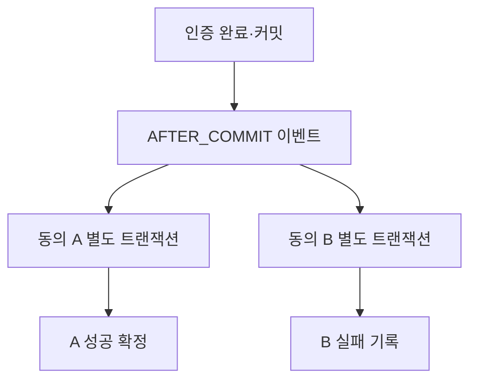
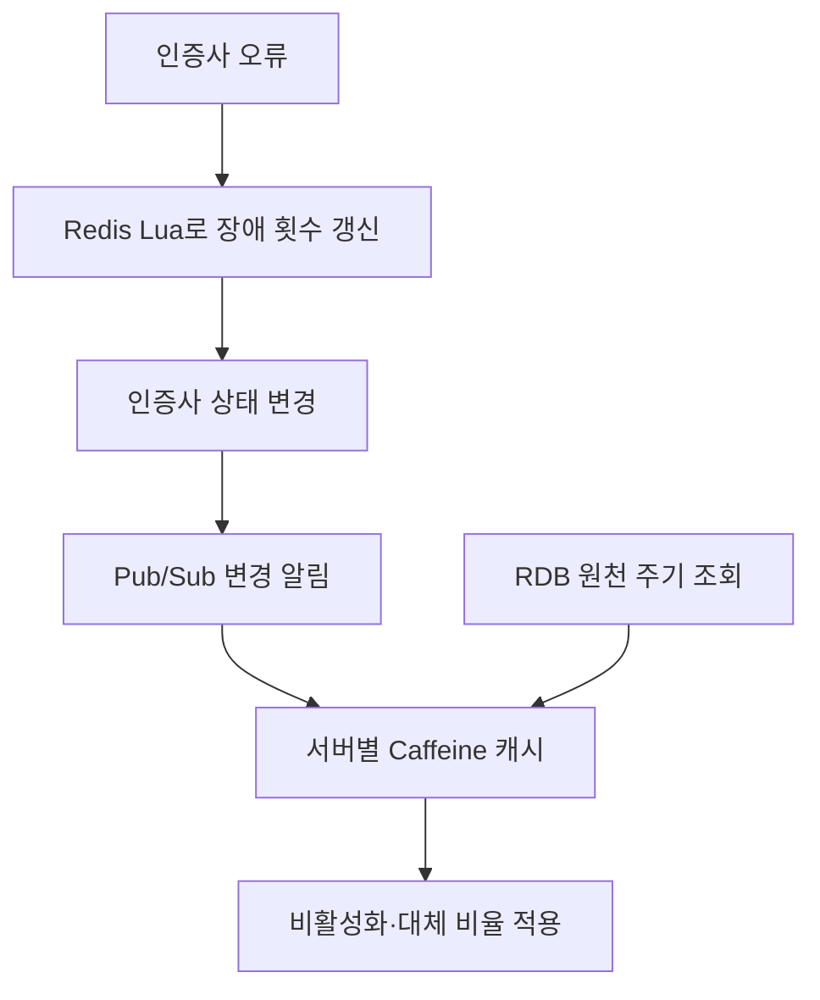

> 인증·제휴·전자문서 프로젝트에서 실패의 영향을 나누고, 이후 처리를 이어 갈 방법을 정리했습니다. 직접 구현한 동작과 실제 운영한 대응, 설계 검토에 머문 부분을 함께 기록합니다.
{: .prompt-info }
<!-- post-check: tone=polite -->

인증은 성공했는데, 이어지는 동의 항목 하나가 실패했습니다. 이미 끝난 인증까지 되돌려야 할까요? 다른 동의 항목이 성공했다면 그 결과는 어떻게 남겨야 할까요?

제휴 연동을 설계할 때 마주한 문제입니다. 외부 시스템이 포함되면 우리 DB의 변경을 취소하는 것만으로 이미 처리된 일을 모두 되돌리기 어렵습니다. 그래서 **어디까지 함께 성공시키고, 실패한 뒤에는 누가 무엇을 이어받을지** 정해야 했습니다.

이 글에서는 그 판단을 네 가지 주제로 돌아봅니다. 기술 이름보다 먼저 당시의 문제와 선택한 이유를 설명하고, 그 선택으로 해결한 범위와 남은 제약을 적었습니다.

| 설계할 때의 질문 | 살펴볼 경험 |
|---|---|
| 일부가 실패해도 끝난 일을 보존할 수 있을까요? | 인증·동의 분리, 제휴 중복 진입, 혜택 재처리 |
| 여러 서버가 같은 상태를 다룰 때 무엇을 보호할까요? | 인증사 장애 집계, 상태 전파, 일배치 경합 |
| 공통으로 쓸 것과 따로 바뀔 것은 무엇일까요? | 약관 모델, 공통 모듈 |
| 운영자가 다음 조치를 판단할 수 있을까요? | 전자문서 인프라, 전달 지연, 장애 분석 |

## 끝난 인증을 보존하고 실패한 처리를 남기기

### 인증과 동의를 각각 완료하기

제휴 연동에서는 인증 완료 뒤 여러 동의 항목을 처리했습니다. 하나의 트랜잭션에 모두 묶으면 동의 한 항목의 실패가 완료된 인증이나 다른 항목의 성공에도 영향을 줍니다.

> **쉽게 말하면** 트랜잭션은 함께 확정하거나 함께 취소할 작업의 묶음입니다. 여기서는 인증 완료를 먼저 확정하고, 동의는 항목별로 결과를 남기도록 묶음을 나눴습니다.
{: .prompt-tip }

인증 트랜잭션이 커밋된 뒤 `AFTER_COMMIT` 이벤트로 동의를 처리했습니다. 각 동의 항목은 `REQUIRES_NEW`로 새 트랜잭션을 열었습니다.

이렇게 하면 한 항목이 실패해도 완료된 인증과 다른 항목의 성공을 보존할 수 있습니다. 대신 전체를 성공 또는 실패 한 값으로 표시하기 어려워집니다. 항목별 결과와 이력을 남겨 **일부만 성공한 상태도 운영자가 다룰 수 있게** 해야 했습니다.

남은 제약은 이벤트의 전달 보장입니다. `AFTER_COMMIT`은 실행 시점을 커밋 뒤로 정합니다. 프로세스가 종료된 뒤에도 반드시 다시 전달하는 큐의 역할은 별도로 필요합니다. 외부 호출까지 한 번에 확정하는 원자성이나 재전달의 내구성은 이 설정만으로 확보되지 않습니다.

### 중복 진입과 실패 후 재시도 다루기

브라우저에서 같은 제휴 절차에 중복으로 들어오는 문제도 있었습니다. 브라우저가 만든 UUID를 Redis에 키가 없을 때만 저장해, 제휴 시작부터 인증 이후 동의까지 중복 진입을 제어했습니다.

> **쉽게 말하면** UUID는 브라우저가 만든 요청 식별표이고, Redis는 그 식별표로 이미 들어온 요청인지 확인하는 곳입니다. 이 확인과 외부 금융사의 실제 처리 결과는 따로 관리해야 합니다.
{: .prompt-tip }

외부 호출이 실패하면 Redis 키를 유지했습니다. 오류는 MongoDB에 남기고, 브라우저에는 인증 상태와 재시도 안내를 제공했습니다.

| 단계 | 처리와 남은 조건 |
|---|---|
| 중복 진입 확인 | Redis에 UUID 키가 없을 때 저장합니다. |
| 외부 호출 실패 | 키를 유지하고 MongoDB에 오류를 기록합니다. |
| 상태 확인·재시도 안내 | 브라우저에 우리 쪽 인증 상태를 제공합니다. 외부 완료 여부 확인에는 한계가 있습니다. |

외부 금융사가 처리 상태 조회 API를 제공하지 않아, 우리 기록만으로 외부의 완료 여부를 모두 확인할 수 없었습니다. 외부 시스템의 중복 처리 방지 동작에도 의존했습니다. Redis의 `SETNX`로 진입을 제어하더라도 Redis·외부 시스템·MongoDB를 잇는 전체 호출을 정확히 한 번 실행한다고 보장할 수는 없습니다.

### 혜택 재처리와 관리자 권한 정하기

**쿠폰·이벤트 혜택은 위 브라우저 흐름과 별도의 백엔드 작업**이었습니다. 연동 실패를 MongoDB에 기록하고 주기적으로 재처리하는 경로를 실제 운영했습니다. 이를 통해 늦게라도 혜택이 전달된 사례가 있었습니다.

이 경험에서 확인한 결과는 실패 기록과 후속 처리가 혜택 전달로 이어졌다는 것입니다. 모든 실패의 복구나 중복 발급 방지를 보장했다는 의미까지 넓히지는 않습니다.

관리자가 지원할 수 있는 범위도 정했습니다. 동의 철회는 관리자 기능으로 제공했습니다. 새 동의 등록에는 별도 금융사 페이지의 인증이 필요해 관리자 기능에 포함하지 않았습니다. 회원 탈회와 동의 철회 역시 각각의 업무로 다뤘습니다.

## 여러 서버가 함께 다루는 값 보호하기

### 인증사 장애 횟수를 한곳에서 갱신하기

2024년 통합인증 프로젝트에서 저는 3인 팀의 기술 설계를 주도하고, 세 사이트·다섯 인증 유형의 인증 기능을 전체 구현했습니다. 인증사 오류가 누적되면 해당 인증사를 자동 비활성화하고, 휴대폰 본인확인은 대체 인증사로 요청 비율을 조정했습니다.

문제는 여러 서버에서 오류가 동시에 발생한다는 점이었습니다. 각 서버 메모리에 횟수를 따로 쌓으면 전체 장애 상황을 같은 기준으로 판단하기 어렵습니다. Redis에서 장애 횟수를 갱신하는 로직을 Lua 스크립트로 묶어 처리했습니다.

> **쉽게 말하면** 여러 창구에서 발생한 오류를 하나의 집계대에 모은 셈입니다. Lua는 장애 횟수 갱신 로직이 실행되는 동안 다른 요청이 중간에 끼어들지 않도록 처리 범위를 정하는 데 사용했습니다.
{: .prompt-tip }

스크립트는 SHA로 캐시하고 `EVALSHA`로 호출했습니다. 실행마다 달라지는 값은 인자로 전달해, 스크립트 본문을 매번 전송하는 비용을 줄였습니다.

| 선택 | 담당한 일 |
|---|---|
| Redis Lua | 장애 횟수 갱신 로직을 하나의 원자적 실행 범위로 처리합니다. |
| `EVALSHA` | 캐시한 스크립트를 식별자로 호출해 본문의 반복 전송을 줄입니다. |

단일 `INCR`도 원자적입니다. Lua를 선택한 이유는 여러 갱신 로직을 묶어 다루기 위해서였습니다. `EVALSHA` 호출 역시 매번 Redis에 도달하고 스크립트를 실행하므로, 요청 횟수 자체가 줄어드는 것은 아닙니다.

### 상태를 빠르게 전파하고 주기적으로 맞추기

장애 횟수를 집계한 다음에는 변경된 인증사 상태를 각 서버에 알려야 했습니다. 각 인스턴스는 Caffeine이라는 로컬 메모리 캐시로 상태를 빠르게 조회하고, 변경 알림은 Redis Pub/Sub으로 받았습니다.

> **쉽게 말하면** Pub/Sub은 변경 사항을 방송하고, Caffeine은 각 서버가 보관하는 상태 메모입니다. 방송을 놓칠 수 있으므로 RDB의 원본을 주기적으로 읽어 메모를 다시 맞췄습니다.
{: .prompt-tip }

이 범위에서는 별도 Kafka 운영을 추가하기보다 알림과 주기 재동기화를 조합했습니다. 그 대가로 알림을 놓친 서버는 다음 재동기화까지 오래된 상태를 사용할 수 있었습니다. Pub/Sub이 담당한 범위는 상태 변경 알림이며, 잠금이나 내구성 있는 이벤트 로그는 별도의 역할입니다.

복구 동작은 다음처럼 구분해야 정확합니다. TTL은 상태를 유지하는 유효 시간입니다.

| 동작 | 진행한 범위 |
|---|---|
| 장애 인증사 자동 비활성화·대체 인증사 분산 | 구현했습니다. |
| 로컬 장애 상태의 10분 TTL 만료 후 비율 보정·재시도 | 구현했습니다. |
| 정상화 뒤 원래 요청 비율로 자동 복귀 | 설계 검토까지 진행했으며 구현하지 않았습니다. |

이미 안정적으로 운영하던 흐름을 바꾸는 데 보수적으로 접근해, 원래 비율로 복귀하는 기능은 구현으로 이어지지 않았습니다. **TTL이 끝났다는 사실과 인증사가 정상 복구됐다는 확인은 구분해야 합니다.**

### 배치 생성과 누적 갱신의 경합 나누기

일배치에서는 첫 데이터 묶음들이 동시에 도착하면 같은 배치 마스터를 각각 만들려 했습니다. 배치 마스터는 해당 배치의 진행과 누적 결과를 관리하는 기준 행입니다.

> **쉽게 말하면** 같은 작업의 관리 장부를 두 요청이 동시에 만들려고 한 상황입니다. 장부를 하나만 만드는 문제와, 이미 있는 장부에 안전하게 합산하는 문제를 나눠 처리했습니다.
{: .prompt-tip }

유니크 제약은 중복 생성을 막지만, 충돌한 트랜잭션은 실패 상태가 됩니다. 그 안에서 그대로 후속 처리를 계속할 수 없어 마스터 생성만 별도 트랜잭션으로 분리했습니다. 먼저 생성한 쪽이 커밋하면, 충돌한 쪽은 이미 만들어진 행을 다시 조회했습니다.

| 처리 시점 | 선택과 이유 |
|---|---|
| 마스터 생성 | 별도 트랜잭션과 유니크 제약으로 생성 경합을 처리하고, 충돌 시 기존 행을 재조회합니다. |
| 중복 묶음 검사·누적 갱신 | 같은 RDB 행에 비관적 잠금을 걸어, 검사와 갱신 사이 값이 바뀌는 틈을 막습니다. |
| 완료 판단 | 최대 묶음 번호와 함께 중간 묶음 누락, 실제 누적 건수를 확인합니다. |

비관적 행 잠금은 같은 행을 바꾸려는 요청을 기다리게 합니다. 앞의 Lua가 Redis 장애 집계를 보호했다면, 여기서는 실제 RDB 업무 행을 보호했습니다. 잠금 안의 작업이 길어질수록 같은 배치 요청의 대기도 늘어난다는 비용이 남았습니다.

## 함께 쓸 모델과 따로 바뀔 정책 나누기

### 약관 내용과 화면 배치 분리하기

약관은 사이트별 HTML과 익일 반영 방식으로 관리하고 있었습니다. 약관 내용이 바뀌는 일과 화면에 배치하는 일이 함께 얽혀 있었습니다.

모델에서는 약관 내용의 버전·시행일과 화면별 그룹·노출 순서를 분리했습니다. 시행일이 되면 노출되도록 했고, 버전 번호는 등록 오류 수정 같은 운영 상황을 고려해 운영자가 관리하도록 남겼습니다.

| 바뀌는 대상 | 따로 관리한 정보 |
|---|---|
| 약관 내용 | 버전, 시행일 |
| 화면 배치 | 화면별 그룹, 노출 순서 |
| 사이트별 저장소 이름 | 테이블·시퀀스 이름 차이를 naming strategy와 설정으로 처리 |

naming strategy는 모델 이름을 실제 테이블·시퀀스 이름에 연결하는 규칙입니다. 같은 업무 개념을 재사용하면서, 사이트마다 다른 저장소 이름을 업무 코드에 반복하지 않도록 했습니다.

저는 주요 모델과 구현을 맡고 공동 발표를 진행했습니다. 회원 동의 확장은 다른 작업자와 역할을 나눴습니다.

### 공통 모듈에서도 사이트 정책은 남기기

DB를 통합한 뒤에도 API 구현과 검증 로직의 중복은 남았습니다. 팀에서 공통 모듈을 설계했고, 저는 제휴·인증 모듈을 맡았습니다.

공통 검증과 흐름을 재사용하되 사이트별 정책 차이는 유지했습니다. 재사용할 범위를 넓히면 공유 코드의 결함이 여러 사용처에 영향을 줄 수 있습니다. 공통화의 이점과 함께, 변경 시 함께 확인할 대상이 늘어나는 비용도 봐야 했습니다.

## 운영자가 판단하고 이어받을 수 있게 만들기

### 복제 구성에 운영 절차 더하기

전자문서 프로젝트는 두 명이 서버 22대의 인프라와 API·관리자·배치, KISA VPN 연동을 다룬 작업이었습니다. 저는 첫 심사 준비와 보완에 참여했고, 2022년 7월 2차 적합 판정과 9월 가오픈을 경험했습니다.

Galera 선택에는 라이선스 비용도 고려했습니다. 구성에서는 데이터를 복제하는 역할과 애플리케이션이 DB에 접속할 경로를 유지하는 역할을 나눴습니다.

> **쉽게 말하면** 데이터 사본을 여러 곳에 유지하는 일과, 애플리케이션이 DB로 연결될 길을 유지하는 일은 각각 필요합니다. 서버 대수만으로는 장애 때 어느 쪽을 확인해야 할지 알기 어렵습니다.
{: .prompt-tip }

| 구성·절차 | 맡긴 역할 |
|---|---|
| Galera | DB 노드 간 데이터 복제 |
| MaxScale·Keepalived | DB 접속 경로의 가용성 구성 |
| 인계 문서 | 노드 상태 확인, 재기동, 인증서 갱신, 순차 배포 절차 |

인계 문서는 다음 담당자가 상태를 판단하고 조작할 수 있도록 남겼습니다. 복제 구성을 갖춘 뒤에도 복구 시간과 데이터 보존을 확인할 운영 절차가 필요했습니다.

### API 접수 뒤의 전달 상태 확인하기

메시징에서는 API의 요청 접수 응답만으로 실제 전달 지연이나 에이전트 상태를 알기 어려웠습니다. 저는 Kafka·InfluxDB·Grafana를 이용한 모니터링 개발을 맡았고, 실제 메일 지연에 대응했습니다.

여기서 관찰해야 한 것은 **접수 이후 어느 구간에서 지연되는가**였습니다. API 접수와 실제 전달을 구분해야 운영자가 다음 확인 지점을 찾을 수 있었습니다.

다른 운영 경험에서도 성공으로 보는 지점과 제가 맡은 역할을 구체적으로 남기려 합니다. 관련 경험은 아래에 모았습니다.

결제·로그인·DNS와 외부 API 전환에서 다룬 일

### 결제와 관리자 개발

PG에서는 브라우저 갱신 이후 특정 카드 인증이 실패하는 상황에 대응하고 연동 업체에 내용을 공유했습니다. VAN 장애 알림도 다뤘습니다.

관리자에서는 JPA와 MyBatis를 병행했습니다. JPA에 익숙하지 않은 팀을 위해 문서를 정리하고 사용 방법을 공유했습니다.

### 로그인 장애 분석과 전환 설계

로그인 DB 연결 장애 분석에 참여했고, Java/Spring 전환 설계에도 참여했습니다. Caffeine 적용은 팀 작업이었습니다.

보안 라이브러리로 인한 .NET 버전 제약도 있었습니다. 이는 별도 조건이므로 DB 연결 장애의 직접 원인과 구분해서 기록합니다.

### DNS 재현과 내부 공유

DNS는 이름으로 서버 주소를 찾는 과정입니다. 기존 HTTP 연결을 재사용하는 요청과, 새 연결을 위해 이름을 다시 찾는 요청을 구분해 재현하고 내부에 공유했습니다.

주소를 성공적으로 찾은 positive 캐시와, 조회 실패를 기억하는 negative 캐시도 나눠 봤습니다. DNS 설정 변경만으로 기존 연결을 포함한 모든 요청의 대상이 즉시 바뀌지는 않기 때문입니다.

### 정보 보호와 외부 변경 대응

CI를 저장하고 조회하는 경로의 암호화, 종료되는 NICE API의 교체, SCDF를 통한 개인정보 배치 전환도 맡았습니다. 각각 보호해야 할 정보, 외부 API 종료 일정, 반복 실행할 작업이라는 조건에 맞춰 처리했습니다.

### 다음 설계에 남길 기준

경험을 돌아보니 기술을 선택한 이유만큼, 그 기술로 어디까지 책임졌는지 적는 일이 중요했습니다.

- **완료의 단위를 먼저 정하겠습니다.** 인증과 동의처럼 분리한 결과는 항목별 상태와 이력으로 설명하겠습니다.
- **보호하는 대상을 함께 적겠습니다.** 장애 횟수 집계, 상태 변경 알림, RDB 행 잠금이 맡은 역할을 구체적으로 남기겠습니다.
- **복구의 진행 상태를 구분하겠습니다.** 구현한 동작, 실제 운영한 대응, 설계 검토 중인 기능을 나눠 기록하겠습니다.

처음의 인증·동의 사례를 다시 보면, 실패 하나를 어떻게 취소할지만으로는 설계를 설명하기 어렵습니다. 이미 완료된 인증과 항목별 동의 결과, 이후 확인할 기록을 함께 봐야 합니다. 다음 사람이 그 상태를 이해하고 처리를 이어 갈 수 있도록 남기는 것까지 제 설계의 일부로 삼겠습니다.
