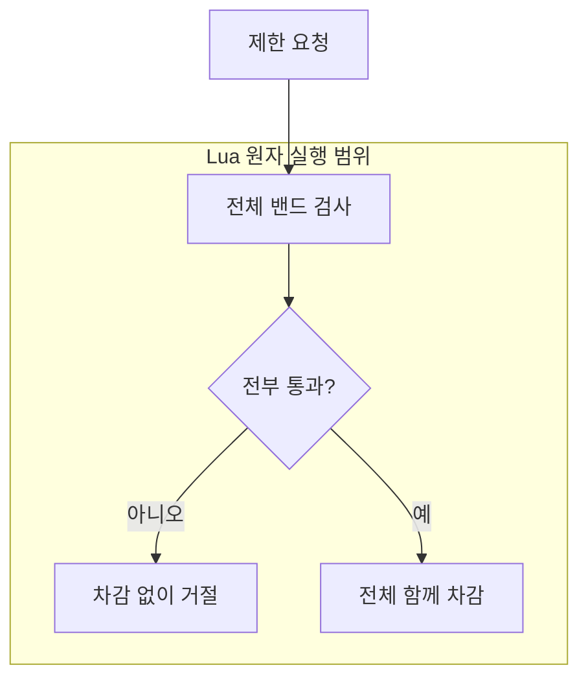

> FluxGate는 Redis Lua로 토큰 확인과 차감을 함께 처리합니다. 어디까지 한 번에 처리할 수 있고, 실패하면 무엇이 남는지 살펴봅니다.
{: .prompt-info }
<!-- post-check: tone=polite -->

## 토큰 하나에 요청 둘이 들어오면

남은 토큰은 1개인데 요청 2개가 동시에 들어옵니다. 두 요청 모두 잔여량을 먼저 읽으면, 각각 “1개 남았으니 통과”라고 판단할 수 있습니다.

설명을 위한 상황입니다. 실제 부하 실험에서 측정한 결과는 아닙니다.

```text
요청 A: 잔여량 1 확인 → 허용 판단 → 차감
요청 B: 잔여량 1 확인 → 허용 판단 → 차감
```

각 Redis 명령이 원자적이어도, 명령 사이에는 다른 요청이 들어올 수 있습니다. **확인부터 차감까지를 하나로 묶어야** 두 요청이 같은 토큰을 쓰는 틈을 막을 수 있습니다.

개인 오픈소스 FluxGate에서 Lua를 선택한 출발점도 이것이었습니다. 그런데 묶을 대상이 버킷 하나에서 여러 제한으로 늘어나면 질문이 달라집니다. 함께 처리할 범위는 어디까지일까요? 차감은 끝났는데 응답을 못 받았다면 다시 실행해도 될까요?

이 글은 개인 오픈소스와 사내 POC의 설계를 설명합니다. 공개 버전 `v0.3.7`과 작업 중인 LTS를 구분하며, LTS 소스는 확인한 커밋 `d2b771a`에 고정했습니다. 상용 운영 성과나 새로운 성능 측정은 다루지 않습니다. 구현 근거는 마지막에 모았습니다.

## 확인과 차감을 함께 묶습니다

토큰 버킷은 정해진 속도로 토큰을 채우고, 요청마다 필요한 양을 쓰는 제한 방식입니다. 여러 앱 서버가 같은 제한을 적용하려면 공유된 잔여량을 기준으로 판단해야 합니다.

여기서 필요한 원자성은 **상태 확인과 변경 사이에 다른 요청이 끼어들지 않는 성질**입니다. FluxGate는 이 일을 Redis 안의 짧은 Lua 스크립트로 처리합니다.

> **쉽게 말하면** 좌석이 남았는지 확인하는 창구와 예약하는 창구를 하나로 합치는 일입니다. 확인한 좌석을 다른 창구가 먼저 팔아 버리는 틈을 없앱니다.
{: .prompt-tip }

### 적용 전

아래 두 블록은 구조를 비교하는 **설명용 의사코드**입니다. 실행 코드나 실측 결과가 아닙니다.

```text
잔여량 = Redis에서 조회
허용 여부 = 보충량과 잔여량으로 계산
허용한다면 Redis에 차감 결과 저장
```

### 적용 후

```text
Redis Lua 안에서:
    현재 시각 확인 → 보충량 계산 → 허용 판단 → 차감 결과 저장
```

단일 `INCR`처럼 명령 하나로 끝나는 일은 이미 원자적입니다. Lua는 **여러 연산으로 이루어진 판단**을 함께 끝내야 할 때 필요합니다.

LTS 스크립트는 Redis의 `TIME`을 사용해 시각을 얻습니다. 앱 서버마다 다른 시계를 기준으로 보충량을 계산하는 문제를 줄이는 선택입니다. 다만 Redis 시계 자체의 정확성과 Lua 숫자의 정밀도 한계는 여전히 고려해야 합니다.

## 락과는 관리할 대상이 다릅니다

RDB 행 잠금도 공유 상태의 동시 변경을 직렬화할 수 있습니다. 어느 쪽이든 “함께 끝내야 하는 일”을 정해야 한다는 점은 같습니다.

| 수단 | 함께 관리할 범위와 비용 |
|---|---|
| RDB 행 잠금 | 트랜잭션 안의 업무 검증·갱신, 잠금 대기 |
| Redis Lua | 제한 상태의 계산·갱신, 스크립트 실행 시간과 Redis 의존성 |

FluxGate에서는 별도의 락 소유자나 만료 시간, 스핀 대기를 설계하는 대신 필요한 갱신을 Redis 안에서 끝냈습니다. 당시 선택의 출발점은 Redis에 둔 제한 상태였고, RDB 행 잠금과의 비교는 이 구조를 설명하며 정리한 내용입니다.

스크립트가 실행되는 동안 다른 Redis 작업은 끼어들지 못합니다. 그래서 이 안에는 짧은 상태 갱신을 두고, 오래 걸리는 계산이나 외부 업무는 넣지 않아야 합니다.

## SHA가 기억하는 것은 코드입니다

`EVALSHA`는 Redis에 로드된 스크립트의 SHA를 지정해 실행하는 명령입니다. 키는 `KEYS`, 용량·기간·요청량 같은 값은 `ARGV`로 전달합니다.

> **쉽게 말하면** 매번 조리법 전체를 보내는 대신 조리법 번호와 이번 주문을 보내는 방식입니다. 조리법은 저장해 두어도 요리는 주문마다 다시 합니다.
{: .prompt-tip }

**캐시되는 것은 스크립트 본문입니다.** 이전 요청의 결과를 재사용하는 구조가 아니며, Redis 호출과 스크립트 실행은 요청마다 일어납니다.

Redis 재시작이나 스크립트 캐시 제거 뒤에는 `NOSCRIPT`가 올 수 있습니다. 실행할 스크립트가 없다는 응답입니다. 현재 구현은 이때 본문을 보내는 `EVAL`로 대체 실행합니다.

```text
EVALSHA(scriptSha, keys, args)
  └─ NOSCRIPT 응답 → EVAL(script, keys, args)
```

## 제한이 두 개라면 모두 확인해야 합니다

초당 제한과 분당 제한을 함께 적용할 수 있습니다. 이처럼 서로 다른 기간의 제한을 여기서는 **밴드**라고 부릅니다.

앞 밴드에서 먼저 차감하고 뒤 밴드에서 거절하면 어떻게 될까요? 요청은 최종 거절됐지만 앞 밴드의 토큰은 이미 줄어든 상태가 됩니다.

| 구현 | 거절될 때 확인할 점 |
|---|---|
| 공개 `v0.3.7` | Java에서 밴드를 순서대로 소비하므로 앞 밴드 차감이 남을 수 있습니다. |
| 현재 LTS | 모든 밴드를 먼저 검사하고, 모두 통과할 때 함께 차감합니다. |

LTS는 멀티밴드를 **모두 통과하거나 차감하지 않는 방식(all-or-nothing)**으로 처리합니다. 단일 버킷만 안전하게 바꾸는 것에서, 함께 적용할 밴드 전체로 범위를 넓힌 것입니다.



## 다른 슬롯이면 보상이 필요합니다

Redis Cluster는 키를 해시 슬롯이라는 구역에 나눠 둡니다. 여러 키를 한 스크립트에서 처리하려면 같은 슬롯에 있어야 합니다.

현재 구현은 슬롯을 확인해 처리 경로를 고릅니다. 같은 슬롯에서는 함께 처리하고, 다른 슬롯에 걸친 여러 규칙은 순차 소비한 뒤 실패하면 앞의 차감을 환급합니다.

이 환급이 **보상 처리**입니다. 이미 끝난 변경을 나중의 작업으로 되돌리는 방식입니다.

> **쉽게 말하면** 여러 곳에서 결제하다 마지막 결제가 실패해 앞선 결제를 취소하는 일입니다. 취소가 끝나기 전에는 돈이 빠져 있고, 취소 작업도 실패할 수 있습니다.
{: .prompt-tip }

따라서 보상 환급을 여러 슬롯 전체의 원자성으로 볼 수는 없습니다. 환급 전에 다른 요청이 줄어든 잔여량을 볼 수 있습니다. 프로세스가 종료되거나 Redis 호출이 실패하면 차감이 남을 수도 있습니다.

같은 슬롯에 모으면 함께 처리할 수 있는 범위가 넓어집니다. 대신 키 배치와 부하 분산의 제약을 함께 검토해야 합니다.

## 응답이 없으면 실행 여부부터 봅니다

Redis에 명령을 보낸 뒤 연결이 끊겼다고 해 보겠습니다. 실행 전에 실패했을 수도 있고, 차감은 끝났지만 응답만 잃었을 수도 있습니다.

두 번째 경우에 같은 명령을 다시 보내면 한 요청에 두 번 차감할 수 있습니다. 현재 저장소 구현은 **실행 여부가 불명확한 명령 실패를 자동 재시도하지 않습니다.**

| 받은 결과 | 현재 구현의 대응 |
|---|---|
| `NOSCRIPT` | 스크립트가 실행되지 않았으므로 `EVAL`로 대체 실행합니다. |
| 실행 여부가 불명확한 연결 실패 | 이미 차감했을 수 있으므로 자동 재시도하지 않습니다. |

실패했다는 사실만으로 재시도 여부를 정할 수는 없습니다. “첫 실행이 상태를 바꾸지 않았다는 근거가 있는가”를 확인해야 합니다.

## 장애 때 허용할지도 정책입니다

제한 판단에 필요한 의존성이 실패하면, 요청을 허용할지 막을지 결정해야 합니다. 현재 구현은 사용 가능한 로컬 대체 제한기가 있으면 먼저 시도합니다.

장애 정책의 기본값은 `DENY`입니다. 이 경로는 사용 불가 오류로 이어집니다. `ALLOW`는 제한 판단을 마치지 못해도 서비스를 계속 이용하게 하는 선택입니다.

배포하는 쪽에서는 서비스 가용성과 제한 준수 중 무엇을 우선할지 정해야 합니다. Lua가 상태 갱신을 묶어 주어도 이 정책까지 대신 결정해 주지는 않습니다.

## 규칙 알림과 토큰 차감은 별개입니다

요청마다 바뀌는 사용량과, 관리 화면에서 바꾸는 제한 규칙은 갱신 경로가 다릅니다. 규칙의 원천 저장소는 MongoDB이며, 실행 중인 인스턴스는 규칙을 캐시합니다.

Redis Pub/Sub은 규칙 변경을 알리는 신호로 사용합니다. 알림을 받은 인스턴스가 규칙 캐시를 갱신하는 구조입니다.

> **쉽게 말하면** Pub/Sub은 새 공지가 올라왔다고 울리는 종이고, MongoDB는 공지 원문입니다. 종소리를 놓쳤다면 원문을 다시 확인해야 합니다.
{: .prompt-tip }

Pub/Sub은 놓친 메시지를 재생해 주지 않습니다. LTS에는 이를 보완하는 주기 조회가 있으며 기본 간격은 60초입니다. 이 기능은 설정으로 끌 수 있고, 실제 보완 경로는 설정과 캐시 조건에 따라 달라집니다.

알림으로 빠르게 반영하고 원천 조회로 놓친 변경을 따라잡는 선택입니다. 별도 메시지 로그 운영을 줄이는 대신, 일시적으로 오래된 규칙을 쓰는 구간을 받아들입니다. 토큰 차감의 원자성과는 별도로 봐야 하는 일관성 범위입니다.

요청을 어디서 판단할지도 따로 선택합니다. **Direct**는 앱 내부 핸들러가 엔진과 Redis를 호출하고, **HTTP**는 별도 제한 서비스에 판단을 요청합니다. HTTP는 적용 지점을 분리할 수 있지만 네트워크 호출과 서비스 장애 경계가 늘어납니다.

## Lua를 검토할 때

| 상황 | 먼저 확인할 것 |
|---|---|
| Redis의 여러 연산을 하나로 묶어야 할 때 | 함께 읽고 바꿀 키, 짧게 끝나는 실행 범위 |
| 명령 하나로 충분할 때 | 기존 원자적 명령으로 처리할 수 있는지 |
| 여러 제한을 함께 적용할 때 | 밴드 전체의 차감 여부, Cluster 슬롯 배치 |
| 요청이 실패하거나 응답을 잃었을 때 | 남은 차감, 보상 실패 가능성, 재실행 근거 |

Lua 사용 여부보다 이 질문들의 답이 설계를 더 정확하게 설명합니다.

## 느낀 점

FluxGate에서 시작한 질문은 “확인과 차감을 어떻게 함께 끝낼까?”였습니다. 구현을 따라 정리하면서, 함께 끝내는 범위를 버킷·밴드·슬롯으로 나눠 적는 것이 중요해졌습니다.

- 원자성을 설명할 때는 **보호하는 상태와 범위**를 함께 적겠습니다.
- 성공 경로만큼 **거절 뒤 남는 차감과 환급 실패**도 살펴보겠습니다.
- 재시도에는 **다시 실행해도 되는 근거**를 요구하겠습니다.

다음 변경을 검토할 때는 스크립트부터 열기보다, 함께 성공해야 할 상태와 실패 뒤 남을 상태부터 적어 보려고 합니다.

## 참고한 내용들

| 기준 | 이 글의 범위 |
|---|---|
| 공개 버전 | `v0.3.7`의 밴드 순차 소비 구현 |
| LTS 소스 | [확인한 커밋 `d2b771a`](https://github.com/OpenFluxGate/fluxgate/tree/d2b771ab7ee9864a040e6672014fb16fb54b4873) |
| 숫자 정밀도 | 스크립트에 명시된 Lua 5.1 숫자 정밀도 한계 |
| 주기 조회 | 기본 60초, 설정과 캐시 조건에 따라 동작 |
| 장애 정책 | 기본 `DENY`, 사용 가능한 로컬 대체 제한기 우선 시도 |

<details markdown="1">
<summary>같은 커밋에서 확인하기</summary>

Git이 설치된 환경의 빈 작업 디렉터리에서 실행합니다. Redis를 실행하는 대신 고정한 소스를 조회하는 절차입니다.

```bash
git clone https://github.com/OpenFluxGate/fluxgate.git fluxgate-source-check
git -C fluxgate-source-check --no-pager show d2b771ab7ee9864a040e6672014fb16fb54b4873:fluxgate-redis-ratelimiter/src/main/resources/lua/token_bucket_consume.lua
git -C fluxgate-source-check --no-pager show d2b771ab7ee9864a040e6672014fb16fb54b4873:fluxgate-redis-ratelimiter/src/main/java/org/fluxgate/redis/store/RedisTokenBucketStore.java
```

- Lua에서 `Pass 1` → `return rejection` → `Pass 2` 순서를 확인합니다. 거절되면 차감 단계로 넘어가지 않습니다.
- Java에서 `RedisNoScriptException` 뒤의 `connectionProvider.eval`과 명령 실패 시의 `Phase.COMMAND`를 확인합니다.
- `bad object`나 `path ... does not exist`가 나오면 가져온 저장소·커밋·경로를 확인합니다.

</details>

### 구현 근거

- [공개 v0.3.7 — 밴드 순차 소비](https://github.com/OpenFluxGate/fluxgate/blob/v0.3.7/fluxgate-redis-ratelimiter/src/main/java/org/fluxgate/redis/RedisRateLimiter.java)
- [LTS Lua — 멀티밴드의 2단계 처리](https://github.com/OpenFluxGate/fluxgate/blob/d2b771ab7ee9864a040e6672014fb16fb54b4873/fluxgate-redis-ratelimiter/src/main/resources/lua/token_bucket_consume.lua#L1-L15), [시간·정밀도 처리](https://github.com/OpenFluxGate/fluxgate/blob/d2b771ab7ee9864a040e6672014fb16fb54b4873/fluxgate-redis-ratelimiter/src/main/resources/lua/token_bucket_consume.lua#L51-L56)
- [LTS 제한기 — 같은 슬롯의 원자 처리와 다른 슬롯의 보상](https://github.com/OpenFluxGate/fluxgate/blob/d2b771ab7ee9864a040e6672014fb16fb54b4873/fluxgate-redis-ratelimiter/src/main/java/org/fluxgate/redis/RedisRateLimiter.java#L43-L71)
- [LTS 저장소 — EVALSHA·NOSCRIPT 처리](https://github.com/OpenFluxGate/fluxgate/blob/d2b771ab7ee9864a040e6672014fb16fb54b4873/fluxgate-redis-ratelimiter/src/main/java/org/fluxgate/redis/store/RedisTokenBucketStore.java#L694-L736), [명령 단계 실패 처리](https://github.com/OpenFluxGate/fluxgate/blob/d2b771ab7ee9864a040e6672014fb16fb54b4873/fluxgate-redis-ratelimiter/src/main/java/org/fluxgate/redis/store/RedisTokenBucketStore.java#L760-L777)
- [LTS 자동 설정 — 알림·주기 조회 구성](https://github.com/OpenFluxGate/fluxgate/blob/d2b771ab7ee9864a040e6672014fb16fb54b4873/fluxgate-spring-boot3-starter/src/main/java/org/fluxgate/spring/autoconfigure/FluxgateReloadAutoConfiguration.java#L255-L273)
- [LTS 핸들러 — 장애 정책](https://github.com/OpenFluxGate/fluxgate/blob/d2b771ab7ee9864a040e6672014fb16fb54b4873/fluxgate-spring-boot3-starter/src/main/java/org/fluxgate/spring/handler/ResilientRateLimiter.java#L274-L308)
- [LTS 아키텍처 — Direct·HTTP 경로](https://github.com/OpenFluxGate/fluxgate/blob/d2b771ab7ee9864a040e6672014fb16fb54b4873/docs/ko/architecture/README.ko.md#L173-L186)

### Redis 공식 문서

- [스크립트 실행과 원자성](https://redis.io/docs/latest/develop/programmability/eval-intro/)
- [Pub/Sub의 전달 특성](https://redis.io/docs/latest/develop/pubsub/)
