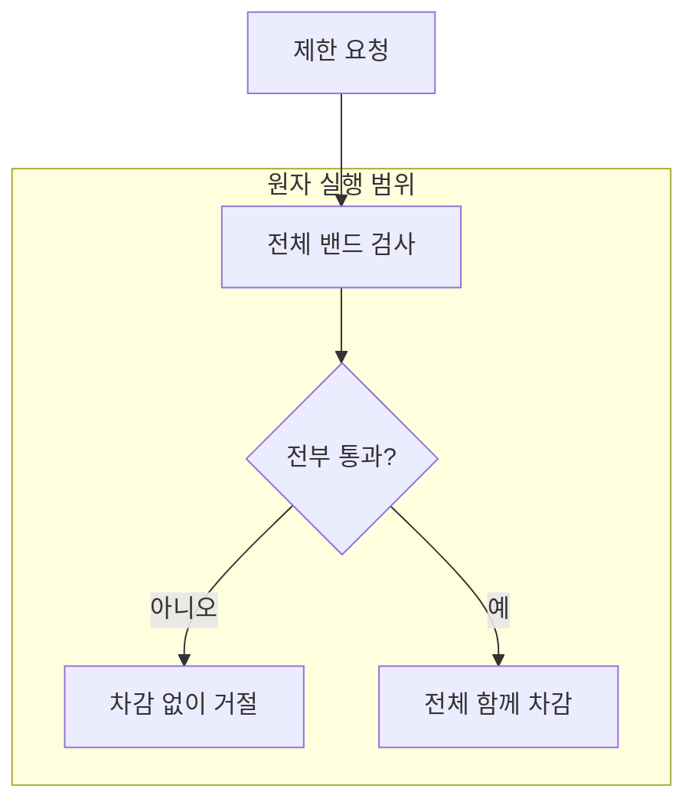

> 개인 오픈소스 FluxGate에서 Lua로 묶은 것은 토큰 상태 확인과 차감이다. 현재 LTS 소스를 따라 원자성이 끝나는 지점, 재시도를 멈춰야 하는 지점까지 정리했다.
{: .prompt-info }

```text
남은 토큰 확인 → 요청 허용 판단 → 토큰 차감
```

이 세 단계를 애플리케이션에서 따로 실행하면, 동시에 들어온 두 요청이 같은 잔여량을 보고 모두 통과할 수 있다. 각 Redis 명령이 원자적이라는 사실만으로 이 전체 판단이 원자적이 되지는 않는다.

FluxGate를 만들 때 Lua를 선택한 이유는 이 경계를 한 번에 묶기 위해서였다. Redis를 썼다는 설명보다, **어느 상태를 읽고 바꾸는 일을 함께 끝내야 하는가**가 먼저였다.

이 글의 대상은 개인 오픈소스와 사내 POC다. 상용 운영 성과를 설명하는 글은 아니다. 또한 공개한 `v0.3.7`과 현재 작업 중인 LTS 브랜치는 구분했다. 아래 현재 구현 링크는 움직이는 브랜치 대신 [확인한 커밋 d2b771a](https://github.com/OpenFluxGate/fluxgate/tree/d2b771ab7ee9864a040e6672014fb16fb54b4873)에 고정했다. 이 글에서 부하 실험이나 성능 수치를 새로 측정하지는 않았다.

## **"락을 잡는 것보다, 판단과 변경을 함께 끝내고 싶었다"**

토큰 버킷은 정해진 속도로 토큰을 채우고 요청이 들어올 때 필요한 양을 쓰는 제한 방식이다. 동시에 여러 서버가 요청을 처리하므로, 각 서버가 기억하는 값이 아니라 공유 상태를 기준으로 허용 여부를 결정해야 했다.

현재 Lua는 Redis의 `TIME`으로 시각을 얻고, 경과 시간에 따른 보충량과 잔여량을 계산한 뒤 차감한다. 앱 서버마다 다른 시계를 그대로 판단 기준으로 삼는 문제를 줄이는 선택이다. Redis 시계의 정확성이나 부동소수점 오차까지 없애는 것은 아니다. 실제 스크립트에도 Lua 5.1 숫자의 정밀도 한계가 명시돼 있다. [시간·정밀도 처리 소스](https://github.com/OpenFluxGate/fluxgate/blob/d2b771ab7ee9864a040e6672014fb16fb54b4873/fluxgate-redis-ratelimiter/src/main/resources/lua/token_bucket_consume.lua#L51-L56)

여기서 별도의 락 소유자, 락 만료 시간, 스핀 대기를 설계했다고 설명하면 실제 선택과 어긋난다. 필요한 갱신을 Redis 안에서 끝내는 구조다. 단일 `INCR`도 이미 원자적이다. Lua의 이유는 Redis가 비원자적이어서가 아니라, **여러 연산으로 된 하나의 판단을 묶어야 해서**다.

> **쉽게 말하면** 좌석 수를 확인한 뒤 다른 창구가 그 좌석을 팔기 전에 예약까지 끝내는 일이다. 조회와 예약 사이의 틈을 없애는 것이 핵심이다.
{: .prompt-tip }

RDB 행 잠금도 공유 상태의 동시 변경을 직렬화하는 수단이다. 다만 행을 잠근 트랜잭션 안에서 업무 검증과 여러 갱신을 수행하는 구조와, Redis의 제한 상태를 짧은 스크립트로 갱신하는 구조는 보호 대상과 비용이 다르다. 전자는 잠금 대기와 트랜잭션 범위를, 후자는 스크립트 실행 시간과 Redis 의존성을 관리해야 한다.

RDB 행 잠금과의 차이는 지금 이 구조를 설명하면서 정리한 것이다. 당시 내 선택의 출발점은 Redis에 둔 제한 상태의 확인과 차감을 함께 실행하는 일이었다.

## **"EVALSHA는 결과를 기억하지 않는다"**

스크립트 본문을 매 요청마다 보내는 대신, 로드한 스크립트의 SHA를 `EVALSHA`에 전달한다. 키는 `KEYS`, 용량·기간·요청량 같은 실행 인자는 `ARGV`로 구분한다. 같은 로직에 다른 요청 값을 넣어 실행하는 방식이다.

```text
EVALSHA(scriptSha, keys, args)
  └─ NOSCRIPT → EVAL(script, keys, args)
```

SHA 캐시는 스크립트 본문을 반복 전송하는 비용을 줄인다. 네트워크 호출이 사라지는 것도, 이전 요청의 결과를 재사용하는 것도 아니다. 스크립트는 요청마다 실행된다. Redis 재시작이나 캐시 제거 뒤에는 `NOSCRIPT`가 발생할 수 있어서, 현재 저장소 구현은 `EVAL`로 실행하는 대체 경로를 둔다. [호출·NOSCRIPT 처리](https://github.com/OpenFluxGate/fluxgate/blob/d2b771ab7ee9864a040e6672014fb16fb54b4873/fluxgate-redis-ratelimiter/src/main/java/org/fluxgate/redis/store/RedisTokenBucketStore.java#L694-L736)

Redis가 보장하는 스크립트 원자성에는 비용도 붙는다. 스크립트 실행 중 다른 작업이 끼어들지 못하므로, 오래 걸리는 계산이나 외부 업무를 넣을 자리가 아니다. 원자성의 범위를 좁고 짧게 유지해야 한다. [Redis 공식 스크립트 설명](https://redis.io/docs/latest/develop/programmability/eval-intro/)

## **"제한이 둘이면, 앞의 토큰만 쓰고 거절할 수 있다"**

초당 제한과 분당 제한을 함께 적용한다고 해 보자. 여기서는 서로 다른 기간의 제한을 밴드라고 부른다. 앞 밴드에서 차감한 뒤 뒤 밴드에서 거절하면, 최종 거절된 요청이 앞 밴드의 토큰을 이미 소비한 상태가 된다.

`v0.3.7`의 Java 구현은 밴드를 순서대로 소비하는 형태였다. **단일 버킷의 원자성**과 **여러 밴드 전체의 원자성**은 같은 주장이 아니었다. [v0.3.7 구현](https://github.com/OpenFluxGate/fluxgate/blob/v0.3.7/fluxgate-redis-ratelimiter/src/main/java/org/fluxgate/redis/RedisRateLimiter.java)

현재 LTS 스크립트는 먼저 모든 밴드가 통과 가능한지 검사한다. 하나라도 부족하면 차감하지 않고, 모두 통과할 때만 함께 차감한다. 성공 경로만 보는 대신 거절된 요청이 상태를 남기는지까지 원자성의 범위에 넣은 것이다. [현재 2단계 처리의 설계 주석](https://github.com/OpenFluxGate/fluxgate/blob/d2b771ab7ee9864a040e6672014fb16fb54b4873/fluxgate-redis-ratelimiter/src/main/resources/lua/token_bucket_consume.lua#L1-L15)



Redis Cluster에서는 여기에도 조건이 붙는다. 여러 키를 같은 스크립트에서 처리하려면 같은 해시 슬롯에 있어야 한다. 현재 코드는 같은 슬롯인지 확인해 함께 처리할 수 있는 경로를 고른다. 다른 슬롯에 걸친 여러 규칙은 순차 소비 후 실패 시 보상 환급을 사용한다. [두 경로와 한계](https://github.com/OpenFluxGate/fluxgate/blob/d2b771ab7ee9864a040e6672014fb16fb54b4873/fluxgate-redis-ratelimiter/src/main/java/org/fluxgate/redis/RedisRateLimiter.java#L43-L71)

**보상 환급은 전체 원자성이 아니다.** 환급 전까지 다른 요청이 줄어든 잔여량을 볼 수 있고, 중간에 프로세스가 종료되거나 Redis 호출이 실패하면 차감이 남을 수 있다. 같은 슬롯에 모으는 설계도 키 배치와 부하 분산의 제약을 만든다. “Lua를 썼으니 전체 요청이 원자적”이라고 쓰면 이 경계가 지워진다.

## **"Pub/Sub은 규칙을 알려 주고, Lua는 사용량을 바꾼다"**

관리 화면에서 바꾸는 제한 규칙과 요청마다 차감하는 사용량은 수명과 빈도가 다르다. 규칙의 원천 저장소는 MongoDB이고, 실행 중인 인스턴스는 규칙을 캐시한다. 규칙 변경 알림은 캐시를 갱신하게 하는 신호다. 토큰 차감 자체를 직렬화하는 신호가 아니다.

현재 LTS에는 Pub/Sub 알림 누락을 보완하는 주기 조회 경로가 있다. 기본 간격은 60초이며 설정으로 끌 수도 있다. 설정과 캐시 조건에 따라 실제 보완 경로가 달라지므로 “언제나 즉시 동기화”라고 부를 수 없다. [알림·주기 조회 구성](https://github.com/OpenFluxGate/fluxgate/blob/d2b771ab7ee9864a040e6672014fb16fb54b4873/fluxgate-spring-boot3-starter/src/main/java/org/fluxgate/spring/autoconfigure/FluxgateReloadAutoConfiguration.java#L255-L273)

Redis Pub/Sub은 구독자가 놓친 메시지를 재생해 주지 않는다. 따라서 알림으로 빠르게 반영하고, 원천 조회로 놓친 변경을 따라잡는 역할을 나눴다. 이 선택은 별도 메시지 로그 운영을 줄이는 대신 일시적으로 오래된 규칙을 사용하는 구간을 받아들인다. [Redis Pub/Sub 전달 특성](https://redis.io/docs/latest/develop/pubsub/)

요청 경로도 둘이다. Direct는 앱 안의 핸들러가 엔진과 Redis를 호출한다. HTTP는 별도 제한 서비스에 판단을 요청한다. 후자는 적용 지점을 분리할 수 있지만 네트워크 호출과 서비스 장애 경계가 늘어난다. 이것은 규칙 전파나 Lua 원자성과 별개의 배치 선택이다. [현재 아키텍처](https://github.com/OpenFluxGate/fluxgate/blob/d2b771ab7ee9864a040e6672014fb16fb54b4873/docs/ko/architecture/README.ko.md#L173-L186)

## **"응답을 못 받았다고 다시 차감하면 안 된다"**

Redis에 명령을 보낸 뒤 연결이 끊기면 실행 전 실패인지, 차감 후 응답만 잃었는지 알 수 없는 경우가 있다. 이때 같은 명령을 자동 재시도하면 한 요청에 두 번 차감할 수 있다. 현재 저장소 코드는 실행 여부가 불명확한 명령 실패를 자동 재시도하지 않는 경계를 둔다. `NOSCRIPT`는 실행할 스크립트가 없다는 응답이므로, 앞의 대체 실행과 상황이 다르다. [명령 단계 실패 처리](https://github.com/OpenFluxGate/fluxgate/blob/d2b771ab7ee9864a040e6672014fb16fb54b4873/fluxgate-redis-ratelimiter/src/main/java/org/fluxgate/redis/store/RedisTokenBucketStore.java#L760-L777)

의존성이 실패했을 때 요청을 허용할지 차단할지도 정해야 한다. 현재 기본은 `DENY`이고, 사용 가능한 로컬 대체 제한기가 있으면 먼저 시도한다. `ALLOW`는 제한 판단을 못 해도 서비스를 계속 쓰게 하는 선택이며, `DENY` 경로는 사용 불가 오류로 이어진다. 서비스 가용성과 제한 준수 중 무엇을 우선할지는 배포하는 쪽의 정책이다. [장애 정책 구현](https://github.com/OpenFluxGate/fluxgate/blob/d2b771ab7ee9864a040e6672014fb16fb54b4873/fluxgate-spring-boot3-starter/src/main/java/org/fluxgate/spring/handler/ResilientRateLimiter.java#L274-L308)

Lua를 넣었다는 한 줄로는 남기기 어려운 선택들이었다. 다음 변경을 검토할 때는 스크립트 사용 여부보다 **함께 성공해야 하는 상태의 범위, 실패 뒤 남는 차감, 재시도해도 되는 근거**를 먼저 확인하려 한다.
